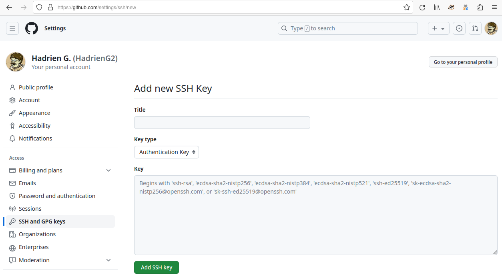
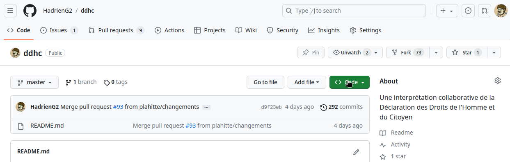
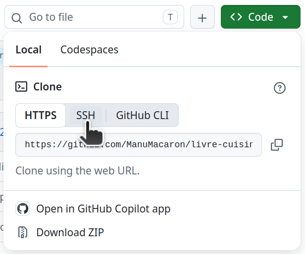

# Dépôt ouvert sur GitHub

Dans cette variante du TP5, nous travaillerons sur un dépôt GitHub ouvert,
lisible par tous et acceptant des contributions extérieures via le mécanisme des
_forks_ et des _pull requests_.


## Préparations au travail en réseau

### Enregistrement de la clé publique SSH

Affichez la clé SSH publique que vous avez générée précédemment, par exemple
avec `cat`…

```bash
{{#include 5-reseau-forges.sh:show-pubkey}}
```

…puis copiez-la (avec un clic droit ou Ctrl+Maj+C) et collez-la dans l’interface
web de gestion de clé SSH de votre compte GitHub, afin que GitHub reconnaisse
cette clé SSH comme vous identifiant.

Vous pouvez accéder à l’interface pour ajouter une clé SSH en vous rendant sur
l’URL <https://github.com/settings/ssh/new> après vous être connecté à votre
compte GitHub avec le bouton « Sign In » en haut à droite. Ou si vous souhaitez
le faire sans lien direct, vous pouvez en cliquant sur votre avatar en haut à
droite de l’interface web de GitHub, puis sur « Settings » dans le menu qui
s’affiche, « SSH and GPG keys » dans la barre latérale à gauche de la nouvelle
page qui s’ouvre, et enfin le bouton « New SSH key » vert en haut à droite.

Dans tous les cas, vous vous retrouverez face au formulaire « Add new SSH Key » :



Dans ce formulaire, vous êtes invité à saisir les informations suivantes :

- **Title :** Un nom de votre choix qui vous permettra de distinguer cette clé
  SSH de vos autres clés SSH. Je vous conseille d’utiliser un nom qui clarifie
  qu’elle est temporaire et liée à cette formation, par exemple « Formation Git ».
- **Key type :** La façon dont vous allez utiliser la clé SSH que vous êtes en
  train d’ajouter à votre compte GitHub. Pour vous connecter à GitHub en SSH
  avec git, prenez le choix par défaut « Authentication Key ».
- **Key :** Collez ici le contenu de la clé publique que vous avez générée
  précédemment, i.e. la sortie de `cat ~/.ssh/id_ed25519.pub`.

Et voilà, vous êtes prêt à échanger des _commits_ avec la forge GitHub !

### _Fork_ et clonage

Une copie de la Déclaration des Droits de l’Homme et du Citoyen est disponible
sur le dépôt git <https://github.com/HadrienG2/ddhc>.

Pour commencer, créez-en un _fork_ sous votre contrôle. Vous utiliserez pour ça
le bouton « Fork » situé en haut à droite de l’interface de GitHub, entre le
bouton « Watch » et le bouton « Star ». Acceptez les paramètres proposés par
défaut avec le bouton « Create fork ».

L’opération va prendre un petit moment (typiquement quelques secondes).
Lorsqu’elle est terminée, vous devriez être redirigé automatiquement sur votre
_fork_ nouvellement créé.

Pour travailler dessus localement, vous allez ensuite devoir copier son contenu
sur votre machine. Pour cela, vous aurez besoin de son URL SSH, que vous pouvez
obtenir comme suit.

D’abord, cliquez sur le bouton vert « Code », en haut à droite de la page
d’accueil du dépôt, en dessous des boutons « Watch », « Fork »
et « Star » :



Ensuite, allez sur l’onglet « Local » puis sur le sous-onglet « SSH » :



L’URL qui s’affiche alors est celle que vous devrez transmettre à git pour
cloner le dépôt en ayant une authentification SSH pour vos opérations
ultérieures :

```bash
{{#include 5-reseau-forges.sh:clone-from-github}}
```

Votre client git vous avertira alors qu’il ne connaît pas l’identité du serveur
auquel vous vous connectez, ce qui est normal ici puisque c’est la première fois
que votre compte utilisateur sur les machines d’enseignement se connecte à
GitHub via SSH. Vous pouvez donc autoriser l’opération.

### Connexion au dépôt officiel

Comme notre clone local dans le TP précédent, le clone du _fork_ possède une
_remote_ pointant vers le _fork_ qui permet d’échanger facilement des commits
avec ce dernier :

```bash
{{#include 5-reseau-forges.sh:goto-repo-and-show-remote}}
```

Mais pour appliquer la méthode de travail basée sur les _forks_ et les _pull
requests_ (appelée _GitHub flow_), il faut aussi être capable d’échanger des
commits avec le dépôt officiel, celui à partir duquel vous avez créé votre _fork_.
En effet, des nouveautés vont arriver sur ce dernier au fur et à mesure du TP,
et vous devrez vous synchroniser avec ces dernières.

Par convention, la _remote_ associée au dépôt officiel est souvent appelée
_upstream_ :

```bash
{{#include 5-reseau-forges.sh:add-upstream-remote}}
```

Notez qu’on peut ici utiliser une URL HTTPS, sans avoir besoin de saisir un mot
de passe, puisqu’on ne fait que lire des _commits_ depuis un dépôt public, ce
qui ne nécessite pas de s’identifier.

Si vous ouvrez maintenant `gitg`, vous pourrez constater que vous pouvez
maintenant visualiser vos commits et branches locales, celles de votre _fork_, et
celles du dépôt officiel. Tout est prêt !


## Travail distribué avec le _GitHub flow_

### Introduction

Le _GitHub flow_ est une méthode de travail qui, malgré son nom, n’a rien de
spécifique à la forge GitHub. Toutes les forges sociales modernes peuvent être
utilisées de cette manière. Dans cette méthode, le travail s’organise autour de
quatre grandes étapes :

1. Rester à jour par rapport au dépôt officiel
2. Préparer des changements dans une branche dédiée de son dépôt local
3. Publier ses changements sur son _fork_ lorsqu’ils sont prêts
4. Les soumettre au dépôt officiel pour qu’ils y soient intégrés

Examinons ces quatre étapes en détail

### Se synchroniser avec le dépôt officiel

Comme nous l’avons vu dans le TP précédent, il est possible de récupérer les
changements du dépôt officiel avec `git fetch upstream`.

Cependant, dans le cadre de cette méthode de travail, nous n’avons généralement
pas besoin de nous intéresser à l’ensemble des branches de ce dépôt. Il suffit
de tenir notre branche `master` à jour, ce que l’on peut faire facilement avec
`git pull` après avoir configuré `upstream/master` comme branche amont comme
suit :

```bash
{{#include 5-reseau-forges.sh:set-upstream-master}}
```

Une fois cette préparation effectuée, vous n’aurez pas besoin de la répéter et
pourrez juste mettre à jour votre branche `master` locale via :

```bash
{{#include 5-reseau-forges.sh:pull-master}}
```

Je conseille ici l’utilisation de `--ff-only` pour vous aider à repérer une
erreur classique. Si l’on applique correctement le _GitHub flow_, la branche
`master` du dépôt officiel devrait avancer de façon monotone, et votre branche
`master` locale devrait suivre son avancée. Par conséquent, si vous ne pouvez
pas mettre en avance rapide, cela relève d’une situation pathologique :

- Soit les mainteneurs du dépôt officiel ont fait diverger `master` en éditant
  son historique. Il n’est que très rarement nécessaire d’en arriver là, et un
  mainteneur responsable devrait informer les autres membres du projet chaque
  fois qu’il doit en venir à de tels extrêmes.
- Soit, et c’est de loin le cas le plus courant, vous avez vous-même créé une
  divergence, typiquement en ajoutant des commits sur votre branche `master`
  locale plutôt que sur une branche de développement dédiée.

Dans ce dernier cas, pour vous tirer d’affaire, vous pouvez…

- Si vous le souhaitez, vous pouvez d’abord sauvegarder vos changements dans une
  nouvelle branche avec `git branch <nom>`.
- Ensuite, forcez votre branche `master` à en revenir au même point que le
  `master` officiel avec la commande `git reset --hard upstream/master`.

Vous pouvez configurer l’utilisation implicite de `--ff-only` pour tous les
`git pull` futurs au sein de ce dépôt avec la commande de configuration…

```bash
{{#include 5-reseau-forges.sh:config-pull-ff-only}}
```

### Construire des changements dans une branche dédiée

Une fois que l’on a un `master` à jour, il est possible de construire des
changements par-dessus ce dernier. Il suffit pour cela de créer une branche qui
part de `master`…

```bash
{{#include 5-reseau-forges.sh:create-dev-branch}}
```

…puis de créer des _commits_ dessus. En voici un exemple, à adapter selon votre
goût : si vous éditez tous la fin du fichier, il y aura des conflits entre
toutes les contributions !

```bash
{{#include 5-reseau-forges.sh:commit-on-dev-branch}}
```

Pendant que vous effectuez vos modifications, le dépôt officiel continue
d’évoluer, et il est possible que des nouveautés arrivent sur la branche
`master`. Les sorties des commandes `git fetch` et `git pull` vous en
informeront.

Si c’est le cas, vous pourrez intégrer ces nouveautés à votre branche de
développement avec les outils que nous avons vus précédemment. Un cycle complet
de mise à jour de `master` et d’intégrations de ses nouveautés à votre branche
pourrait ainsi ressembler à ceci :

```bash
{{#include 5-reseau-forges.sh:update-master-and-merge}}
```

En cas de conflit de fusion, il vous appartiendra de vous adapter aux nouveautés
de la branche `master` officielle qui sont incompatibles avec vos changements.

<div class="warning">

  Plus une de vos branches a une durée de vie longue, plus il y a de chances que
  des conflits se produisent avec le _master_ qui évolue en parallèle. De plus,
  si vous utilisez `git rebase` plutôt que `git merge`, comme la politique de
  certains projets l’exige, il peut aussi arriver que vous rencontriez de
  conflits de fusion en cascade, où vous devrez faire face à des conflits non
  pas une seule fois, mais une fois par commit de votre branche !

  Pour éviter cela et simplifier le passage en revue de vos changements par les
  mainteneurs, il est recommandé de privilégier des branches de durée de vie
  courte, aux objectifs précis et modestes, que l’on soumettra au dépôt officiel
  dès que possible. Nous allons maintenant étudier ce processus de soumission.

</div>

### Mettre en ligne des changements sur son _fork_

Lorsque vous êtes satisfait de votre branche locale, vous pouvez la mettre en
ligne sur votre _fork_ avec la commande `git push`.

L’option `--set-upstream`, que nous avons évoquée précédemment, vous permettra
de mémoriser l’association entre votre branche locale et la branche distante sur
votre _fork_ lors de la mise en ligne.

```bash
{{#include 5-reseau-forges.sh:push-set-upstream}}
```

Une fois cette association mémorisée, vous pourrez par la suite vous contenter
d’une simple commande `git push` sans arguments supplémentaires.

Nous l’avons évoqué précédemment, dès lors que vous avez mis des changements en
ligne sur un serveur, il faut être prudent avec les modifications d’historique
et les `git push --force` associés pour ne pas couper l’herbe sous le pied aux
gens qui travaillent par-dessus vos branches.

Mais l’un des avantages qu’il y a à utiliser un _fork_, c’est que ce dépôt
n’appartient qu’à vous. Personne d’autre n’est donc censé baser son travail
dessus, et c’est pourquoi la plupart des projets tolèrent l’utilisation libérale
du _force-push_ sur les _forks_, un confort très appréciable pour les amateurs
d’édition d’historique.

<div class="warning">

  Cette politique est à double tranchant. Si vous devez un jour baser votre
  travail sur le _fork_ de quelqu’un d’autre, il vous appartiendra de vivre avec
  les suppressions de branches et autres modifications d’historique effectuées
  par cette personne sur son _fork_. Évitez donc si possible de baser du travail
  sur le _fork_ d’autrui, en privilégiant toujours le travail à partir du dépôt
  officiel du projet.

</div>

### Soumission au dépôt officiel

Une fois que vous avez mis des changements en ligne sous la forme d’une branche
sur votre _fork_, vous pouvez demander l’intégration de ces changements au dépôt
officiel avec une fonctionnalité des forges git modernes, la _pull request_.
Cette fonctionnalité est également appelée _merge request_ par GitLab, mais
comme nous utilisons GitHub dans ce TP, nous nous en tiendrons à sa terminologie
afin d’éviter toute confusion.

Comme son nom l’indique, une _pull request_ invite les mainteneurs du dépôt
officiel à intégrer des changements au projet en fusionnant les nouveautés de
votre branche dans un historique officiel (généralement la branche `master`).

Cette possibilité vous sera généralement directement offerte par l’affichage
d’une URL dans la console lorsque vous poussez la branche sur votre _fork_,
ainsi que par un bandeau dans l’interface web de votre _fork_ sur GitHub pendant
quelque temps après le _push_. Mais si vous avez ignoré tous ces raccourcis,
vous pouvez toujours créer « manuellement » une _pull request_ de la façon suivante.

Allez sur l’interface web de votre _fork_ et affichez la liste des branches avec
le lien « N branches » en haut à gauche, un peu en dessous du nom du dépôt :


Ensuite, cliquez sur le bouton « New Pull Request » associé à la branche que
vous voulez soumettre au dépôt officiel pour initier le processus de soumission
:


Après avoir fait tout ça, vous vous retrouverez sur la même interface de
création de _pull request_ que vous auriez eu si vous aviez utilisé un des
raccourcis initialement :


De haut en bas, cette interface contient…

- En haut, une section à laquelle vous n’aurez presque jamais besoin de toucher
  qui vous permet de spécifier quelle branche de votre _fork_ (ou d’un autre
  dépôt) vous voulez fusionner dans quelle branche du dépôt officiel.
- Ensuite, un formulaire pour donner un nom à votre _pull request_ ainsi qu’une
  description plus détaillée si besoin. Cette description peut être formatée
  avec [le dialecte local de
  Markdown](https://docs.github.com/fr/get-started/writing-on-github/getting-started-with-writing-and-formatting-on-github/basic-writing-and-formatting-syntax).
- En bas de ce formulaire, une case à cocher « Allow edits by maintainers » qui
  permet aux mainteneurs du dépôt d’ajouter des changements à votre branche (ça
  permet de fluidifier un peu le processus de passage en revue d’une
  contribution en faisant directement les modifications mineures plutôt que de
  vous demander de les faire vous-même).
- Près de cette case à cocher, un bouton « Create pull request » qui termine la
  saisie et crée la _pull request_, avec sur le côté droit une option un peu
  trop bien cachée (flèche descendante) pour créer la _pull request_ en mode
  brouillon. Cela signifie que vous informez les mainteneurs que vous aurez
  bientôt des changements à intégrer et leur permettez d’y jeter un œil, mais
  ne souhaitez pas qu’ils soient intégrés tout de suite, car vous n’avez pas fini
  le travail.
- En dessous de tout ça, pour information, une visualisation des changements
  apportés par votre branche : liste des commits et différences par rapport à la
  branche de destination.

Pour les mainteneurs, une _pull request_ se présente ensuite sous la forme du
titre et de la description que vous avez donnée, d’une visualisation des
changements proposés, et d’une interface permettant de discuter desdits
changements (pour proposer des modifications avant intégration par exemple).

Il est aussi possible pour le mainteneur de définir une batterie de tests
automatisés que toute _pull request_ doit passer avant d’être acceptée par le
projet. On parle alors d’intégration continue.

Si des changements sont demandés par le mainteneur, vous pouvez ajouter ceux-ci
à votre branche locale via de nouveaux commits et de les pousser sur votre
_fork_ avec un simple `git push`. La _pull request_ associée sera alors mise à
jour automatiquement.

Une fois la _pull request_ fusionnée, vous pourrez supprimer la branche de
développement associée de vos dépôts locaux et distants…

```bash
{{#include 5-reseau-forges.sh:delete-dev-branch}}
```

…puis recommencer un autre développement depuis la branche `master` quand vous
voudrez en reprenant le cheminement indiqué ci-dessus à partir du début.


## À vous de jouer !

À ce stade, vous en savez assez pour commencer à vous amuser avec cette pauvre
Déclaration des Droits de l’Homme.

Peut-être avez-vous toujours rêvé de paraphraser Olympe de Gouges en réécrivant
entièrement le texte au féminin (« Déclaration des Droits de la Femme et de
la Citoyenne ») ? Peut-être souhaitez-vous y ajouter l’article
manquant qui résoudra enfin le débat séculaire entre pain au chocolat et
chocolatine ? Ou bien peut-être est-il temps d’amender l’article 15 qui
autorise chaque citoyen à demander des comptes aux agents publics ?

Modifiez le texte comme vous le souhaitez, en n’hésitant pas à créer des commits
en cours de route pour vous permettre de revenir facilement en arrière. Puis,
quand vous aurez fini, poussez votre branche finale sur votre _fork_, et
soumettez une _pull request_ au dépôt officiel pour terminer ce TP.

Ensuite, vous pourrez aller lire la [conclusion commune](5.3-conclusion.md). Si
vous êtes en avance, n'hésitez pas à aller voir aussi la variante [« GitLab
fermé »](5.2-gitlab-ferme.md) du TP, qui vous permettra de pratiquer sur une
autre forge couramment utilisée (GitLab), avec une méthode de travail plus
adaptée pour des projets impliquant des informations confidentielles.
