# Dépôt fermé sur GitLab

Dans cette variante du TP5, nous travaillerons sur un dépôt GitLab fermé, qui
n'est accessible qu'à l'équipe projet et dont la branche `master` fait l'objet
d'un niveau de vérification supplémentaire via le mécanisme des _merge
requests_.


## Préparation au travail en réseau

### Se connecter à l'instance GitLab de l'IN2P3

Lorsque vous vous rendez à l'URL <https://gitlab.in2p3.fr> pour la première fois
sur une machine[^1], vous allez vous retrouver face à l’invite de connexion de
GitLab :

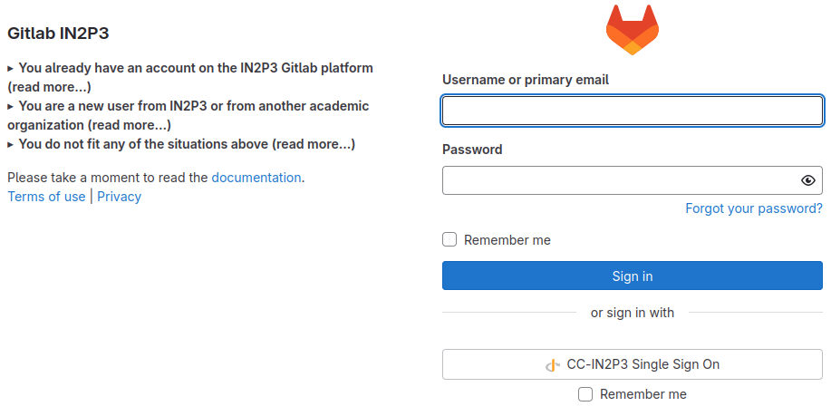

Nous allons utiliser ici la méthode de connexion « CC-IN2P3 Single Sign-On ».
Pour y accéder, cliquez sur le bouton correspondant en-dessous du bouton bleu
« Sign in ». Vous vous retrouverez alors face à l’invite de connexion du centre
de calcul de l’IN2P3 (CC-IN2P3) :

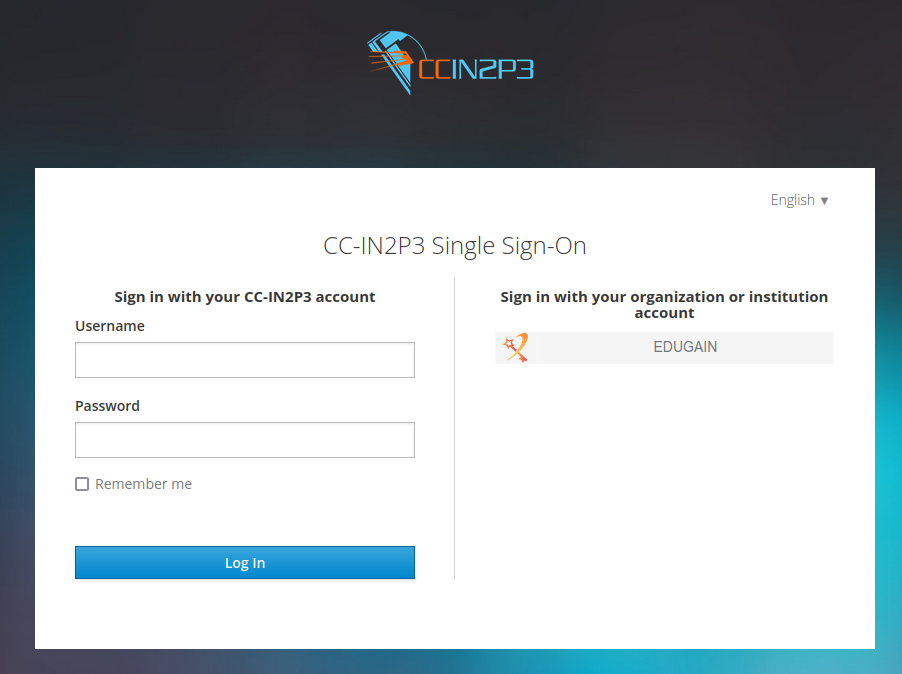

La méthode proposée à gauche ne convient que pour les personnes qui ont un
compte local au centre de calcul, ce qui ne sera pas le cas de beaucoup d’entre
vous. Mais heureusement, l'instance GitLab du CC-IN2P3 accepte aussi la
connexion via des comptes informatiques des laboratoires de recherche du monde
entier via la fédération eduGAIN.

Pour y accéder, cliquez sur le bouton « EDUGAIN » à droite de l’invite. Cela
vous conduira à une nouvelle page où vous pouvez choisir une institution
académique auprès de laquelle vous possédez un compte informatique, par exemple
« CNRS » ou « Université Paris-Saclay » dans mon cas :

<center>

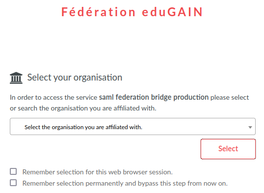

</center>

A cette étape, il faut faire attention à deux choses :

- Il est possible de chercher le nom de votre institution en tapant une partie
  de ce dernier, mais le moteur de recherche n’est pas très perfectionné et le
  morceau de nom doit correspondre exactement. Par exemple, si vous tapez
  « Paris Saclay », il ne trouvera pas l'université Paris-Saclay car il manque
  un tiret entre les deux mots…
- Quand vous pouvez vous connecter avec différentes institutions, vous devriez
  toujours utiliser la même à chaque fois. En effet, GitLab utilise l’addresse
  mail pour identifier les utilisateurs, donc si vous vous connectez avec
  différentes institutions, vous avez différentes addresses mail, et donc vous
  n’êtes pas la même personne du point de vue de GitLab. Vous vous retrouverez
  donc connecté à un compte GitLab différent, où vos dépôts ne sont pas
  disponibles…

Quoiqu'il en soit, une fois que vous aurez choisi votre institution, vous vous
retrouverez sur l’invite de connexion de cette dernière. Ici, je ne peux pas
vous donner des instructions précises car ça dépend de votre employeur, mais
voici par exemple la page de connexion Janus du CNRS :

<center>

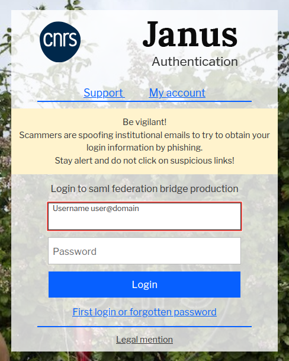

</center>

Enfin, une fois cette étape terminée, un compte GitLab sera créé automatiquement
pour vous si vous ne vous vous êtes jamais connecté à l’instance GitLab de
l’IN2P3 avec cette institution, puis vous vous retrouverez face à la page
d'accueil de GitLab, qui ressemble à ceci :

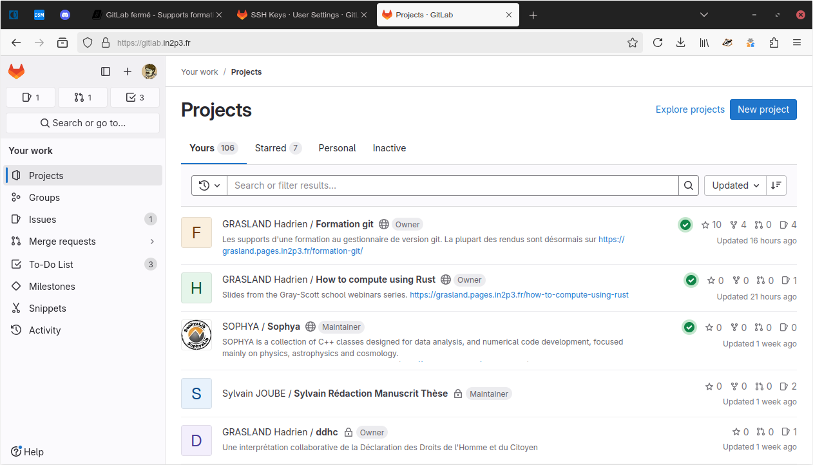

[^1]: Pour plus de sécurité, vos comptes utilisateur sur les machines de TP
      partagées sont configurés pour oublier les connexions actives à chaque
      fois que vous fermez Firefox. Donc si vous êtes du genre à fermer le
      navigateur web dès que vous ne l'utilisez pas, vous pourriez vous
      retrouver face à cette invite de nombreuses fois pendant le TP. Si cela
      s'avère trop gênant, n'hésitez pas à changer ce réglage dans les
      préférences de Firefox.


### Enregistrement de la clé publique SSH

Nous allons maintenant transmettre la clé SSH publique que nous avons générée à
l’instance GitLab de l’IN2P3, afin qu’elle nous reconnaisse lorsqu'on se
connecte en SSH depuis git.

Vous pouvez accéder à l’interface pour ajouter une clé SSH en vous rendant sur
l’URL <https://gitlab.in2p3.fr/-/user_settings/ssh_keys>. Ou si vous souhaitez
le faire sans lien direct, vous pouvez vous y rendre en cliquant sur votre
avatar en haut à droite du panneau latéral à gauche de l’interface de GitLab,
puis sur « Preferences » dans le menu qui s’affiche, « SSH Keys » dans la barre
latérale à gauche de la nouvelle page qui s’ouvre.

D'une façon où d’une autre, vous vous retrouverez face à la page suivante, où
vous pouvez cliquer sur le bouton « Add new key » en haut à droite pour ajouter
une nouvelle clé SSH :

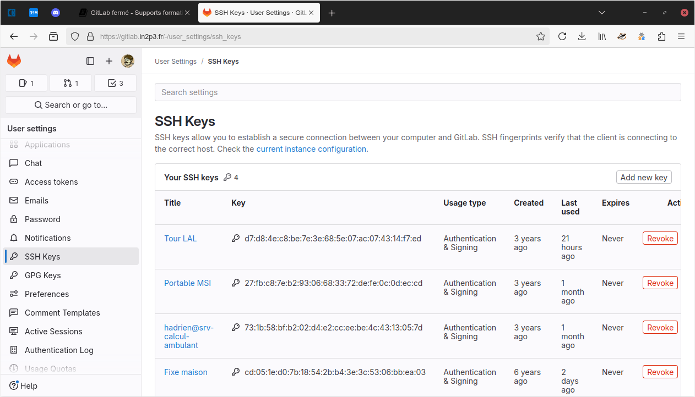

Ceci fait, vous vous retrouverez face au formulaire d'ajout de clé SSH :

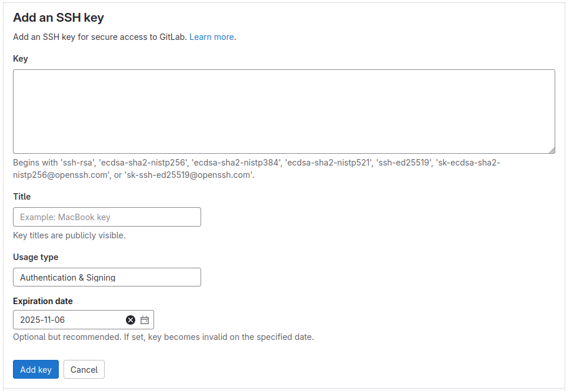

Voici les informations dont vous aurez besoin pour le remplir :

- **Key :** Collez ici la clé publique SSH que vous avez générée précédemment.
  Pour cela, vous pouvez l’afficher avec `cat` dans votre terminal…

  ```bash
  {{#include 5-reseau-forges.sh:show-pubkey}}
  ```

  …puis la copier (avec un clic droit ou Ctrl+Maj+C) et la coller dans
 l’interface de GitLab.
- **Title :** Un nom de votre choix qui vous permettra de distinguer cette clé
  SSH de vos autres clés SSH. Je vous conseille d’utiliser un nom qui clarifie
  qu’elle est temporaire et liée à cette formation, par exemple « Formation
  Git ».
- **Usage type :** La façon dont vous souhaitez utiliser la clé SSH que vous
  êtes en train d’ajouter à votre compte GitLab. Pour vous connecter à GitLab en
  SSH avec git, le choix « Authentication » est suffisant.
- **Expiration date :** Une date limite à partir de laquelle la clé SSH ne sera
  plus utilisable. La clé que nous sommes en train de saisir est spécifique à
  votre ordinateur de TP et ne servira que pendant la formation, donc vous
  pouvez mettre « 2024-11-09 » ici.

Ensuite, plus qu’à valider avec le bouton bleu « Add key », et vous serez prêt à
échanger des commits avec l’instance GitLab de l’IN2P3 !

### Obtenir l'accès au dépôt du TP

Une copie de la Déclaration des Droits de l’Homme et du Citoyen est disponible
sur le dépôt git <https://gitlab.in2p3.fr/grasland/ddhc>. Mais cette copie est
en accès privé, donc pour l’instant vous ne pouvez pas y accéder.

Pour vous y donner accès, j’aurai besoin de connaître le nom de votre compte
utilisateur. Vous pouvez le découvrir en cliquant sur votre avatar en haut à
droite du panneau latéral à gauche de l’interface de GitLab. Il apparaît en haut
du menu qui s'affiche, précédé d'un arobase `@` :

<center>

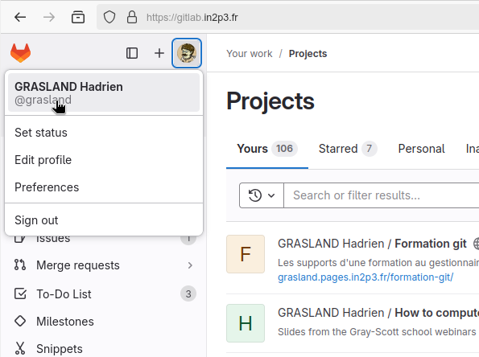

</center>

Dès que vous me l’aurez transmis, je pourrai vous donner un accès de niveau
« Developer » au dépôt. Ce niveau d’accès vous permettra entre autres de voir le
contenu du dépôt et d’y pousser des branches de développement, mais pas de
modifier directement le contenu de la branche `master`. Pour cela, vous devrez
passer par une procédure de validation de ma part, la _merge request_. Ce
concept sera présenté un peu plus loin dans cet énoncé de TP.

### Créer un clone local du dépôt

A ce stade, vous devriez maintenant avoir accès au dépôt
<https://gitlab.in2p3.fr/grasland/ddhc> quand vous êtes connecté à l’instance
GitLab de l'IN2P3.

Il est possible de travailler directement à partir de l’interface web de la
forge, mais c’est limitant dès que le projet grossit un peu, car vous n'avez pas
accès à tous les outils installés en local sur votre machine. Je vous recommande
donc de plutôt travailler sur un clone local du dépôt git.

Pour créer ce clone, nous allons avoir besoin de l’URL SSH du dépôt. Pour
l’obtenir, rendez-vous d’abord sur [l’interface web du
dépôt](https://gitlab.in2p3.fr/grasland/ddhc), puis cliquez sur le bouton bleu
« Code » en haut à droite :

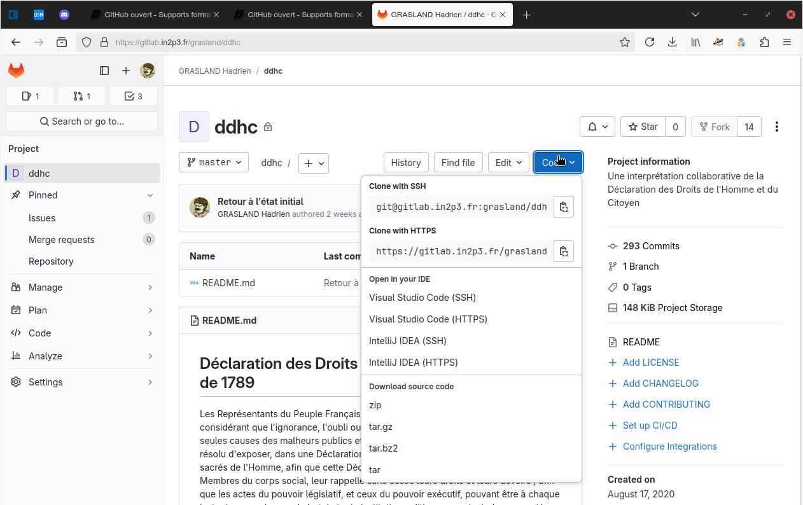

Il suffit ensuite de copier l’URL intitulée « Clone with SSH ». Notez
l’existence d'un bouton à droite pour la mettre rapidement dans le
presse-papier.

Vous pourrez ensuite créer un clone local sur votre machine comme ceci :

```bash
{{#include 5-reseau-forges.sh:clone-from-gitlab}}
```

Votre client git vous avertira alors qu’il ne connaît pas le serveur auquel vous
vous connectez, ce qui est normal puisque c’est la première fois que votre
compte sur le PC d’enseignement se connecte à l’instance GitLab de l’IN2P3 via
SSH. Vous pouvez donc autoriser l’opération.

Une fois le clone créé, vous êtes prêt pour travailler en local et publier vos
changements sur GitLab !


## Travail distribué avec le _GitHub flow_

### Introduction

Le _GitHub flow_ est une méthode de travail qui, malgré son nom, n’a rien de
spécifique à la forge GitHub. Toutes les forges sociales modernes peuvent être
utilisées de cette manière. Dans cette méthode, le travail s’organise en quatre
grandes étapes :

1. Rester à jour par rapport au dépôt officiel
2. Préparer des changements dans une branche dédiée de son dépôt local
3. Publier la branche associée sur le dépôt officiel
4. Proposer l'intégration de ces changements à la branche `master`

La suite de ce TP vous expliquera le fonctionnement de ces quatre étapes.

### Se synchroniser avec le dépôt officiel

Comme nous l’avons vu dans le TP précédent, il est possible de récupérer les
changements du dépôt officiel avec `git fetch origin`.

Cependant, dans le cadre de cette méthode de travail, nous n’avons souvent pas
besoin de nous intéresser à l’ensemble des branches de ce dépôt. Il suffit de
tenir notre branche `master` à jour. On peut le faire avec le raccourci `git
pull` car `git clone` a configuré ce qu'il faut pour nous :

```bash
{{#include 5-reseau-forges.sh:pull-master-gitlab}}
```

Je conseille ici l’utilisation de `--ff-only` pour vous aider à repérer une
erreur classique. Si l’on applique correctement le _GitHub flow_, la branche
`master` du dépôt officiel devrait avancer de façon monotone, et votre branche
`master` locale devrait suivre son avancée. Par conséquent, si vous ne pouvez
pas mettre en avance rapide, cela relève d’une situation pathologique :

- Soit les mainteneurs du dépôt officiel ont fait diverger `master` en éditant
  son historique. Il n’est que très rarement nécessaire d’en arriver là, et un
  mainteneur responsable devrait informer les autres membres du projet chaque
  fois qu’il doit en venir à de tels extrêmes.
- Soit, et c’est de loin le cas le plus courant, vous avez vous-même créé une
  divergence, typiquement en ajoutant des commits sur votre branche `master`
  locale plutôt que sur une branche de développement dédiée.

Dans ce dernier cas, pour vous tirer d’affaire, vous pouvez…

- D’abord sauvegarder vos changements dans une nouvelle branche, si vous le
  souhaitez, avec l’habituelle commande `git branch <nom>`.
- Ensuite forcer votre branche `master` à en revenir au même point que le
  `master` officiel avec la commande `git reset --hard upstream/master`.

Vous pouvez configurer l’utilisation implicite de `--ff-only` pour tous les
`git pull` futurs au sein de ce dépôt avec la commande de configuration…

```bash
{{#include 5-reseau-forges.sh:config-pull-ff-only}}
```

### Préparer des changements dans une branche dédiée

Une fois que l’on a un `master` à jour, il est possible de construire des
changements par-dessus ce dernier. Il suffit pour cela de créer une branche qui
part de `master`…

```bash
{{#include 5-reseau-forges.sh:create-dev-branch-gitlab}}
```

…puis de créer des commits dessus. En voici un exemple, à adapter selon votre
goût : si vous éditez tous la fin du fichier, il y aura des conflits entre
toutes les contributions !

```bash
{{#include 5-reseau-forges.sh:commit-on-dev-branch}}
```

Pendant que vous effectuez vos modifications, le dépôt officiel continue
d’évoluer, et il est possible que des nouveautés arrivent sur la branche
`master`. Les sorties des commandes `git fetch` et `git pull` vous en
informeront.

Si c’est le cas, vous pourrez intégrer ces nouveautés à votre branche de
développement avec les outils que nous avons vus précédemment. Un cycle complet
de mise à jour de `master` et d’intégrations de ses nouveautés à votre branche
pourrait ainsi ressembler à ceci :

```bash
{{#include 5-reseau-forges.sh:update-master-and-merge}}
```

En cas de conflit de fusion, il vous appartiendra de vous adapter aux nouveautés
de la branche `master` officielle qui sont incompatibles avec vos changements.

<div class="warning">

  Plus une de vos branches a une durée de vie longue, plus il y a de chances que
  des conflits se produisent avec le _master_ qui évolue en parallèle. De plus,
  si vous utilisez `git rebase` plutôt que `git merge`, comme la politique de
  certains projets l’exige, il peut aussi arriver que vous rencontriez de
  conflits de fusion en cascade, où vous devrez faire face à des conflits non
  pas une seule fois, mais une fois par commit de votre branche !

  Pour éviter cela et simplifier le passage en revue de vos changements par les
  mainteneurs, il est recommandé de privilégier des branches de durée de vie
  courte, aux objectifs précis et modestes, que l’on soumettra au dépôt officiel
  dès que possible. Nous allons maintenant étudier ce processus de soumission.

</div>

### Mettre en ligne la branche sur le dépôt officiel

Lorsque vous êtes satisfait de votre branche locale, vous pouvez la mettre en
ligne sur le dépôt officiel avec la commande `git push`.

L’option `--set-upstream`, que nous avons évoquée précédemment, vous permettra
de mémoriser l’association entre votre branche locale et la branche distante sur
votre _fork_ lors de la mise en ligne.

```bash
{{#include 5-reseau-forges.sh:push-set-upstream}}
```

Une fois cette association mémorisée, vous pourrez par la suite vous contenter
d’une simple commande `git push` sans arguments supplémentaires.

Si votre première commande `git push` échoue, la cause la plus probable est que
quelqu’un d'autre a déjà créé une branche portant ce nom au sein du dépôt. Vous
pouvez vérifier si c'est le cas dans `gitg` ou dans [la section Code → Branches
de l’interface web du dépôt](https://gitlab.in2p3.fr/grasland/ddhc/-/branches).

Dans ce cas, pas de chance, il va falloir renommer votre branche avec `git
branch -m AncienNom NouveauNom` puis réessayer en adaptant les commandes.

Dans tous les cas, comme nous l’avons évoqué au TP4, dès que vous avez mis des
changements en ligne il faut être prudent avec les modifications d’historique et
les `git push --force` associés pour ne pas couper l’herbe sous le pied aux gens
qui travaillent par-dessus vos branches. Ou alors vous pouvez vous mettre
d'accord avec vos collègues sur le fait qu'il faut attendre que les changements
soient intégrés à `master` avant de baser du travail dessus.

### Proposition d'intégration à la branche `master`

Une fois que vous avez mis des changements en ligne sous la forme d'une branche
sur le dépôt officiel, vous pouvez demander l’intégration de ces changements au dépôt
officiel avec une fonctionnalité des forges git modernes, la _merge request_.
Cette fonctionnalité est également appelée _pull request_ par GitHub, mais comme
nous utilisons GitLab dans ce TP, nous nous en tiendrons à sa terminologie afin
d’éviter toute confusion.

Comme son nom l’indique, une _merge request_ invite les mainteneurs du dépôt à
intégrer vos changements en fusionnant les nouveautés de votre branche dans un
historique officiel (généralement la branche `master`).

Cette possibilité vous sera directement offerte par l’affichage d’une URL dans
la console lorsque vous poussez votre branche sur le dépôt, ainsi que par un
bandeau dans l’interface web du dépôt pendant quelque temps après le _push_.
Mais si vous avez ignoré tous ces raccourcis, vous pouvez toujours créer
« manuellement » une _merge request_ de la façon suivante.

Allez dans [la section Code → Branches de l’interface web du
dépôt](https://gitlab.in2p3.fr/grasland/ddhc/-/branches). La liste des branches
actuellement présentes au sein du dépôt s’affiche alors. Si vous avez poussé
récemment sur votre branche, elle devrait se situer vers le haut de la liste des
branches actives :

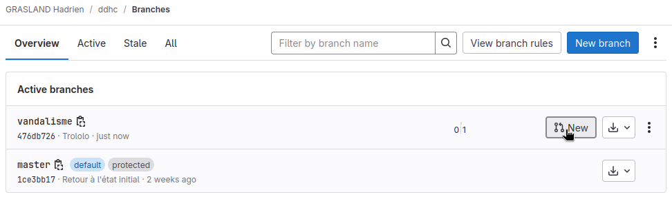

En cliquant sur le bouton « New » de l’entrée correspondant à votre branche dans
cette liste, vous accéderez au formulaire de création de _merge request_
exactement comme si vous aviez utilisé un des raccourcis mentionnés
précédemment :

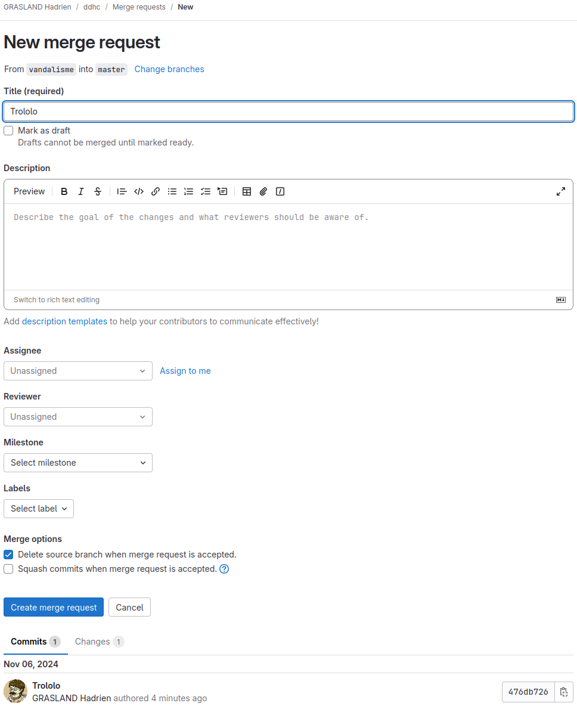

De haut en bas, ce formulaire contient…

- Tout en haut, une section à laquelle vous n’aurez presque jamais besoin de
  toucher qui vous permet de choisir quelle branche vous voulez fusionner au
  sein de quelle autre branche.
- Un champ « Title » permet de donner un nom à votre _merge request_, qui
  permettra plus tard de l’identifier dans la liste des _merge requests_ du
  dépôt.
- Une case à cocher qui permet de dire que cette _merge request_ est encore à
  l'état de brouillon et ne devrait pas être fusionnée. Cette possibilité est
  intéressante quand vous voulez inviter les autres à jeter un oeil à votre
  travail, mais il vous reste des choses à faire avant qu’il soit prêt à être
  intégré à la branche `master`.
- Un champ optionnel « Description » qui permet si besoin de clarifier
  l’objectif de la _merge request_. Cette description peut être mise en forme
  avec [le dialecte local de
  Markdown](https://docs.gitlab.com/ee/user/markdown.html).
- Des champs optionnels « Assignee » et « Reviewer » qui permettent de désigner
  des personnes responsables pour passer en revue votre travail et l’intégrer à
  la branche `master` une fois la revue terminée. Sur des petits projets, une
  même personne tend à s’occuper des deux tâches, dans ce cas on n’utilise
  généralement que le champ « Assignee ».
- Un champ optionnel « Milestone » qui permet d’associer vos changements à un
  certain objectif du projet. Cela peut être par exemple une version stable 
  future, ou bien quelque chose de plus qualitatif comme une grosse
  fonctionnalité en cours de développement dans un logiciel.
- Un champ optionnel « Labels » permet de catégoriser vos changements de façon
  libre. Par exemple, dans les projets logiciels, on utilise souvent ce champ
  pour indiquer ce qui relève du correctif, de l’ajout de nouvelles
  fonctionnalités, ce qui brise une interface publique potentiellement utilisée
  par des personnes extérieures au projet…
- Enfin, une paire de cases à cocher permet de définir ce qui se passera le jour
  où votre _merge request_ sera intégrée à la branche cible. Est-ce que la
  branche source est désormais inutile et peut être supprimée ? Est-ce que votre
  travail comprenant potentiellement plusieurs commits peut être résumé à un
  seul commit au sein de la branche cible ?

Sous le formulaire, après les boutons de validation et d'annulation, vous
noterez une petite interface permettant d'examiner les changements proposés par
la _merge request_, sous forme de commits (par défaut) ou de _diff_ (via
l’onglet « Changes »). C’est une bonne occasion de vérifier que la _merge
request_ contient bien tous les changements souhaités, et que vous n’avez pas
par exemple oublié de pousser vos dernières modifications.

Une fois créée, une _merge request_ se présentera pour les mainteneurs sous la
forme du titre et de la description que vous avez choisi, d’une visualisation
des changements proposés, et d’une interface permettant d’en discuter (pour
proposer des modifications avant intégration par exemple).

Il est aussi possible pour un mainteneur de définir une batterie de tests
automatisés que toute _merge request_ doit passer avant d’être acceptée par le
projet. On parle alors d’intégration continue.

Si des changements sont demandés par un mainteneur, vous pouvez ajouter ceux-ci
à votre branche locale via de nouveaux commits et de les pousser sur le dépôt 
avec un simple `git push`. La _merge request_ associée sera alors mise à jour
automatiquement.

Une fois la _merge request_ fusionnée, vous pourrez supprimer la branche de
développement associée au sein de votre dépôt local…

```bash
{{#include 5-reseau-forges.sh:delete-dev-branch-gitlab}}
```

…puis recommencer un autre développement depuis la branche `master` quand vous
voudrez en reprenant le cheminement indiqué ci-dessus à partir du début.


## À vous de jouer !

À ce stade, vous en savez assez pour commencer à vous amuser avec cette pauvre
Déclaration des Droits de l’Homme.

Peut-être avez-vous toujours rêvé de paraphraser Olympe de Gouges en réécrivant
entièrement le texte au féminin (« Déclaration des Droits de la Femme et de
la Citoyenne ») ? Peut-être souhaitez-vous y ajouter l’article
manquant qui résoudra enfin le débat séculaire entre pain au chocolat et
chocolatine ? Ou bien peut-être est-il temps d’amender l’article 15 qui
autorise chaque citoyen à demander des comptes aux agents publics ?

Modifiez le texte comme vous le souhaitez, en n’hésitant pas à créer des commits
en cours de route pour vous pouvoir revenir facilement en arrière. Puis, poussez
votre branche finalisée sur le dépôt et soumettez une _merge request_ vers la
branche `master` pour terminer ce TP.

Ensuite, vous pourrez aller lire la [conclusion commune](5.3-conclusion.md). Si
vous êtes en avance, n'hésitez pas à aller voir aussi la variante [« GitHub
ouvert »](5.1-github-ouvert.md) du TP, qui vous permettra de pratiquer sur une
autre forge couramment utilisée (GitHub), avec une méthode de travail plus
adaptée pour des projets open-source ouverts aux contributions extérieures.
