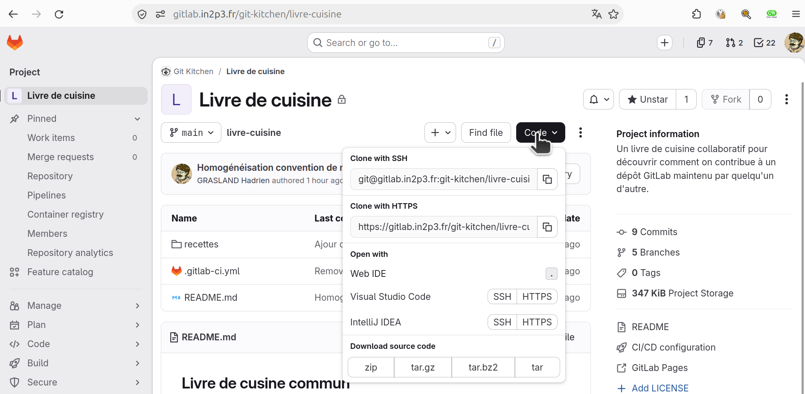

# Créer un nouveau projet et y contribuer (GitLab)

## Objectif

Dans ce TP, nous allons découvrir la création et la gestion d’un projet sur **GitLab**, en suivant notre fil rouge : les **recettes de cuisine**.
Dans un premier temps chaque participant disposera de son propre espace de travail sur la forge **GitLab In2P3**, au sein d'un groupe commun _Recette de Cuisine_ <lien à venir>

L’objectif est de :

- Créer un dépôt GitLab personnel.
- Organiser les fichiers d’un projet.
- Ajouter une première recette au dépot local puis de l'envoyer sur la forge.

---

## Étape 0 - Rejoindre le groupe de travail

À ce stade, vous devriez maintenant avoir accès au groupe privé
[https://gitlab.in2p3.fr/recette-de-cuisine](https://gitlab.in2p3.fr/recette-de-cuisine)
sur l’instance GitLab de l’IN2P3. Si ce n'est pas le cas, il faut nous le signaler dès maintenant.

---

## Étape 1 - Créer un projet

Depuis la page du groupe **Recette de Cuisine**, cliquez sur le bouton **New project → Create blank project**.

Remplissez les champs comme suit :

| Champ                     | Contenu suggéré                                          |
| ------------------------- | -------------------------------------------------------- |
| **Project name**          | `Recettes De <votre-identifiant>`                        |
| **Project namespace**     | Recette de Cuisine (rempli automatiquement)              |
| **Project slug**          | (sera automatiquement généré à partir du nom du projet)  |
| **Project description**   | "Mon carnet de recettes personnelles pour le TP GitLab." |
| **Visibility level**      | `Private` (par défaut)                                   |
| **Project Configuration** | Décocher "Initialize repository with a README"           |

Cliquez sur **Create project** pour valider.

---

## Étape 2 - Cloner le dépôt sur votre machine

GitLab a maintenant créé un dépôt vide. Il est tout à fait possible de créer et modifier des fichiers directement depuis l’interface web de la forge, mais cette méthode devient vite limitée : vous n’avez pas accès à vos outils habituels (éditeur préféré, prévisualisation Markdown, gestion fine des branches, etc.).
Nous allons donc travailler **sur un clone local** du dépôt Git.

#### 1. Récupérer l’URL SSH du projet

Depuis la page d’accueil de votre projet GitLab, cliquez sur le bouton bleu **« Code »** en haut à droite :



Dans la fenêtre qui s’ouvre, copiez l’URL indiquée dans la zone **« Clone with SSH »**.
Un bouton de copie rapide sur la droite vous permettra de la mettre dans votre presse-papier.

> ⚠️ Assurez-vous d’avoir bien configuré votre clé SSH sur GitLab avant cette étape.
> Si GitLab ne reconnaît pas votre clé, vous ne pourrez pas pousser vos changements plus tard.

---

#### 2. Créer le clone local

Ouvrez un terminal sur votre machine, puis placez-vous dans le dossier où vous souhaitez stocker vos projets de cuisine.
Créez ensuite un clone du dépôt à l’aide de la commande suivante (en adaptant l’URL à votre projet) :

```bash
git clone git@gitlab.in2p3.fr:recette-de-cuisine/recettes-de-<votre-identifiant>.git
cd recettes-de-<votre-identifiant>
```

Lors de la première connexion à la forge via SSH, votre client Git vous avertira qu’il ne connaît pas encore ce serveur.
C’est parfaitement normal — il suffit d’accepter la connexion lorsqu’il vous demande confirmation.

---

#### 3. Structure du projet

Votre dépôt est pour l’instant vide. Nous allons lui donner une structure simple pour accueillir vos futures créations culinaires.

Créez un dossier `recettes` et un fichier de description pour votre première recette :

```bash
mkdir recettes
nano recettes/crepes-classiques.md
```

Copiez-collez ensuite le gabarit ci-dessous dans le fichier (vous pouvez adapter les valeurs selon votre humeur du jour) :

```markdown
titre: "Crêpes classiques"
description: "Une recette simple et rapide pour des crêpes moelleuses."
auteur: "Votre identifiant"
date: 2025-10-06
temps_preparation: "10 min"
temps_cuisson: "15 min"
temps_repos: "—"
difficulte: "Facile"
nombre_personnes: 4
categorie: "Dessert"
cout: "€"
tags:

- rapide
- vegetarien
  image: "/images/crepes-classiques.jpg"
  ingredients:
- "250 g de farine"
- "3 œufs"
- "50 g de sucre"
- "1 pincée de sel"
- "50 cl de lait"
  conseils:
- "Laissez reposer la pâte 30 min pour plus de goût!"

---

1.
```

Enregistrez et fermez le fichier.

---

#### 4. Versionner et publier la recette

Ajoutez les fichiers nouvellement créés à votre dépôt local :

```bash
git add recettes/crepes-classiques.md
```

Créez un premier _commit_ pour enregistrer votre travail :

```bash
git commit -m "Ajout de la recette de crêpes classiques"
```

Puis poussez-le vers la forge GitLab :

```bash
git push origin main
```

GitLab vous demandera peut-être de confirmer l’association entre votre branche locale et la branche distante.
Vous pouvez la mémoriser pour les futurs envois avec :

```bash
git push --set-upstream origin main
```

---

#### 5. Vérification sur GitLab

Rendez-vous maintenant sur la page de votre projet dans GitLab.
Dans la section **Repository → Files**, vous devriez voir apparaître le dossier `recettes/` contenant votre fichier `crepes-classiques.md`.

Si vous ouvrez ce fichier, GitLab affichera directement le contenu en Markdown — parfait pour relire ou corriger vos instructions culinaires avant de les partager avec le reste du groupe.

---

Travailler sur son dépot s'est bien, mais maintenant nous allons mettre notre savoir faire en commun pour réaliser un véritable livre de cuisine numérique. La suite c'est par [ici]()
