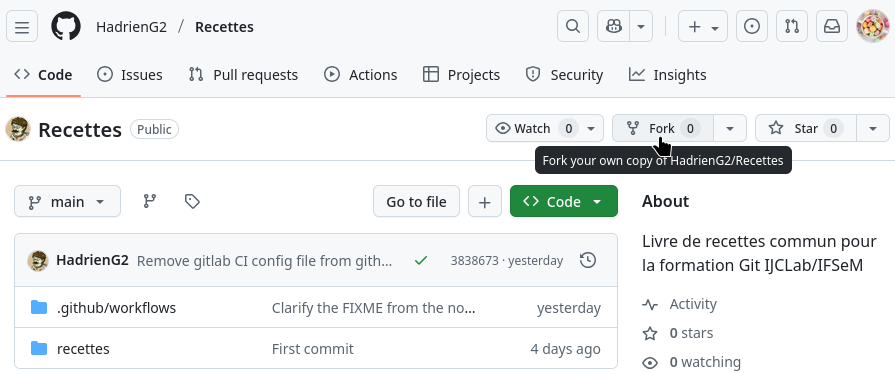
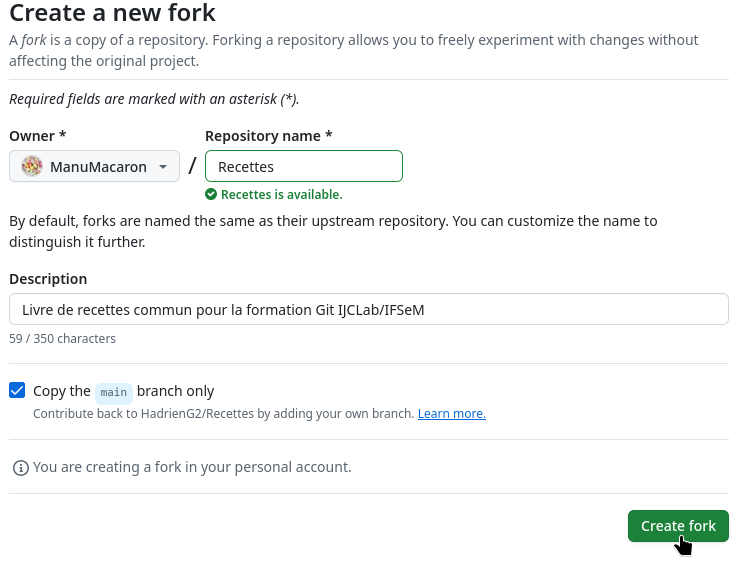
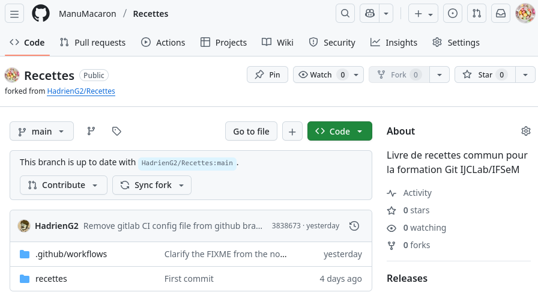
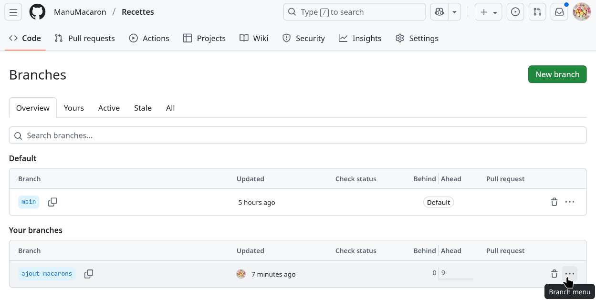

# Contribuer à un dépôt existant

## Introduction

Vous aviez en réalité accès au dépôt GitHub
[« HadrienG2/livre-cuisine »](https://github.com/HadrienG2/livre-cuisine) depuis
le début, avant même de vous connecter à votre compte GitHub, car ce dépôt est
en accès libre. Mais pour des raisons évidentes de sécurité, cet accès est en
lecture seule et ne vous permet pas de modifier directement les fichiers du
dépôt.

Maintenant vous avez un compte GitHub, le mainteneur du dépôt pourrait vous
accorder un accès en écriture, comme dans le parcours [« Gitlab
fermé »](../gitlab/1-intro.md). Mais il faut comprendre que cela reflète une
grande confiance de sa part:

- Dans les configurations de sécurité standard [de
  GitHub](https://docs.github.com/en/organizations/managing-user-access-to-your-organizations-repositories/managing-repository-roles/repository-roles-for-an-organization#permissions-for-each-role)
  comme [de
  GitLab](https://docs.gitlab.com/user/permissions/#packages-and-registries-group-permissions),
  une personne qui peut pousser des branches peut aussi pousser des _tags_ et
  créer des _releases_. Pour un projet logiciel, cela ouvre la porte aux
  attaques de type _supply chain_, comme [celle récemment survenue contre le
  projet `xz`](https://en.wikipedia.org/wiki/XZ_Utils_backdoor).
- Pour contourner ce problème, les mainteneurs peuvent se tourner vers des
  configurations non standard. Mais elles sont difficiles à mettre en place et
  inhabituelles pour les autres contributeurs. Et la permission de pousser des
  branches reste irrémédiablement couplée à celle de modifier ou supprimer les
  branches d'autres développeurs (à l'exception typiquement de la branche
  principale[^protected-branches]), ce qui suffit déjà à causer pas mal de
  dégâts en interne.

Ce mode d'accès au dépôt n'est donc pas adapté quand on souhaite recevoir des
contributions de parfaits inconnus comme c'est l'usage dans la communauté
_open-source_. On préfère alors une autre approche basée sur des copies privées
des dépôts git appelées _forks_. L'idée est la suivante :

- Vous créez une copie du dépôt git auquel vous voulez contribuer qui est
  associée à votre compte utilisateur et sous votre contrôle. Cette copie
  privée, appellée _fork_, est hébergée sur GitHub au même titre que le dépôt
  original, ce qui sera important pour la suite.
- Vous travaillez ensuite au sein de branches que vous poussez à volonté sur
  votre _fork_ jusqu'à obtenir une contribution qui vous semble digne d'être
  intégrée au dépôt original.
- Vous soumettez alors aux mainteneurs du dépôt original cette contribution sous
  la forme d'une _pull request_. Il s'agit d'un mécanisme propre à la forge qui
  notifie les mainteneurs de votre souhait d'intégrer les changements de votre
  fork au dépôt officiel, vous permet de justifier ces changements, et leur
  offre la possibilité de les examiner et d'en discuter avec vous. Ce processus
  de révision manuelle des contributions est généralement complété par un jeu de
  tests automatisés (intégration continue), qui ne saurait bien sûr le
  remplacer.[^ci-isnt-enough]
- Une fois un accord trouvé entre les mainteneurs et vous, et les changements
  éventuellement demandés apportés à votre branche, les mainteneurs n'ont
  ensuite plus qu'à cliquer sur un bouton dans l'interface de GitHub. Vos
  changements seront alors fusionnés au sein du dépôt officiel (typiquement au
  sein de la branche principale `main`), et ils deviendront alors une partie du
  contenu officiel du dépôt et de son historique officiel.

On le voit, le mécanisme des _forks_ offre un canal sécurisé par lequel un
projet peut accepter des contributions de parfaits inconnus, moyennant un
processus de passage en revue des contributions suffisamment rigoureux. Nul
besoin pour ça de distribuer à tout va de dangereux accès en écriture. C'est donc
un mécanisme très adapté aux projets _open-source_.

Mais il y a un prix à payer pour cette sécurité et cette ouverture, qui est une
lourdeur plus importante du processus de contribution. En effet, avec les
_forks_, les contributeurs doivent jongler avec pas moins de 3 dépôts git
différents, un sur leur machine et deux sur les serveurs de GitHub :

- Le dépôt local sur leur machine est utilisé pour l'édition directe des
  fichiers.[^web-edition]
- Le dépôt officiel du projet, auquel ils n'ont qu'un accès en lecture seule,
  est utilisé pour se tenir à jour par rapport à l'actualité du projet.
- Leur _fork_ privé, auquel ils ont accès en écriture, est utilisé pour mettre
  en ligne les branches qui seront à terme soumises au dépôt officiel via une
  _pull request_.

Ce jonglage nécessite un peu de pratique pour être maîtrisé, et l'objectif de ce
TP est justement de vous le faire pratiquer jusqu'à que vous soyez plus à l'aise
avant de passer à la suite.

[^ci-isnt-enough]: Si vous avez besoin de vous en convaincre, considérez le fait
                   qu'il est possible de soumettre une _pull request_ qui
                   supprime ou désactive la totalité des tests automatisés
                   effectués par l'intégration continue.
[^protected-branches]: Beaucoup de projets appliquent des règles de protection
                       aux branches « officielles » comme `main` afin de
                       restreindre le nombre de personnes qui y ont accès. Cela
                       réduit le risque associé à une fausse manip, à un
                       utilisateur malveillant, ou à un compte compromis.
[^web-edition]: On peut aussi éditer des fichiers via l'interface web de GitHub,
                mais cette approche rencontre vite ses limites dès qu'on
                souhaite par exemple vérifier rapidement que le code que l'on
                est en train d'éditer fonctionne toujours. Ce n'est donc
                intéressant que pour des modifications très simples comme
                corriger une faute d'orthographe dans un fichier README par
                exemple.


## Préparation

### Création du _fork_

La première étape est de vous rendre sur le dépôt GitHub
[« HadrienG2/livre-cuisine »](https://github.com/HadrienG2/livre-cuisine) et de
créer votre _fork_ de celui-ci. On utilisera pour cela le bouton « Fork » de
l'interface de GitHub. Il est situé dans la troisième barre d'outils horizontale
en partant du haut, dans une rangée de trois boutons sur la droite où c'est le
bouton du milieu:



Ce bouton vous conduit à un formulaire dans lequel vous pouvez spécifier les
propriétés de votre futur _fork_. Vous n'aurez quasiment jamais besoin de dévier
des réglages par défaut ici: vous voulez être propriétaire du _fork_, le nom et
le description n'ont pas besoin de changer par rapport à l'original, et vous
n'avez besoin que de la branche `main` pour travailler.[^main-branch]



Après avoir cliqué sur le bouton « Create fork », vous allez potentiellement
devoir attendre quelques secondes/minutes que les serveurs de GitHub créent le
_fork_, cela dépend de leur niveau de charge au moment de la
formation. Puis quand l'opération sera terminée vous serez automatiquement
redirigés vers la page d'accueil de votre _fork_ :



A première vue, elle semble identique à celle du dépôt original, et vous risquez
de les confondre au début. Mais il y a des indices visuels permettant de les
différencier. Enumérons-en quelques un en parcourant visuellement la page de
haut en bas :

- En haut à gauche, le nom complet du _fork_ commence par votre nom
  d'utilisateur GitHub (ici l'utilisateur « ManuMacaron » créé pour les besoins
  de cette démo), alors que celui du dépôt original commence par le nom
  d'utilisateur de son créateur (ici « HadrienG2 »).
- Les onglets de la barre d'outil horizontale plus bas sont différents. Par
  exemple, GitHub désactive par défaut la gestion de tickets (« Issues ») sur
  les _forks_ car les problèmes devraient normalement être remontées au projet
  original. En revanche vous avez la possibilité de modifier la configuration du
  _fork_ via l'onglet « Settings » à droite, alors que vous n'avez pas les
  permissions requises pour le faire sur le dépôt original.
- Si l'on continue vers le bas, on arrive à la région sur fond blanc, à
  l'endroit où le nom du dépôt est répété. On remarque que le nom du _fork_ est
  ici précédé horizontalement par votre avatar (pas celui du créateur du dépôt
  original) et suivi en-dessous de la mention « forked from
  HadrienG2/livre-cuisine » avec un lien vers le dépôt original.
- Au niveau des boutons à droite du nom du dépôt, vous remarquerez que vous ne
  pouvez pas _forker_ vos propres dépôts, donc le bouton « Fork » est grisé. En
  revanche vous pouvez mettre tous les dépôts dont vous êtes propriétaire en
  valeur sur votre page d'accueil d'utilisateur GitHub, y compris les _forks_
  d'autres dépôts, donc un bouton « Pin » est apparu pour ça.
- Enfin, en-dessous du bouton « main ⏷ » à gauche qui vous permet de
  sélectionner la branche dont les fichiers sont visualisés au sein de
  l'interface de GitHub, vous remarquerez qu'une nouvelle interface est apparue.
  Celle-ci vous permet de gérer la branche `main` de votre _fork_. Nous
  n'encourageons pas son utilisation car elle est souvent source de confusion
  pour les débutants, donc nous ne détaillerons pas ces fonctionnalités.

[^main-branch]: A dire vrai, vous n'allez même pas utiliser la branche `main` de
                votre _fork_ car c'est la branche `main` du dépôt original qui
                est importante, par la copie au sein de votre _fork_ qui ne sera
                bientôt plus à jour. Mais l'interface web de GitHub a besoin que
                les dépôts git contiennent au moins une branche pour bien
                fonctionner, et cela améliore aussi l'efficacité des échanges
                réseaux associés à la mise en ligne de branches quand les dépôts
                ont un long historique avant la création de votre _fork_.

### Clonage du _fork_

Si mainteant nous remontons un tout petit peu les yeux vers le haut tout en
restant dans la région sur fond blanc, vous remarquerez que sur le dépôt
original comme sur votre _fork_ il y a aussi vers la droite un bouton appelé
« Code ⏷ » qui est sur fond vert.

Le fait que ce soit le seul bouton sur fond coloré sur la page d'accueil d'un
dépôt vous indique que les concepteurs de GitHub considèrent ce bouton comme
important et veulent attirer votre attention dessus. Il est effectivement
important, car c'est lui qui va vous permettre de configurer votre client git
local pour échanger des commits avec votre _fork_ et le dépôt officiel.

Pour commencer, cliquez sur le bouton « Code ⏷ » sur la page d'accueil de
**votre _fork_**. Vous vous retrouvez ainsi face à l'interface suivante :

<center>


</center>

En haut, il y a une paire d'onglets qui vous permet de choisir entre du travail
avec des outils localement installés sur votre machine et du travail avec des
outils installés sur les serveurs de GitHub/Microsoft. Dans cette formation,
nous privilégions le travail sur votre machine locale, donc nous vous invitons à
rester sur le premier onglet, ou basculer sur celui-ci si vous utilisez l'onglet
« Codespaces » d'habitude.

Un peu plus bas, après le texte « Clone », il y a des sous-onglets appelés
« HTTPS », « SSH » et « GitHub CLI ». Ceux ci représentent trois protocoles que
vous pouvez utiliser pour échanger des commits avec votre _fork_. Quelles
différences entre ces protocoles ?

- Les protocoles HTTPS et SSH sont supportés en standard par git, alors que
  l'option « GitHub CLI » requiert l'utilisation d'une application spécifique à
  GitHub. Dans cette formation, nous encourageons l'utilisation d'outils
  standard compatibles avec toutes les forges, donc nous ne détaillerons pas
  cette troisième option.
- Le protocole HTTPS est pratique pour les accès en lecture seule à des dépôts
  publics car il est utilisable sans aucune configuration préalable. Mais GitHub
  ne permet plus de l'utiliser pour des opérations qui nécessitent une
  authentification, comme par exemple mettre en ligne des commits et des
  branches sur votre _fork_, hors cas particulier des _tokens_.[^why-not-https]
- Le protocole SSH nécessite de configurer [votre machine
  locale](../1-intro.md#génération-de-clés-ssh) et [la forge GitHub](2-acces.md)
  comme nous l'avons expliqué précédemment. Mais une fois ces formalités
  effectuées, il fournit une approche sécurisée et standardisée pour les
  opérations nécessitant une authentification.

Pour échanger entre votre machine locale et votre _fork_, le protocole SSH est
le plus adapté, car il est nativement supporté par git et permet l'accès en
écriture pour mettre en ligne vos branches. Je vous invite donc à cliquer sur
l'onglet « SSH » puis copier l'adresse qui s'affiche alors. Notez le bouton
« double carré » à droite qui facilite la copie.

Une fois l'adresse SSH copiée, il ne reste plus qu'à la coller au sein d'une
commande `git clone` pour créer le clone local du _fork_ au sein duquel nous
allons travailler :

```bash
{{#include ../../5-reseau-forges.sh:clone-from-github}}
```

Votre client git vous avertira alors qu’il ne connaît pas l’identité du serveur
auquel vous vous connectez, ce qui est normal ici puisque c’est la première fois
que votre compte utilisateur sur les machines d’enseignement se connecte à
GitHub via SSH. Vous pouvez donc autoriser l’opération.

[^why-not-https]: L'utilisation classique de HTTPS en mode login/mot de passe
                  pour des opérations authentifiées a deux défauts majeurs qui
                  ont conduit à cette interdiction. D'abord, au niveau
                  ergonomique il n'y a pas de moyen standardisé pour permettre à
                  git de mémoriser votre mot de passe HTTPS, ce qui vous conduit
                  généralement à le saisir à répétition pour chaque échange avec
                  GitHub qui nécessite de prouver votre identité (écriture
                  typiquement). Ensuite, au niveau sécurité c'est une
                  authentification par mot de passe, ce qui signifie que vous
                  transmettez l'information secrètre qui prouve votre identité à
                  votre interlocuteur. Donc si vous vous retrouvez à confier par
                  accident votre mot de passe à une personne malveillante qui se
                  fait passer pour GitHub, cette personne obtient les mêmes
                  droits que vous pour une durée indéterminée. Ces deux défauts,
                  on le devine, s'amplifient mutuellement : si vous devez taper
                  votre mot de passe tout le temps, vous ne faites plus trop
                  attention aux circonstances dans lesquelles vous devez le
                  saisir... On peut cependant noter que GitHub autorise toujours
                  l'authentification HTTPS pour des [jetons de connexions
                  d'accès
                  restreint](https://docs.github.com/en/authentication/keeping-your-account-and-data-secure/managing-your-personal-access-tokens)
                  (_personal access tokens_).

### Connexion au dépôt officiel

Comme notre clone local dans le TP précédent, le clone du _fork_ possède une
_remote_ pointant vers le _fork_ qui permet d’échanger facilement des commits
avec ce dernier :

```bash
{{#include ../../5-reseau-forges.sh:goto-repo-and-show-remote}}
```

Mais pour appliquer la méthode de travail basée sur les _forks_ et les _pull
requests_ (appelée _GitHub flow_), il faut aussi être capable d’échanger des
commits avec le dépôt officiel, celui à partir duquel vous avez créé votre _fork_.
En effet, des nouveautés vont arriver sur ce dernier au fur et à mesure du TP,
et vous devrez mettre à jour vos branches en fonction.

Par convention, la _remote_ associée au dépôt officiel est souvent appelée
_upstream_ :

```bash
{{#include ../../5-reseau-forges.sh:add-upstream-remote}}
```

Notez qu’on peut ici utiliser une URL HTTPS, sans avoir besoin de saisir un mot
de passe, puisqu’on ne fait que lire des commits depuis un dépôt public, ce
qui ne nécessite pas de s’identifier.

Si vous ouvrez maintenant SourceGit, vous constaterez que vous pouvez maintenant
visualiser vos commits et branches locales, celles de votre _fork_, et celles du
dépôt officiel. Tout est prêt !


## Contribution par _GitHub flow_

### Introduction

Le _GitHub flow_ est une méthode de travail qui, malgré son nom, n’a rien de
spécifique à la forge GitHub. Toutes les forges modernes peuvent être utilisées
de cette manière. Dans cette méthode, le travail s’organise en quatre grandes
étapes :

1. Rester à jour par rapport au dépôt officiel
2. Préparer des changements dans une branche dédiée de son dépôt local
3. Publier la branche associée sur son _fork_
4. Proposer l'intégration de ces changements à la branche `main` du dépôt
   officiel

La suite de ce TP vous expliquera le fonctionnement de ces quatre étapes.

### Rester à jour par rapport au dépôt officiel

Comme nous l’avons vu dans le TP précédent, il est possible de récupérer les
changements du dépôt officiel avec `git fetch upstream`.

Cependant, dans le cadre de cette méthode de travail, nous n’avons généralement
pas besoin de nous intéresser à l’ensemble des branches de ce dépôt. Il suffit
de tenir notre branche `main` à jour, ce que l’on peut faire facilement avec
`git pull` après avoir configuré `upstream/main` comme branche amont comme
suit :

```bash
{{#include ../../5-reseau-forges.sh:set-upstream-main}}
```

Une fois cette préparation effectuée, vous n’aurez pas besoin de la répéter et
pourrez juste par la suite mettre à jour votre branche `main` locale avec ces
deux commandes :

```bash
{{#include ../../5-reseau-forges.sh:pull-main-github}}
```

Nous conseillons ici l’utilisation de `--ff-only` pour vous aider à repérer une
erreur classique. Si vous et les mainteneurs du dépôt officiel pratiquez
correctement le _GitHub flow_, la branche `main` du dépôt officiel devrait
avancer uniquement par ajout de nouveaux commits, et votre branche `main` locale
devrait suivre son avancée. Par conséquent, si vous ne pouvez pas mettre en
avance rapide, cela relève d’une situation pathologique :

- Soit les mainteneurs du dépôt officiel ont fait diverger `main` en éditant
  son historique. Il n’est que très rarement nécessaire d’en arriver là, et un
  mainteneur responsable devrait informer les autres membres du projet chaque
  fois qu’il doit en venir à de tels extrêmités.
- Soit, et c’est de loin le cas le plus courant, vous avez vous-même créé une
  divergence, typiquement en ajoutant des commits sur votre branche `main`
  locale plutôt que sur une branche de développement dédiée.

Dans ce dernier cas, pour vous tirer d’affaire, vous pouvez…

- D’abord sauvegarder vos changements dans une nouvelle branche, si vous le
  souhaitez, avec `git branch NouveauNom` (où `NouveauNom` est à remplacer par
  un nom de branche qui n'est pas encore utilisé au sein de votre dépôt).
- Ensuite forcer votre branche `main` à en revenir au même point que le
  `main` officiel avec la commande `git reset --hard upstream/main`.

Vous pouvez configurer l’utilisation implicite de `--ff-only` pour tous les
`git pull` futurs au sein de ce dépôt avec la commande de configuration…

```bash
{{#include ../../5-reseau-forges.sh:config-pull-ff-only}}
```

...et dans ce cas vous n'aurez plus qu'à utiliser `git pull` sans arguments
supplémentaires par la suite pour obtenir le même résultat.


### Préparer des changements dans une branche dédiée

Une fois que l’on a un `main` à jour, il est possible de construire des
changements par-dessus ce dernier. Il suffit pour cela de créer une branche qui
part de `main`…

```bash
{{#include ../../5-reseau-forges.sh:create-dev-branch-github}}
```

…puis de créer des commits dessus. Par exemple, vous pourriez vouloir soumettre
une nouvelle recette en vous inspirant du format de la recette
`recettes/crepes.md` fournie. Ou bien vous pourriez soumettre une correction à
une des recettes pré-existantes.

Par exemple les commandes suivantes utilisent l'outil Unix `sed` pour remplir la
métadonnée "temps_de_repos" de la recette de crêpes fournie avec le temps de
repos suggéré dans la partie "conseils". Mais nous vous encourageons à être
créatif et original, d'autant que si vous éditez tous le même fichier au même
endroit, vous vous exposez à un risque de conflit !

```bash
{{#include ../../5-reseau-forges.sh:commit-on-dev-branch}}
```

Pendant que vous effectuez ces modifications, le dépôt officiel continue
d’évoluer, et il est possible que des nouveautés arrivent sur la branche
`main`. Les sorties des commandes `git fetch` et `git pull` vous en
informeront.

Si c’est le cas, vous pourrez intégrer ces nouveautés à votre branche de
développement avec les outils que nous avons vus précédemment. Un cycle complet
de mise à jour de `main` et d’intégrations de ses nouveautés à votre branche
pourrait ainsi ressembler à ceci :

```bash
{{#include ../../5-reseau-forges.sh:update-main-and-merge}}
```

En cas de conflit de fusion, il vous appartiendra de vous adapter aux nouveautés
de la branche `main` officielle qui sont incompatibles avec vos changements.

<div class="warning">

Plus une de vos branches a une durée de vie longue, plus il y a de chances que
des conflits se produisent avec le `main` qui évolue en parallèle. De plus, si
vous utilisez `git rebase` plutôt que `git merge`, comme la politique de
certains projets l’exige, il peut aussi arriver que vous rencontriez de
conflits de fusion en cascade, où vous devrez faire face à des conflits non
pas une seule fois, mais une fois par commit de votre branche !

Pour éviter cela et simplifier le passage en revue de vos changements par les
mainteneurs, il est recommandé de privilégier des branches de durée de vie
courte, aux objectifs précis et modestes, que l’on soumettra au dépôt officiel
dès que possible.

</div>

### Publier la branche sur son _fork_

Lorsque vous êtes satisfait de votre branche locale, vous pouvez la mettre en
ligne sur votre _fork_ avec la commande `git push`.

L’option `--set-upstream`, que nous avons évoquée précédemment, vous permettra
de mémoriser l’association entre votre branche locale et la branche distante sur
votre _fork_ lors de la mise en ligne.

```bash
{{#include ../../5-reseau-forges.sh:push-set-upstream}}
```

Une fois cette association mémorisée, vous pourrez par la suite vous contenter
d’une simple commande `git push` sans arguments supplémentaires.

Nous l’avons évoqué précédemment, en général, quand vous mettez des changements
en ligne sur un serveur, il faut être prudent avec les modifications
d’historique et les `git push --force` associés pour ne pas couper l’herbe sous
le pied aux gens qui travaillent par-dessus vos branches.

Mais l’un des avantages qu’il y a à utiliser un _fork_, c’est que ce dépôt
n’appartient qu’à vous. Personne d’autre n’est donc censé baser son travail
dessus, et c’est pourquoi la plupart des projets tolèrent l’utilisation libérale
du _force-push_ sur les _forks_, un confort très appréciable pour les amateurs
d’édition d’historique.

<div class="warning">

Cette politique est à double tranchant. Si vous devez un jour baser votre
travail sur le _fork_ de quelqu’un d’autre, il vous appartiendra de vivre avec
les suppressions de branches et autres modifications d’historique effectuées
par cette personne sur son _fork_. Évitez donc si possible de baser du travail
sur le _fork_ d’autrui, en privilégiant toujours le travail à partir du dépôt
officiel du projet.

</div>

### Soumission au dépôt officiel

Une fois que vous avez mis des changements en ligne sous la forme d’une branche
sur votre _fork_, vous pouvez demander l’intégration de ces changements au dépôt
officiel avec une fonctionnalité des forges git modernes, la _pull request_.
Cette fonctionnalité est également appelée _merge request_ par GitLab, mais
comme nous utilisons GitHub dans ce TP, nous nous en tiendrons à sa terminologie
afin d’éviter toute confusion.

Comme son nom l’indique, une _pull request_ invite les mainteneurs du dépôt
officiel à intégrer vos changements au projet en fusionnant les nouveautés de
votre branche dans un historique officiel (généralement la branche `main`). Ce
nom rend hommage à la commande `git pull`, dont nous avons vu qu'elle sert à
obtenir et fusionner des changements distants.

Vous avez peut-être remarqué durant l'étape précédente que GitHub vous fournit
plusieurs raccourcis pour créer une _pull request_ lorsque vous poussez une
branche sur votre _fork_ :

- Dans la console, après avoir exécuté la commande `git push`, une URL s'affiche
  que vous pouvez suivre avec votre navigateur web lancer la création de la
  _pull request_.

  ```text
  > git push -u manu ajout-macarons
  Énumération des objets: 6, fait.
  Décompte des objets: 100% (6/6), fait.
  Compression par delta en utilisant jusqu'à 20 fils d'exécution
  Compression des objets: 100% (4/4), fait.
  Écriture des objets: 100% (4/4), 2.42 Kio | 2.42 Mio/s, fait.
  Total 4 (delta 1), réutilisés 0 (delta 0), réutilisés du paquet 0 (depuis 0)
  remote: Resolving deltas: 100% (1/1), completed with 1 local object.
  remote:
  remote: Create a pull request for 'ajout-macarons' on GitHub by visiting:
  remote:      https://github.com/ManuMacaron/livre-cuisine/pull/new/ajout-macarons
  remote:
  To github-manu-macaron:ManuMacaron/livre-cuisine.git
   * [new branch]      ajout-macarons -> ajout-macarons
  la branche 'ajout-macarons' est paramétrée pour suivre 'manu/ajout-macarons'.
  ```
- Dans l'interface web de votre _fork_ sur GitHub, quand vous êtes connecté à
  votre compte, un bouton s'affiche temporairement quelques temps après avoir
  poussé des commits sur une branche. Ce bouton vous permet aussi de créer une
  _pull request_ à partir de cette branche.

  

Mais même si vous avez ignoré tous ces raccourcis, vous pouvez toujours créer
« manuellement » une _pull request_ de la façon que nous allons décrire
maintenant.

D'abord, allez sur l’interface web de votre _fork_ et affichez la liste des
branches avec le lien « N branches » en haut à gauche, un peu en dessous du nom
du dépôt :


Ensuite, trouvez la branche dont vous voulez soumettre les changements dans la
liste et ouvrez le menu associé avec l'icône « points de suspension » sur la
droite :



Vous y trouverez l'option « New Pull Request » qui vous permet d'initier le
processus de soumission de changements :

<center>


</center>

Après avoir fait tout ça, vous vous retrouverez face l'interface de création de
_pull request_ que vous auriez vue directement si vous aviez utilisé un des
raccourcis évoqués précédemment :


De haut en bas, cette interface contient…

- En haut, une section à laquelle vous n’aurez presque jamais besoin de toucher
  qui vous permet de spécifier quelle branche de votre _fork_ (ou d’un autre
  dépôt) vous voulez fusionner dans quelle branche du dépôt officiel.
- Ensuite, un formulaire pour donner un nom à votre _pull request_ ainsi qu’une
  description plus détaillée si besoin. Cette description peut être formatée
  avec [le dialecte local de
  Markdown](https://docs.github.com/fr/get-started/writing-on-github/getting-started-with-writing-and-formatting-on-github/basic-writing-and-formatting-syntax).
- En bas de ce formulaire, une case à cocher « Allow edits by maintainers » qui
  permet aux mainteneurs du dépôt d’ajouter des changements à votre branche (ça
  permet de fluidifier un peu le processus de passage en revue d’une
  contribution en faisant directement les modifications mineures plutôt que de
  vous demander de les faire vous-même).
- Près de cette case à cocher, un bouton « Create pull request » qui termine la
  saisie et crée la _pull request_, avec sur le côté droit une option un peu
  trop bien cachée (flèche descendante) pour créer la _pull request_ en mode
  brouillon. Cela signifie que vous informez les mainteneurs que vous aurez
  bientôt des changements à intégrer et leur permettez d’y jeter un œil, mais
  ne souhaitez pas qu’ils soient intégrés tout de suite, car vous n’avez pas fini
  le travail.
- En dessous de tout ça, pour information, une visualisation des changements
  apportés par votre branche : liste des commits et différences par rapport à la
  branche de destination.

Pour les mainteneurs, une _pull request_ se présentera ensuite sous la forme du
titre et de la description que vous avez choisi, d’une visualisation des
changements proposés, et d’une interface permettant d’en discuter (pour proposer
des modifications avant intégration par exemple). Nous allons voir cette
interface ensemble lorsque l'un d'entre vous sera arrivé à ce point du TP.

Si des changements sont demandés par un mainteneur, vous pouvez ajouter ceux-ci
à votre branche locale via de nouveaux commits et de les pousser sur votre
_fork_ avec un simple `git push`. La _pull request_ associée sera alors mise à
jour automatiquement.

Une fois la _pull request_ fusionnée, vous pourrez supprimer la branche de
développement associée de vos dépôts locaux et distants…

```bash
{{#include ../../5-reseau-forges.sh:delete-dev-branch-github}}
```

…puis recommencer un autre développement depuis la branche `main` du dépôt
officiel quand vous voudrez en reprenant le cheminement indiqué ci-dessus à
partir du début.


## À vous de jouer !

À ce stade, vous en savez assez pour commencer à vous amuser avec notre livre de
cuisine. Vous pouvez par exemple :

- ajouter une nouvelle recette de votre choix (titre, ingrédients, étapes, temps
  de préparation/cuisson, etc.) ;
- améliorer une recette existante en corrigeant l’orthographe, en précisant les
  quantités ou en clarifiant une étape ;
- proposer des variantes d'une recette ;

Modifiez le texte comme vous le souhaitez, en n’hésitant pas à créer des commits
en cours de route pour vous pouvoir revenir facilement en arrière. Puis, poussez
votre branche finalisée sur le dépôt et soumettez une _merge request_ vers la
branche `main` pour terminer ce TP.

Une fois que vous serez à l'aise avec cette méthode de travail, vous pourrez
vous lancer dans la [création de votre livre de cuisine
personnelles](4-depot-personnel/1-intro.md).
