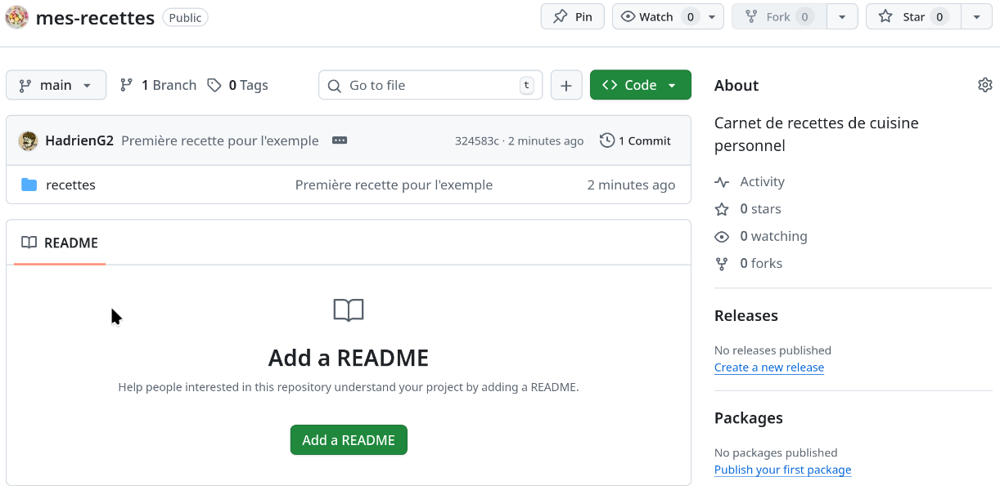
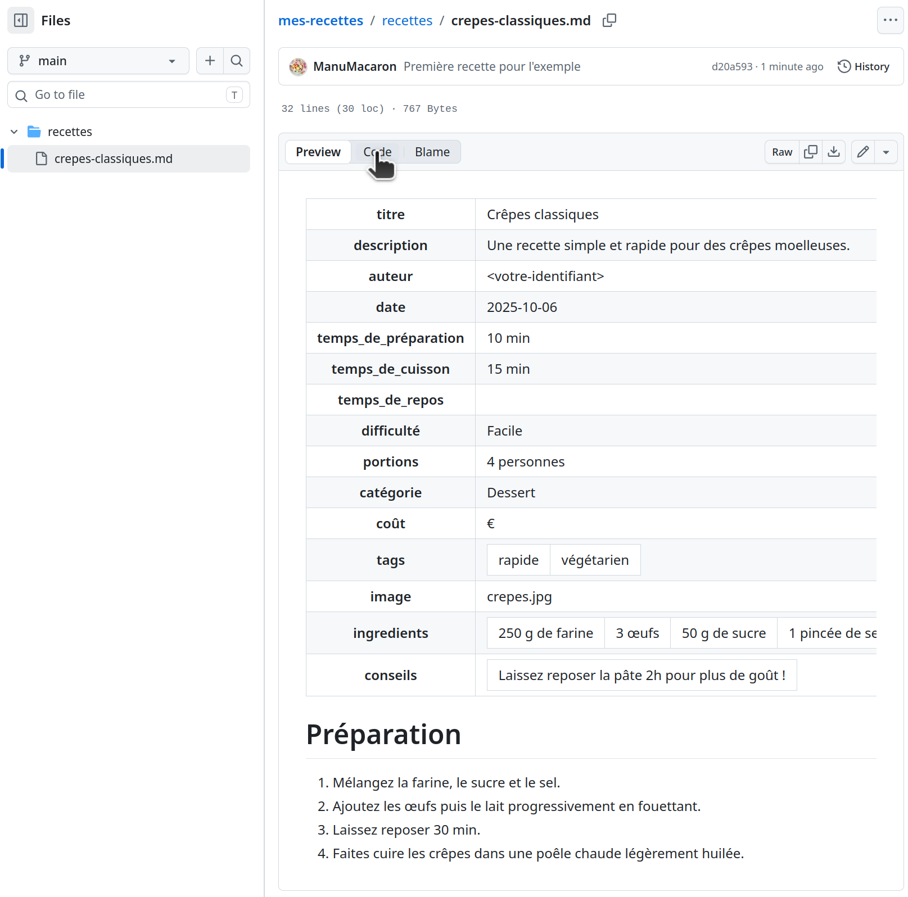

# Création d’un dépôt

## Interface web

Le processus de création de dépôts commence sur l'interface web de GitHub, et
plus précisément dans le bandeau supérieur de celle ci.

Quelle que soit la page du site GitHub que vous soyez en train de visualiser, de
la [page d'accueil](https://github.com/) aux dépôts de parfaits inconnus, il y a
un ensemble de boutons qui est toujours affiché en haut de l'interface web à
partir du moment où vous êtes connecté à votre compte utilisateur.


Parmi ces outils, notez la présence d'un bouton dont l'icône est le signe `+`.
Ce bouton ouvre un menu qui vous permet de créer différentes choses, dont des
dépôts (_repositories_) :

<center>


</center>

Quand vous sélectionnez cette option, vous êtes dirigé vers un formulaire
permettant de préciser les propriétés de votre dépôt :


Les options disponibles vous permettent de...

- Donner un nom à votre dépôt. Ce nom fera partie de l'URL du dépôt, donc il
  doit être compatible avec les contraintes des URLs (pas d'espace, pas de
  caractères spéciaux...). Si vous violez une de ces contraintes, GitHub vous
  proposera une alternative automatiquement.
    - Pour cette formation, nous vous suggérons le nom de dépôt
      **mes-recettes**. Vous pouvez en choisir un autre si vous voulez, mais
      vous devrez faire attention à adapter les commandes que nous allons vous
      donner par la suite.
- Décrire un peu plus longuement ce que vous avez en tête, ce qui servira par
  exemple aux personnes qui cherchent des dépôts sur GitHub de savoir plus
  rapidement si votre dépôt correspond à leur recherche ou pas.
    - Cette partie est libre, écrivez ce que vous voulez selon votre inspiration
      du jour.
- Choisir qui peut voir le contenu de votre dépôt, ce qui va indirectement
  déterminer quelles fonctionalités de GitHub seront gratuites ou payantes pour
  vous.
    - Nous allons utiliser des fonctionnalités qui ne sont gratuites que pour
      les dépôts publics, donc vous devriez choisir **Public** ici. Ce qui est
      heureusement le choix par défaut.
- Choisir si vous souhaitez que GitHub pré-remplisse certains fichiers dans
  votre dépôt.
    - Nous souhaitons tout faire nous même ici, donc laissez ces options à leur
      valeur par défaut où aucun fichier n'est pré-rempli.

Une fois ces différentes options remplies ou vérifiées, il ne vous reste qu'à
cliquer sur le bouton « Create repository », et après un bref instant vous serez
redirigés vers la page d'accueil de votre dépôt nouvellement créé, initialement 
vide de tout contenu :


## Cloner le dépôt sur votre machine

Vous l'aurez remarqué, quand on visualise un dépôt vide, le haut de l'interface
de GitHub est à peu près identique à ce que vous voyez quand vous créez un
_fork_.

En revanche, là où vous devriez visualiser les branches et fichiers contenus
dans le dépôt, si il y en avait, vous avez à la place des grands encadrés qui
font de la publicité pour différentes fonctionnalités de GitHub.

Afin de pouvoir connecter notre client git local à ce dépôt, nous allons avoir
besoin du grand encadré bleu « Quick setup », qui nous indique l'adresse de
_remote_ à utiliser. Et comme nous souhaitons écrire de nouveaux fichiers au
sein du dépôt et pousser de nouvelles branches, nous allons plus précisément
avoir besoin de l'adresse de _remote_ SSH.

Puis, comme précédemment, nous allons cloner ce dépôt. Attention, les commandes
suivantes sont spécifiques au compte fictif « ManuMacaron » utilisé pour cet
exemple. Vous devrez les adapter à votre nom d'utilisateur, voire votre nom de
dépôt.

```bash
git clone git@github.com:ManuMacaron/mes-recettes.git
cd mes-recettes
```

La sortie textuelle devrait ressembler à ceci :

```text
Clonage dans 'mes-recettes'...
avertissement : Vous semblez avoir cloné un dépôt vide.
```

Notez l'avertissement. Au moment de cloner le dépôt, git vous signale qu’aucun
fichier ni commit n’existent encore dans votre dépôt. C’est normal à ce stade.

Et en effet, si vous listez le contenu du répertoire :

```bash
ls -a
```

Vous ne verrez que le répertoire caché `.git/`, qui contient les données du
dépôt Git.

Vous pouvez dès lors vérifier que vous êtes bien sur la branche `main` et que la
_remote_ `origin` est bien configurée :

```bash
git status
git remote -v
```


## Structurer le dépôt et ajouter une première recette

L'idée maintenant est de structurer le dépôt en créant un répertoire `recettes/`
qui contiendra vos recettes au format Markdown.

Dans le terminal, on commence par créer le répertoire `recettes/` :

```bash
mkdir recettes
```

Puis on ajoute une première recette. Nous vous donnons un exemple avec des
crêpes, n'hésitez pas à utiliser une autre recette selon vos goûts :

```bash
touch recettes/crepes-classiques.md
```

Vous pouvez ensuite ouvrir ce fichier avec votre éditeur de texte préféré (ou le
modifier en ligne de commande) et y ajouter le contenu de la recette. Voici un
exemple de gabarit que vous pouvez utiliser pour structurer votre recette :

```markdown
---
titre: "Crêpes classiques"
description: "Une recette simple et rapide pour des crêpes moelleuses."
auteur: "<votre-identifiant>"
date: 2025-10-06
temps_de_préparation: "10 min"
temps_de_cuisson: "15 min"
temps_de_repos: ""
difficulté: "Facile"
portions: 4 personnes
catégorie: "Dessert"
coût: "€"
tags:
  - rapide
  - végétarien
image: crepes.jpg
ingredients:
  - "250 g de farine"
  - "3 œufs"
  - "50 g de sucre"
  - "1 pincée de sel"
  - "50 cl de lait"
conseils:
  - "Laissez reposer la pâte 2h pour plus de goût !"
---

# Préparation

1. Mélangez la farine, le sucre et le sel.
2. Ajoutez les œufs puis le lait progressivement en fouettant.
3. Laissez reposer 30 min.
4. Faites cuire les crêpes dans une poêle chaude légèrement huilée.
```


## Versionner et publier la recette

C'est le moment de voir si vous avez bien compris les notions vues précédemment.
Il est temps de versionner votre recette et la publier sur GitHub. Pour cela,
commencez comme d'habitude par vérifier l'état de git :

```bash
git status
```

Vous devriez voir que le répertoire `recettes/` est non suivi (untracked). Il
vous faut donc :

1. ajouter le fichier de recette au suivi de git ;
2. créer un commit local ;
3. pousser ce commit sur le dépôt distant.

Nous vous conseillons dans un premier temps de rester sur la branche `main`, ce
qui n'est pas un gros problème tant que vous travaillez tout seul. Si besoin,
relisez [le chapitre sur les dépôts distribués](../../../4-depots-distribues.md)
pour vous remémorer la procédure.

Une fois ces étapes réalisées, vous pouvez vérifier l’état du dépôt local et
distant avec :

```bash
git log --oneline --graph --decorate
git status
```

L'historique devrait montrer votre commit (à la fois sur la version locale et
distante de `main`), et le statut indiquer que la branche `main` suit
`origin/main` et le répertoire de travail est propre (_clean_).


## Vérifier le contenu du dépôt sur GitHub

Si vous vous rendez sur la page GitHub de votre dépôt, ou rafraîchissez celle-ci
si elle est déjà ouverte dans votre navigateur web, vous constaterez que la mise
en ligne de fichiers a fait disparaître la plupart des encadrés affichés pour un
dépôt vide. Un autre encadré a toutefois fait son apparition, qui vous invite à créer un fichier README :



Cet encadré-là continuera à vous narguer indéfiniment. Libre à vous de l'ignorer
ou d'y céder. Le point important, c'est que si vous créez un fichier README via
ce bouton « Add a README » de l'interface web de GitHub plutôt que via votre
client git local, cela va mettre à jour la branche `main` de votre dépôt sur le
serveur de GitHub, mais pas celle de votre dépôt git local. Il faudra donc faire
une opération (ou une paire d'opérations) au sein de votre dépôt git local avant
de pouvoir ajouter et pousser davantage de commits sur la branche `main`. Nous
vous proposons comme exercice de vous rappeler à quelle(s) opération(s) nous
faisons référence ici.

Quoiqu'il en soit, vous pouvez vérifier que le dossier `recettes` est bien
visible ainsi que la recette de cuisine à l'intérieur. Par défaut, GitHub
effectue automatiquement une visualisation du contenu du fichier Markdown, qui
ne facilite pas forcément la lecture des en-têtes...



...mais vous pouvez si besoin revenir vers un affichage texte brut en passant de
l'onglet « Preview » à l'onglet « Code » en haut à gauche de cette visualisation
du fichier. La troisième option « Blame » permet quand à elle de savoir qui a
contribué à quelle section d'un fichier via quel commit, à la manière de
l'utilitaire en ligne de commande `git blame`, mais sa sortie n'est pas très
intéressante à ce stade puisque le fichier n'a qu'un seul auteur et n'a été
édité que via un seul commit. Essayez-la plutôt sur un autre dépôt GitHub avec
davantage d'historique pour comprendre son intérêt...

Vous remarquerez également que la première ligne du message de votre nouveau
commit est visible en haut de la page d'accueil du dépôt et de la visualisation
du fichier créé par ce commit. Plus généralement, en tout point de l'interface
web de GitHub, vous pouvez facilement savoir quel est le dernier commit qui a
modifié le fichier, dossier, dépôt... que vous êtes en train de regarder. Et il
est bien sûr possible de survoler les différentes informations avec la souris ou
cliquer dessus pour accéder à plus d'informations sur le commit en question.


## Conclusion

Dans ce chapitre, vous avez appris à créer votre propre dépot public et à y
versionner vos fichiers. Vous avez pu mettre en pratique les notions vu lors des
chapitres précédents pour versionner puis publier une première recette de
cuisine sur GitHub.

Vous avez maintenant les bases pour gérer votre propre dépôt GitHub. Dans la
suite, nous allons voir comment mettre en place quelques automatisations pour
[valider automatiquement le contenu de votre dépôt](3-integration-continue.md) à
chaque modification.

---

## Exercices

Jusqu'ici nous avons travaillé sur `main`, mais nous allons bientôt voir que
cela a des inconvénients. Il est donc préférable de prendre tôt l'habitude de
faire ses tests sur des branches dédiées. Voici un exercice pour vous y
entraîner tout en révisant le mécanisme des _pull requests_ :

1. Dans une nouvelle branche, ajoutez une image de présentation dans le dossier
   `recettes` et référencez-la dans votre recette (champ `image:`). Pour
   faciliter le repérage dans les fichiers plus tard, c'est une bonne idée de
   donner à l'image le même nom que la recette correspondante.
2. Poussez les changements et visualisez l'image dans l'interface web de GitHub
   (vous aurez besoin pour ça de basculer la visualisation, qui est par défaut
   sur la branche `main`, sur votre branche de travail).
3. Créez une _pull request_ depuis votre branche de travail vers votre branche
   `main`, visualisez celle-ci dans l'interface de GitHub, puis fusionnez-la.

## Antisèche

Cloner un dépôt (SSH) :

```bash
git clone git@github.com:<utilisateur>/<projet>.git
```

Vérifier l’état et la remote :

```bash
git status
git remote -v
```

Publier une branche et définir le suivi :

```bash
git push --set-upstream origin <branche>
```

Fusionner une _pull request_ :

Une fois la branche et la _pull request_ créées, vous pourrez fusionner vos
modifications dans `main` via l'interface web de GitHub. Pour cela rendez-vous
dans l'onglet « Pull requests », sélectionnez votre _pull request_, puis cliquez
sur le bouton « Merge pull request » pour finaliser l'intégration.

---


## Informations complémentaires

### Nettoyage des branches distantes

Pensez à supprimer les branches devenues inutiles après fusion (commande `git
push origin --delete <branche>` qui peut être automatisée via l'option de dépôt
« Automatically delete head branches »), ainsi que leurs homologues dans votre
dépôt local (`git branch -d <branche>`) sinon celles-ci risquent de s'accumuler
très vite au sein de vos dépôts...
