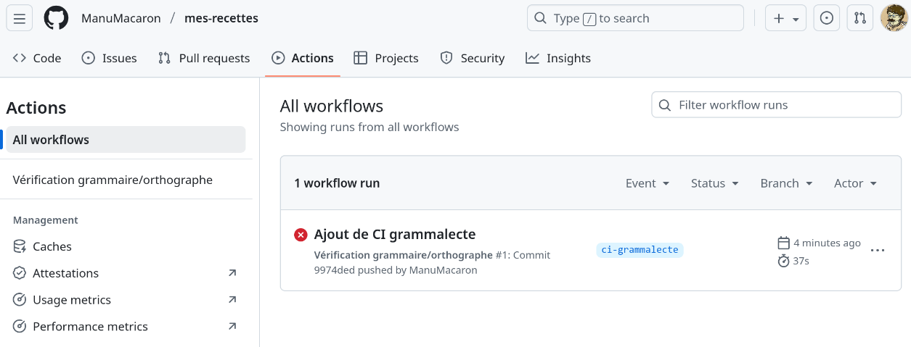
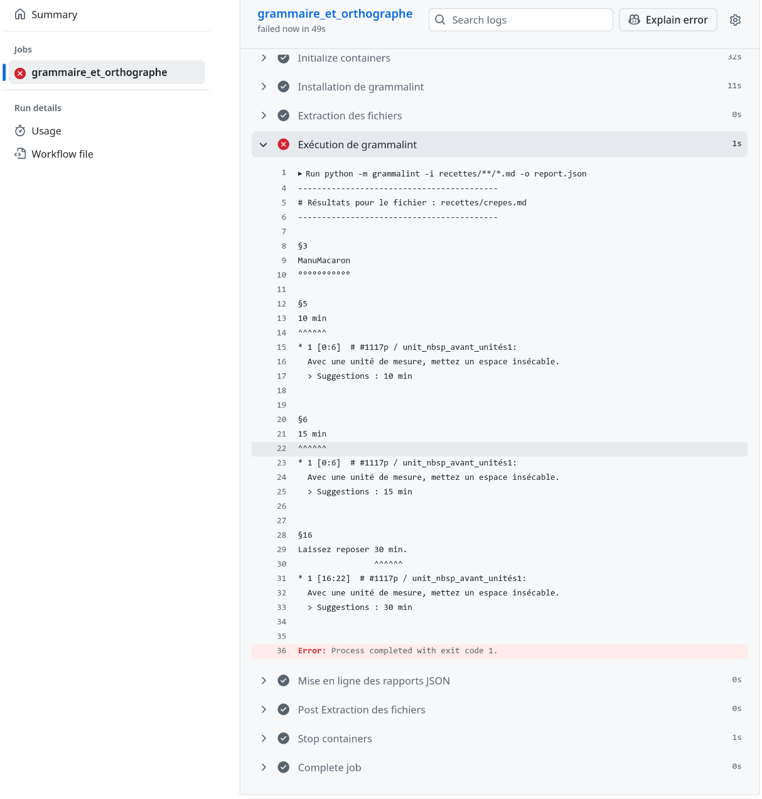

# Bases de l'intégration continue

Écrire des recettes, c’est bien. Bien les écrire, c’est encore mieux ! Le
concept d’intégration continue (_Continuous Integration_, ou en abrégé CI)
désigne l’automatisation de tâches de validation et de vérification. Cela
permet, par exemple, de s’assurer que le contenu d'une branche respecte
certaines normes de qualité avant qu'il ne soit fusionné dans la branche
principale.

Dans notre cas, nous allons mettre en place une intégration continue qui
vérifiera automatiquement l’orthographe, la grammaire et certaines règles
typographiques de vos recettes rédigées en Markdown, à l’aide de
[Grammalecte](https://grammalecte.net/).


## Tour d'horizon de GitHub Actions

L'intégration continue est un sujet complexe, riche en concepts et en jargon
spécifique à chaque forge. Nous vous proposons donc avant de commencer la
pratique un petit survol des concepts et du jargon de GitHub, dont nous allons
approfondir plusieurs points par la suite.

Le système d'intégration continue de GitHub s'appelle [GitHub
Actions](https://docs.github.com/fr/actions/get-started/understand-github-actions)
et il se configure avec un ensemble de fichiers YAML dans une hiérarchie de
répertoires `.github/workflows` que vous devez créer à la racine de votre
dépôt.

Chacun de ces fichiers YAML définit un
[_workflow_](https://docs.github.com/fr/actions/concepts/workflows-and-actions/workflows),
c'est à dire un ensemble de [tâches
(_jobs_)](https://docs.github.com/fr/actions/reference/workflows-and-actions/workflow-syntax#jobs)
qui s'exécutent automatiquement en réponse à un [événement déclencheur
(_trigger_)
](https://docs.github.com/fr/actions/using-workflows/triggering-a-workflow). Les
différentes tâches d'un _workflow_ sont par défaut considérées comme
indépendantes et autorisées à s'exécuter en parallèle, mais on peut introduire
des dépendances entre elles si besoin. Chaque tâche se décomposent ensuite en un
certain nombre d'étapes (_steps_) qui s'exécutent quand à elles de façon
séquentielle. Ces étapes peuvent être de simples [commandes
_shell_](https://docs.github.com/fr/actions/reference/workflows-and-actions/workflow-syntax#jobsjob_idstepsrun)
ou utiliser des [briques logicielles plus
complexes](https://docs.github.com/fr/actions/reference/workflows-and-actions/workflow-syntax#jobsjob_idstepsuses)
appelées « actions ».[^custom-actions]

Lorsque l'événement déclencheur se produit, l'exécution de l'ensemble des tâches
associés au _workflow_ est programmée, on parle alors de _run_. Chaque tâche est
traitée par un serveur[^runner-server] appelé exécuteur (_runner_), idéalement
en parallèle dans la limite des exécuteurs disponibles et des contraintes
induites par les dépendances entre tâches. Si l'on multiplie cette charge de
travail par un grand nombre de tâches, de _workflows_, de _runs_ parallèles et
de projets, vous devinez qu'une infrastructure d'intégration continue peut vite
consommer [beaucoup de ressources
informatiques](https://arxiv.org/abs/2510.26413). Pour cette raison, les forges
diffèrent beaucoup les unes des autres au niveau de la quantité et du type de
ressources qu'elles choisissent de mettre gratuitement à la disposition des
projets _open source_, et c'est donc un critère à vérifier quand vous choisissez
l'hébergement d'un projet.

Dans le cas de GitHub, les projets _open source_ ont accès gratuitement à
[différents types d'exécuteurs prêts à
l'emploi](https://docs.github.com/fr/actions/reference/runners/github-hosted-runners#standard-github-hosted-runners-for-public-repositories)
permettant d’exécuter des tâches sous Windows, macOS et Linux avec des
processeurs x86 et Arm. Leur configuration matérielle est, prise
individuellement, plutôt modeste, mais chaque utilisateur GitHub a la
possibilité d'en utiliser [jusqu'à 20
simultanément](https://docs.github.com/en/actions/reference/limits#job-concurrency-limits-for-github-hosted-runners),
y compris au sein d'un seul de ses dépôts. En découpant bien ses _workflows_ en
tâches parallèles, il est donc possible d'avoir accès à des ressources
informatiques déjà très importantes.

Toutefois, si ces ressources ne suffisent pas[^resource-hog] ou si on a des
besoins spécifiques (ex: GPU, données de test sensibles qui ne doivent pas
quitter votre réseau interne...), il est aussi possible de [configurer ses
propres
serveurs](https://docs.github.com/en/actions/how-tos/manage-runners/self-hosted-runners)
comme exécuteurs GitHub (_self-hosted runners_).

Dans la suite de cette formation, nous ne détaillerons pas davantage cette
notion d'exécuteur, et prendrons pour acquis que ceux qui sont fournis
gratuitement par GitHub sont suffisants, afin de pouvoir nous concentrer
davantage sur la définition des _workflows_.

[^custom-actions]: On peut définir soi-même des actions réutilisables à base de
                   commandes _shell_, programmes Javascript ou conteneurs
                   Docker, mais il existe aussi un grand nombre d'actions prêtes
                   à l'emploi fournies par GitHub et des tierces parties. Bien
                   sûr, comme chaque fois qu'on dépend du code d'un tiers, cette
                   décision devrait idéalement être prise en considérant tous
                   les aspects du compromis sous-jacent, pas seulement le
                   moindre effort au temps court mais aussi les risques
                   potentiels au temps long en termes de sécurité et de
                   maintenance.

[^resource-hog]: ...auquel cas il est toujours bon de prendre le temps de
                 vérifier que l'on utilise vraiment les ressources disponibles
                 efficacement. A-t'on configuré une [mise en
                 cache](https://github.com/actions/cache) des résultats
                 réutilisables entre différentes exécutions d'une même tâche ?
                 La combinatoire des
                 [matrices](https://docs.github.com/fr/actions/reference/workflows-and-actions/workflow-syntax#jobsjob_idstrategymatrix)
                 éventuellement utilisées est-elle sous contrôle ?

[^runner-server]: Suivant la logique moderne du _cloud_, les exécuteurs sont
                  typiquement des machines virtuelles, ce qui permet d'héberger
                  un grand nombre d'exécuteurs dont la consommation de ressource
                  individuelle est faible sur une grosse machine hyperviseur
                  unique et d'adapter facilement l'infrastructure aux demandes
                  utilisateur variées en termes de versions de systèmes
                  d'exploitation.


## Préparation

Avant de commencer, assurez-vous que votre répertoire de travail est propre
(aucune modification en cours), que votre dépôt est à jour (synchronisé avec le
dépôt distant sur GitHub) et que vous êtes sur la branche `main`.

Créez ensuite une branche dédiée à la mise en place de l’intégration continue :

```bash
git checkout -b ci-grammalecte
```


## Créer le fichier de _workflow_

Comme nous n'avons encore défini aucun _workflow_, il faut d'abord créer
l'arborescence de répertoires `.github/workflows`, par exemple avec cette
commande à la racine de votre dépôt :

```bash
mkdir -p .github/workflows
```

Ceci fait, nous pouvons créer notre premier fichier _workflow_. Nous allons
commencer par un fichier vide que nous allons ensuite remplir étape par étape
afin de mieux expliquer sa structure :

```bash
touch .github/workflows/grammalecte.yml
```

### Nom du _workflow_

Par défaut, l'interface web de GitHub désigne les _workflows_ par le chemin vers
le fichier dans lequel ils sont définis. Ce n'est pas toujours très clair, et on
n'a pas forcément envie d'utiliser un nom de fichier très long pour clarifier,
donc la coutume est plutôt d'utiliser l'option
[`name`](https://docs.github.com/en/actions/reference/workflows-and-actions/workflow-syntax#name)
pour donner au _workflow_ un nom plus explicite.

Pour cela, ouvrez le fichier `.github/workflows/grammalecte.yml` avec votre
éditeur de texte préféré et ajoutez-y le texte suivant :

```yaml
name: "Vérification grammaire/orthographe"
```

### Événement déclencheur (_trigger_)

Après avoir donné un nom à notre _workflow_, nous allons ensuite vouloir définir
dans quel cas il va s'exécuter. On utilise pour cela l'option
[`on`](https://docs.github.com/en/actions/reference/workflows-and-actions/workflow-syntax#on).

Il est possible de programmer l'exécution d'un _workflow_ en réponse à [de
nombreux événements
déclencheurs](https://docs.github.com/en/actions/reference/workflows-and-actions/events-that-trigger-workflows).
Nous allons pour commencer déclencher le _workflow_ quand de nouveaux commits
sont ajoutés au dépôt, ce qui correspond à l'événement
[`push`](https://docs.github.com/en/actions/reference/workflows-and-actions/events-that-trigger-workflows#push) :

```yaml
# ... après le nom de workflow ...

on: push
```

### Définir la tâche d'analyse

Notre premier _workflow_ ne contiendra qu'une seule tâche
`grammaire_et_orthographe` chargée d'analyser le contenu des recettes.

Cette tâche nécessite un environnement Python afin d’exécuter Grammalecte. Pour
simplifier la gestion d’environnements parfois hétérogènes (chaque tâche ayant
ses propres dépendances), GitHub Actions permet d’utiliser des [images
Docker](https://hub.docker.com/). Celles-ci offrent des environnements
préconfigurés couvrant un large éventail de besoins.

Ici, nous utiliserons l’image officielle `python:3.12`, qui contient la dernière
version de Python 3.12 :

```yaml
# ... après l'événement déclencheur ...

jobs:
  grammaire_et_orthographe:
    runs-on: ubuntu-latest
    container: python:3.12
    # ... d'autres instructions viendront ici plus tard ...
```

Après avoir utilisé le mot-clé
[`jobs`](https://docs.github.com/en/actions/reference/workflows-and-actions/workflow-syntax#jobs)
pour indiquer que nous allons définir les tâches exécutées par ce _workflow_,
nous déclarons notre première tâche en lui donnant le nom
`grammaire_et_orthographe`. Puis nous demandons qu'elle soit exécutée par un
_runner_ sous Linux[^linux-runner], car c'est le seul système d'exploitation qui
supporte nativement l'utilisation de conteneurs Docker[^native-docker]. Enfin
nous demandons que ce _runner_ travaille avec l'image Docker `python:3.12`.

Notez qu'en YAML comme en Python, l'indentation est significative: elle sert à
indiquer que `grammaire_et_orthographe` est une tâche (car ce texte est plus
indenté que l'en-tête `jobs:`), puis ensuite à indiquer que `runs_on` et
`container` sont des propriétés de la tâche `grammaire_et_orthographe`.

[^linux-runner]: ...plus précisément sous la dernière version
                 d'[Ubuntu](https://ubuntu.com/), car 1/Ubuntu est la seule
                 distribution Linux disponible sur les _runners_ par défaut de
                 GitHub et 2/la version d'Ubuntu utilisée importe peu quand on
                 travaille avec des images Docker, donc autant utiliser une
                 version `latest` qui va évoluer automatiquement au fil du
                 temps, ce qui nous fera un numéro de version de moins à
                 maintenir à jour manuellement à l'avenir.

[^native-docker]: Les versions de Docker pour Windows et macOS utilisent une
                  machine virtuelle Linux sous le capot.

### Installer Grammalecte

Nous devons ensuite expliquer à GitHub comment installer Grammalecte dans
l’environnement Python fourni par l’image Docker. Nous utiliserons `pip`, le
gestionnaire de paquets Python, pour installer une surcouche de Grammalecte
nommée  [`grammalint`](https://gitlab.in2p3.fr/sonny.lion/grammalint).

La commande d’installation est la suivante :

```bash
python -m pip install git+https://gitlab.in2p3.fr/sonny.lion/grammalint.git
```

Pour l'exécuter, il suffit d'ajouter une étape à notre tâche
`grammaire_et_orthographe` :

```yaml
jobs:
  grammaire_et_orthographe:
    # ... options globales de la tâche ...
    steps:
      - name: Installation de grammalint
        run: python -m pip install git+https://gitlab.in2p3.fr/sonny.lion/grammalint.git
      # ... d'autres instructions viendront ici plus tard ...
```

Avec le mot-clé
[`steps`](https://docs.github.com/en/actions/reference/workflows-and-actions/workflow-syntax#jobsjob_idsteps),
nous indiquons que nous commençons la liste des étapes de la tâche. Puis nous
créons une première étape (notez le tiret), nous donnons un nom à cette étape
(optionnel mais recommandé) avec l'option
[`name`](https://docs.github.com/en/actions/reference/workflows-and-actions/workflow-syntax#jobsjob_idstepsname),[^name-aliasing]
et enfin nous indiquons que cette étape consiste à exécuter une
commande _shell_ avec l'option
[`run`](https://docs.github.com/en/actions/reference/workflows-and-actions/workflow-syntax#jobsjob_idstepsrun)
suivie de la commande en question.

[^name-aliasing]: Notez qu'une même option peut avoir un effet différent selon
                  sa profondeur d'indentation : à la racine du fichier YAML,
                  `name` donne un nom au _workflow_, mais ici elle donne un nom
                  à une étape de la tâche `grammaire_et_orthographe`. Encore une
                  fois, l'indentation est très importante en YAML.

### Extraire les fichiers du dépôt

Dans GitHub Actions, l'extraction des fichiers du dépôt est une étape dédiée au
sein d'une tâche, ce qui représente un léger gain en termes de flexibilité par
rapport à la plupart des autres systèmes d'intégration continue où cette
opération est implicite :

- Le travail associé à l'extraction des fichiers n'est pas effectué quand il
  n'est pas utile, par exemple si la tâche échoue dès les étapes préparatoires
  (comme l'installation de `grammalint` ici). Un autre cas se présente sur les 
  _workflows_ plus complexes, ou souvent certaines tâches ne dépendent que des
  sorties de tâches précédents (ex : binaires précompilés) et pas des fichiers
  source contenus dans le dépôt.
- Puisque l'opération d'extraction est explicite, il est possible de la
  configurer pour lui demander d'extraire un commit de son choix. C'est
  intéressant quand on utilise des déclencheurs autres que `push`, où il n'y a
  pas de notion naturelle de « dernier commit poussé ».

Ici, nous voulons travailler avec les derniers commits qui ont été poussés, ce
qui est le cas le plus courant, donc il nous suffit d'exécuter l'action
`checkout` avec ses paramètres par défaut :

```yaml
jobs:
  grammaire_et_orthographe:
    # ... options globales de la tâche ...
    steps:
      # ... installation de grammalint ...
      - name: Extraction des fichiers
        uses: actions/checkout@v5
      # ... d'autres instructions viendront ici plus tard ...
```

Notez l'utilisation du mot-clé
[`uses`](https://docs.github.com/en/actions/reference/workflows-and-actions/workflow-syntax#jobsjob_idstepsuses).
Celui-ci nous indique que `checkout` n'est pas une commande _shell_ normale,
mais une action, c'est à dire un programme réutilisable de complexité
arbitraire.

Cette action est distribuée par GitHub, et vous trouverez sa documentation (par
exemple les options qu'il accepte en paramètre) dans [le dépôt de code source
associé](https://github.com/actions/checkout/). Mais GitHub n'ont pas le
monopole de la création d'actions, et vous pouvez aussi [utiliser des actions
créées par d'autres personnes](https://github.com/marketplace?type=actions) ou
[créer vos propres
actions](https://docs.github.com/en/actions/how-tos/create-and-publish-actions),
ce qui est utile quand vos fichiers de _workflows_ commencent à devenir
répétitifs.

### Effectuer l’analyse des fichiers

Une fois `grammalint` installé et le commit actif extrait, il faut indiquer à
GitHub comment lancer l’analyse des fichiers Markdown. Pour vérifier un fichier
spécifique, on utilise la commande suivante :

```bash
python -m grammalint -i recettes/crepes-classiques.md
```

Pour analyser tous les fichiers Markdown du dossier `recettes/` (y compris ceux
des sous-dossiers), on utilise la commande suivante :

```bash
python -m grammalint -i recettes/**/*.md
```

En intégrant cette seconde commande à notre tâche `grammaire_et_orthographe`
sous forme d’étape supplémentaire, le fichier de _workflow_ complet devient :

```yml
name: "Vérification grammaire/orthographe"

on: push

jobs:
  grammaire_et_orthographe:
    runs-on: ubuntu-latest
    container: python:3.12
    steps:
      - name: Installation de grammalint
        run: python -m pip install git+https://gitlab.in2p3.fr/sonny.lion/grammalint.git
      - name: Extraction des fichiers
        uses: actions/checkout@v5
      - name: Exécution de grammalint
        run: python -m grammalint -i recettes/**/*.md
```


## Mettre à l’épreuve le _workflow_

Une fois votre _workflow_ prêt, il est temps de vérifier que tout fonctionne.

Pour cela, versionnez le fichier et poussez-le (_push_) sur le dépôt distant.
Rendez-vous ensuite dans l’interface web de GitHub, onglet **Actions**, pour
observer le _workflow_ en action. Vous devriez voir une page similaire à
celle-ci :



Dans la table de droite, chaque ligne correspond à l'exécution d'un _workflow_
et se structure de la façon suivante :

- D'abord un petit pictogramme qui indique si l'exécution est en cours (point
  jaune), a réussi (coche verte) ou échoué (croix rouge). Ici, hélas, toutes les
  exécutions ont échoué.
- Ensuite un titre qui est par défaut tiré du message de commit. Vous pouvez
  le personnaliser avec l'option de _workflow_
  [`run-name`](https://docs.github.com/en/actions/reference/workflows-and-actions/workflow-syntax#run-name).
- Sous le titre, des infos plus détaillées concernant le _workflow_ qui s'est
  exécuté, le nombre de fois que ce _workflow_ s'est exécuté précédemment,
  l'identifiant du commit qui a déclenché le _workflow_, et le nom d'utilisateur
  de la personne qui a poussé ce commit.
- A droite, en bleu, le nom de la branche au sein duquel le commit a été poussé.
- Et enfin, des statistiques concernant le moment auquel le _workflow_ s'est
  exécuté et la durée pendant laquelle il s'est exécuté.

Si le _workflow_ ne s’exécute pas, vérifiez que...

- le fichier de _workflow_ possède bien l'extension `.yml` ou `.yaml` ;
- il est placé à la position `.github/workflows/xyz.yml` par rapport à la racine
  du dépôt ;
- il a bien été inclus dans un commit qui a ensuite été poussé sur GitHub.


## Consulter les journaux du _workflow_

En cliquant sur le titre d'une exécution d'un _workflow_ dans la liste
précédente, on accède à une interface qui permet d'en savoir plus sur cette
exécution :


A gauche, on trouve une liste des différentes tâches qui composent le
_workflow_, où on peut cliquer sur chaque tâche pour avoir des informations
détaillées sur son exécution. A droite on trouve...

- En haut, un rappel des propriétés de cette exécution : auteur du commit
  déclencheur, heure à laquelle il a été poussé, etc.
- Ensuite une visualisation plus précise des différentes tâches qui composent le
  _workflow_ et de leurs dépendances entre elles. Ici, nous n'avons qu'une seule
  tâche, donc ce n'est pas différent de la liste à gauche, mais si vous allez
  sur [un dépôt avec un _workflow_ GitHub Actions plus
  complexe](https://github.com/HadrienG2/hwlocality/actions/workflows/ci.yml)
  vous comprendrez vite l'intérêt de cette visualisation.
- Et en bas une résumé des erreurs et avertissements éventuels issus des tâches.
  Ici on y apprend que notre tâche a échoué parce que le processus a retourné un 
  code de retour non nul, ce qui signale qu'une erreur est survenue dans les
  conventions des programmes Unix.

En cliquant sur le nom d'une tâche à un des trois endroits où il apparaît, nous
avons accès au détail de l'exécution de la tâche :



La section de gauche de l'interface n'a pas changé, ce qui vous permet de
basculer rapidement entre la visualisation des différentes tâches du _workflow_.
Mais à droite on observe maintenant une liste des différentes étapes d'exécution
de la tâche avec la possibilité de visualiser les sorties consoles émises par
chaque étape. Vous constaterez que...

- En plus des 3 étapes que nous avons saisi nous-même dans le fichier de 
  _workflow_, GitHub en ajoute implicitement quelques autres au début et à la
  fin pour mettre en place la machine virtuelle, démarrer le conteneur Docker,
  faire le ménage à la fin...
- Initialement, la visualisation des étapes de la tâche va droit à l'essentiel :
  les sorties consoles des étapes qui ont réussi sont masquées, et la vue est
  automatiquement centrée sur la première étape qui a échoué. Il est bien sûr
  possible d'aller examiner les autres étapes de la tâche si besoin en cliquant
  sur leur nom.

Nous voyons que dans ce cas précis, la tâche échoue parce que Grammalecte a
signalé des fautes d’orthographe et de typographie :

- Le nom d'utilisateur « ManuMacaron » ne faisant pas partie du dictionnaire, il
  est traité comme une faute d’orthographe.
- En typographie française, les quantités et leurs unités doivent être séparées
  par un espace insécable. Celui-ci est visuellement identique à l'espace
  normal, mais il se comporte différemment au niveau de l'affichage du texte car
  il est interdit de remplacer un espace insécable par un saut de ligne. Ici
  nous n’avons pas respecté cette règle de typographie au niveau de nos temps de
  préparation, repos et cuisson.

La première erreur est un faux positif que l'on corrigerait normalement en
ajoutant le nom au dictionnaire utilisé pour la vérification orthographique.
Hélas Grammalecte ne facilite pas cette opération, les ajouts au dictionnaire
devant être effectués via un fichier JSON de format complexe.

Nous vous proposons donc à la place de désactiver la vérification orthographique
et grammaticale pour le champ `auteur:` des en-tête de recettes, car ce champ
est très sujet aux faux positifs de correcteur orthographique. Cela peut être
fait en passant à grammalint l'option `--skip-frontmatter-keys auteur`.

Pour ce qui concerne les espaces insécables, ils ne sont malheureusement pas
nativement disponibles sur le clavier français, donc on est forcé de les saisir
avec une procédure un peu alambiquée et spécifique au système d'exploitation
utilisé. Dans cette formation, nous utilisons Linux, où la procédure la plus
universelle[^input-sequences] est de…

- Presser le raccourci clavier Ctrl+Shift+U pour basculer en mode de saisie
  Unicode.
- Taper le texte « a0 », qui est le code hexadécimal de l’espace insécable.
- Appuyer sur la barre d'espace pour valider la saisie.

[^input-sequences]: Il existe [beaucoup d'autres méthodes pour saisir des
                    espaces insécables sous
                    Linux](https://ladedu.com/how-to-insert-a-non-breaking-space-on-linux/),
                    dont plusieurs sont plus pratiques. Mais beaucoup sont
                    spécifiques à une application donnée, un environnement de
                    bureau donné, nécessitent une configuration préalable, etc.
                    Le raccourci Ctrl+Shift+U a l'avantage d'être activé par
                    défaut dans tous les environnements graphiques Linux que
                    l'auteur utilise couramment.


## Corriger et relancer le _workflow_

Décidez d'abord si les erreurs signalées par Grammalecte proviennent de réelles
fautes de votre part ou de faux positifs de l'analyse du correcteur. Cette
réflexion est essentielle : en intégration continue, il ne faut pas corriger
mécaniquement, mais comprendre la cause et la pertinence de chaque alerte.

Puis, selon les erreurs détectées…

1. Corrigez vos fichiers Markdown localement ou ajustez la configuration de
   Grammalecte au niveau de la définition du _workflow_.
2. Versionnez les modifications, puis effectuez un nouveau _push_.
3. GitHub exécutera automatiquement le _workflow_ à nouveau.


## Artefacts et rapports d’analyse

Les **artefacts** sont des fichiers produits par une tâche (rapports, journaux,
fichiers d’analyse, etc.) et conservés par GitHub. Ils peuvent être téléchargés
directement depuis l’interface web pendant une certaine durée après l'exécution
du _workflow_, 90 jours par défaut.

Pour générer un rapport JSON avec `grammalint`, modifiez l'étape « Exécution de
grammalint » de la tâche `grammaire_et_orthographe` pour ajouter l'option `-o
report.json` :

```yml
jobs:
  grammaire_et_orthographe:
    # ... options globales de la tâche ...
    steps:
      # ... étapes précédentes ...
      - name: Exécution de grammalint
        run: python -m grammalint -i recettes/**/*.md -o report.json
```

Puis ajoutez une étape de mise en ligne d'artefact en utilisant l’action
[`upload-artifact`](https://github.com/actions/upload-artifact) :

```yml
jobs:
  grammaire_et_orthographe:
    # ... options globales de la tâche ...
    steps:
      # ... étapes précédentes ...
      - name: Mise en ligne du rapport JSON
        uses: actions/upload-artifact@v7
        with:
          name: grammalint-report
          path: recettes/report.json
          retention-days: 7
        if: failure()
```

C'est l'occasion d'introdure quelques nouvelles options qu'on peut utiliser
quand on déclare une étape de la tâche :

- Avec
  [`with`](https://docs.github.com/en/actions/reference/workflows-and-actions/workflow-syntax#jobsjob_idstepswith)
  on peut configurer les paramètres d'entrée d'une action. Ici nous voulons…
  * Donner un nom plus clair à l'artefact (c’est `artifact` par défaut).
  * Indiquer quels fichiers doivent être sauvegardés.
  * Réduire la durée de rétention de l'artefact à une semaine afin d'économiser
    le stockage.
- Avec
  [`if`](https://docs.github.com/en/actions/reference/workflows-and-actions/workflow-syntax#jobsjob_idstepsif)
  on peut configurer dans quels cas une étape s'exécute.
  - Par défaut, cette option a la valeur
    [`success()`](https://docs.github.com/en/actions/reference/workflows-and-actions/expressions#success),
    ce qui signifie qu'on n'exécute l'étape que si les étapes précédentes ont
    réussi. Ce n'est pas pertinent ici puisque Grammalecte n'émet des
    informations intéressantes en sortie que quand l'analyse a échoué.
  - En fixant la condition d'exécution
    [`failure()`](https://docs.github.com/en/actions/reference/workflows-and-actions/expressions#failure),
    on précise donc qu'on veut au contraire mettre en ligne un artefact
    seulement quand le _workflow_ échoue.[^missing-file]

L'artefact `grammalint-report` apparaîtra alors en bas de la page du _workflow_,
où il sera possible de le télécharger pour examen plus approfondi.

Nous le verrons plus en détail dans une prochaine séquence, mais notez que les
artefacts peuvent aussi être utilisés pour transférer des fichiers entre
différentes tâches d’un même _workflow_.

[^missing-file]: Les plus aguerris d'entre vous auront remarqué que le
                 _workflow_ peut échouer pour d'autres raisons qu'une erreur
                 Grammalecte, par exemple si l'installation de grammalint
                 échoue. Ce n'est pas un gros problème ici puisque l'action
                 `upload-artifact` gère correctement l'absence de fichier en
                 émettant un _warning_ et la tâche est condamnée à échouer de
                 toutes façons. Mais on peut si besoin demander que l'action
                 `upload-artifact` ne s'exécute que si l'étape d'exécution de
                 grammalint a échoué en utilisant [une condition `if` plus
                 complexe](https://docs.github.com/en/actions/reference/workflows-and-actions/expressions#failure-with-conditions).


## Conclusion

Dans ce TP, nous avons découvert comment GitHub permet de mettre en place une
**intégration continue** simple mais efficace pour nos projets. Nous avons
appris à :

- Définir un _workflow_ d’intégration continue
- Créer et configurer une tâche d’analyse automatique avec Grammalecte
- Surveiller l’exécution du _workflow_ et interpréter les résultats dans
  l’interface GitHub
- Générer et consulter des rapports d’analyse sous forme d’artefacts

Avec ces notions, nous disposons désormais d’un outil capable de vérifier
automatiquement la qualité de nos fichiers Markdown à chaque modification.

Dans la prochaine séquence, nous irons plus loin en découvrant comment enchaîner
plusieurs tâches, gérer des dépendances entre elles et construire des
_workflows_ plus complets adaptés à des projets collaboratifs.


---

## Exercices

1. Ajoutez un second fichier de recette (avec des fautes), vérifiez que
   l’analyse le prend bien en compte et que le _workflow_ échoue.
2. Téléchargez le rapport JSON depuis la page du _workflow_ et consultez son
   contenu.
3. Corrigez les fautes, effectuez un _push_ et vérifiez que le _workflow_
   réussit.
4. Fusionnez les changements de `ci-grammalecte` dans `main` en utilisant une
   _pull request_.

Notez que l'interface de passage en revue des _pull requests_ vous permet de
savoir si un _workflow_ d'intégration continue a réussi ou échoué avant
d'effectuer la fusion dans `main`. En passant systématiquement par une branche
dédiée et une _pull request_, vous pouvez donc facilement éviter d'intégrer à
`main` des changements qui ne respectent pas votre politique qualité.

Dans cette optique, nous verrons bientôt comment garantir que toutes les
modifications à un projet passent par une _pull request_ en interdisant le
_push_ direct de changements dans `main`.


---

## Informations complémentaires

### Conditionner l’exécution d’un _workflow_

Pour l'instant, notre _workflow_ est configuré pour s'exécuter à chaque _push_
sur n'importe quelle branche. Mais il arrive parfois qu'on aie envie d'effectuer
des analyses trop coûteuses pour que ce soit acceptable, par exemple une
recompilation de pile logicielle complète qui dure des heures.

Dans ce cas, nous vous enjoignons à explorer de plus près la documentation des
[événements
déclencheurs](https://docs.github.com/en/actions/reference/workflows-and-actions/events-that-trigger-workflows),
et en particulier à considérer les configurations suivantes:

- Seulement lorsque des _commits_ sont intégrés à `main`.
  - Avantage : Pas d'utilisation des ressources CI pendant la phase de
    développement.
  - Inconvénient : Les problèmes ne sont trouvés qu'après intégration dans
    `main` et doivent être résolus après coup avec des outils comme `git
    revert`.
- Lorsqu'une _pull request_ est ouverte ou mise à jour.
  - Avantage : Permet de trouver les problèmes avant intégration.
  - Inconvénient : Plus coûteux que l'option précédente, surtout sur des projets
    très actifs avec beaucoup de _pull requests_.
- A intervalle régulier (ex : chaque nuit, chaque week-end…)
  - Avantage : Le coût n’augmente pas quand l’activité au sein du dépôt
    augmente.
  - Inconvénient : Même quand les ressources ne sont pas utilisées, celui qui
    soumet des changements doit attendre longtemps pour avoir un retour de la
    CI.

Il s'agit d'un des nombreux leviers dont on dispose pour garder sous contrôle la
consommation de ressources associée à l'intégration continue. Plus tard dans ce
cours, vous verrez un exemple de la deuxième politique à l'oeuvre.
