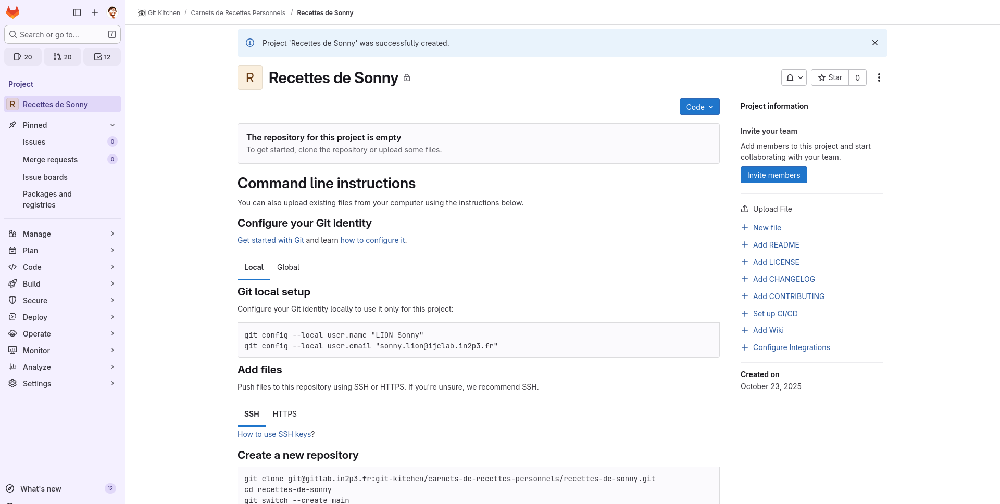
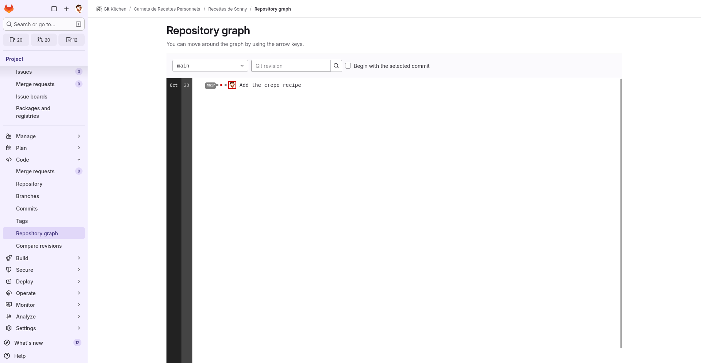

# Création d'un dépôt

Pour regrouper l'ensemble des carnets de recettes personnels des cuisiniers,
nous avons avons créé en amont un sous-groupe privé intitulé [« Carnets de
recettes
personnels »](https://gitlab.in2p3.fr/git-kitchen/carnets-de-recettes-personnels)
dans le groupe GitLab « Git Kitchen ». C'est dans ce sous-groupe que vous allez
créer votre propre projet GitLab.

Dans un premier temps, vérifiez que vous avez bien accès au sous-groupe privé
[« Carnets de recettes
personnels »](https://gitlab.in2p3.fr/git-kitchen/carnets-de-recettes-personnels).
Si ce n’est pas le cas, signalez-le nous au plus vite pour que nous puissions
régler le problème.


## Créer un projet GitLab personnel

Dans cette section, tout se passe dans l’interface web de GitLab. Pour créer
votre dépôt personnel de recettes, procédez comme suit :

1. Depuis la page du groupe [« Carnets de recettes
   personnels »](https://gitlab.in2p3.fr/git-kitchen/carnets-de-recettes-personnels),
   cliquez sur « New project → Create blank project ».
2. Renseignez les champs (adaptez à votre identifiant) :
   - Project name : `Recettes de <votre-identifiant>`
   - Project URL, composé de :
      * Project namespace : `git-kitchen/carnets-de-recettes-personnels`
        (proposé automatiquement)
      * Project slug : `recettes-de-<votre-identifiant>` (proposé
        automatiquement)
   - Project description : Par exemple « Mon carnet de recettes personnelles
     pour le TP GitLab. »
   - Visibility level : `Private` (par défaut, hérité du groupe parent)
   - Project configuration : décocher « Initialize repository with a README »
     (nous partons d’un dépôt entierement vide)
3. Cliquez sur « Create project ».

Vous devriez maintenant vous retrouver sur la page principale de votre nouveau
projet GitLab, qui ressemble à ceci :




## Cloner le dépôt sur votre machine

Maintenant que le dépôt GitLab est créé, il est temps de le cloner sur votre
machine. Nous allons suivre la même procédure que dans le [chapitre
précédent](../3-contribution.md) à la différence qu'il s'agit de votre propre
dépôt. Pour rappel, il faut :

1. Récupérer l’URL SSH du dépôt : cliquez sur le bouton bleu « Code » en haut à
   droite, puis copiez l’URL « Clone with SSH ».
2. Créer le clone local

Voud devriez utiliser dans votre terminal des commandes qui ressemblent à ceci
(en adaptant l'URL et le nom de dossier à votre projet GitLab)...

```bash
git clone git@gitlab.in2p3.fr:git-kitchen/carnets-de-recettes-personnels/recettes-de-<votre-identifiant>.git
cd recettes-de-<votre-identifiant>
```

...et elles devraient produire une sortie qui ressemble à ceci :

```text
Cloning into 'recettes-de-<votre-identifiant>'...
Warning: You appear to have cloned an empty repository.
```

Notez l'avertissement. Au moment de cloner le dépôt, git vous signale qu’aucun
fichier ni commit n’existent encore dans votre dépôt. C’est normal à ce stade.

Et en effet, si vous listez le contenu du répertoire :

```bash
ls -a
```

Vous ne verrez que le répertoire caché `.git/`, qui contient les données du
dépôt Git.

Vous pouvez dès lors vérifier que vous êtes bien sur la branche `main` et que la
_remote_ `origin` est bien configurée :

```bash
git status
git remote -v
```


## Structurer le dépôt et ajouter une première recette

L'idée maintenant est de structurer le dépôt en créant un répertoire `recettes/`
qui contiendra vos recettes au format Markdown.

Dans le terminal, on commence par créer le répertoire `recettes/` :

```bash
mkdir -p recettes
```

Puis on ajoute une première recette. Nous vous donnons un exemple avec des
crêpes, n'hésitez pas à utiliser une autre recette selon vos goûts :

```bash
touch recettes/crepes-classiques.md
```

Vous pouvez ensuite ouvrir ce fichier avec votre éditeur de texte préféré (ou le
modifier en ligne de commande) et y ajouter le contenu de la recette. Voici un
exemple de gabarit que vous pouvez utiliser pour structurer votre recette :

```markdown
---
titre: "Crêpes classiques"
description: "Une recette simple et rapide pour des crêpes moelleuses."
auteur: "<votre-identifiant>"
date: 2025-10-06
temps_preparation: "10 min"
temps_cuisson: "15 min"
temps_repos: "—"
difficulte: "Facile"
nombre_personnes: 4
categorie: "Dessert"
cout: "€"
tags:
  - rapide
  - végétarien
image: "/images/crepes-classiques.jpg"
ingredients:
  - "250 g de farine"
  - "3 œufs"
  - "50 g de sucre"
  - "1 pincée de sel"
  - "50 cl de lait"
conseils:
  - "Laissez reposer la pâte 2h pour plus de goût !"
---

# Préparation

1. Mélangez la farine, le sucre et le sel.
2. Ajoutez les œufs puis le lait progressivement en fouettant.
3. Laissez reposer 30 min.
4. Faites cuire les crêpes dans une poêle chaude légèrement huilée.
```


## Versionner et publier la recette

C'est le moment de voir si vous avez bien compris les notions vues précédemment.
Il est temps de versionner votre recette et de la publier sur GitLab. Pour cela,
commencez par observer l’état avant versionnage :

```bash
git status
```

Vous devriez voir que le répertoire `recettes/` est non suivi (untracked). Il
vous faut donc :

1. ajouter le fichier de recette au suivi de Git ;
2. créer un commit local ;
3. pousser ce commit sur le dépôt distant.

Nous vous conseillons dans un premier temps de rester sur la branche `main`, ce
qui n'est pas un gros problème tant que vous travaillez tout seul. Si besoin,
relisez [le chapitre précédent](../3-contribution.md) pour vous remémorer la
procédure.

Une fois ces étapes réalisées, vous pouvez vérifier l’état du dépôt local et
distant avec :

```bash
git log --oneline --graph --decorate
git status
```

L'historique devrait montrer votre commit (à la fois sur la version locale et
distante de `main`), et le statut indiquer que la branche `main` suit bien
`origin/main` et que le répertoire de travail est propre (_clean_).


## Vérifier le contenu du dépôt sur GitLab

Rendez-vous sur la page de votre projet GitLab dans l’interface web (au besoin,
rafraîchissez la page). Vous devriez maintenant voir votre dossier `recettes/`
comme ci-dessous :


En cliquant sur le dossier `recettes/`, vous pourrez voir le fichier de recette
que vous avez ajouté et le consulter en ligne. Gitlab affiche automatiquement le
rendu Markdown du fichier. Vous pouvez aussi consulter la version brute en
cliquant sur le bouton « Raw ».

Rendez-vous maintenant dans « Code > Repository graph » pour afficher
l'historique des commits :



Vous devriez voir votre commit apparaître dans le graphique.


## Conclusion

Dans ce chapitre, vous avez appris à créer votre propre dépot au sein du
sous-groupe privé et à y versionner vos fichiers. Vous avez pu mettre en
pratique les notions vu lors des chapitres précédents pour versionner puis
publier une première recette de cuisine sur GitLab.

Vous avez maintenant les bases pour gérer votre propre dépôt GitLab. Dans la
suite, nous allons voir comment mettre en place quelques automatisations pour
[valider automatiquement le contenu de votre dépôt](3-integration-continue.md) à
chaque modification.

---

## Exercices

Jusqu'ici nous avons travaillé sur `main`, mais nous allons bientôt voir que
cela a des inconvénients. Il est donc préférable de prendre tôt l'habitude de
faire ses tests sur des branches dédiées. Voici un exercice pour vous y
entraîner tout en révisant le mécanisme des _Merge Requests_ :

1. Dans une nouvelle branche, ajoutez une image de présentation dans un dossier
   `images/` et référencez-la dans votre recette (champ `image:`).
2. Poussez les changements et visualisez l'image dans l'interface web de GitLab
   (vous aurez besoin pour ça de basculer la visualisation, qui est par défaut
   sur la branche `main`, sur votre branche de travail).
3. Créez une _Merge Request_ depuis votre branche de travail vers votre branche
   `main`, visualisez celle-ci dans l'interface de GitLab, puis fusionnez-la.

## Antisèche

Cloner un dépôt (SSH) :

```bash
git clone git@gitlab.in2p3.fr:<groupe>/<projet>.git
```

Vérifier l’état et la remote :

```bash
git status
git remote -v
```

Publier une branche et définir le suivi :

```bash
git push --set-upstream origin <branche>
```

---

## Informations complémentaires

### Nettoyage des branches distantes

Pensez à supprimer les branches devenues inutiles après fusion (option GitLab
lors du _merge_, ou `git push origin --delete <branche>`), ainsi que leurs
homologues dans votre dépôt local (`git branch -d <branche>`) sinon celles ci
risquent de s'accumuler très vite au sein de vos dépôts...
