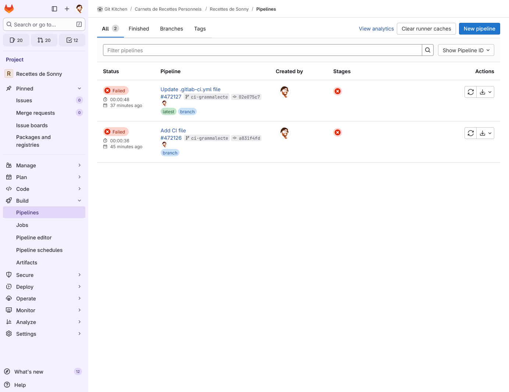
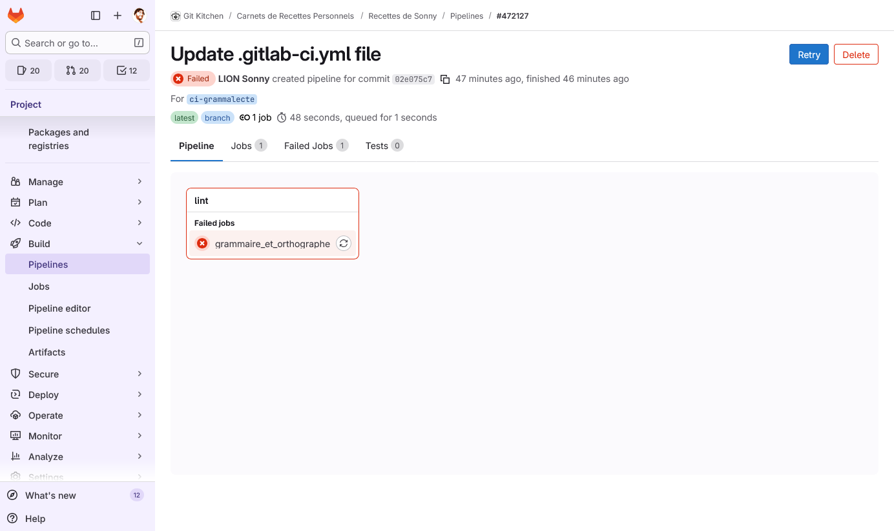

# Bases de l’intégration continue

Écrire des recettes, c’est bien. Bien les écrire, c’est encore mieux ! Le
concept d’intégration continue (_Continuous Integration_, ou en abrégé CI)
désigne l’automatisation de tâches de validation et de vérification. Cela
permet, par exemple, de s’assurer que le contenu d'une branche respecte
certaines normes de qualité avant qu'il ne soit fusionné dans la branche
principale.

Dans notre cas, nous allons mettre en place une intégration continue qui
vérifiera automatiquement l’orthographe, la grammaire et certaines règles
typographiques de vos recettes rédigées en Markdown, à l’aide de
[Grammalecte](https://grammalecte.net/).


## Tour d'horizon de GitLab CI

L'intégration continue est un sujet complexe, riche en concepts et en jargon
spécifique à chaque forge. Nous vous proposons donc avant de commencer la
pratique un petit survol des concepts et du jargon de GitLab, dont nous allons
approfondir plusieurs points par la suite.

Le système d'intégration continue de GitLab s'appelle [GitLab
CI/CD](https://docs.gitlab.com/ci/) et il se configure avec un fichier YAML
appelé `.gitlab-ci.yml` que vous devez créer à la racine de votre dépôt.

Ce fichier YAML contient la description d'un _pipeline_, c'est à dire un
ensemble de tâches (_jobs_) où chaque tâche est une [séquence de commandes
_shell_](https://docs.gitlab.com/ci/yaml/#script) vouée à s'exécuter à chaque
fois que de nouveaux commits sont poussés au sein du dépôt.[^triggers] On
définit aussi généralement une [séquence d'étapes
(_stages_)](https://docs.gitlab.com/ci/yaml/#stages) en s'assurant que [chaque
_job_ est affecté à une étape](https://docs.gitlab.com/ci/yaml/#stage), ce qui
permet de structurer l'exécution des _jobs_ de la façon suivante :

- Les étapes d'un _pipeline_ s'exécutent dans l'ordre de la séquence, en
  attendant que les _jobs_ associés à chaque étape soit terminés avant de
  traiter l'étape suivante.
- Les _jobs_ associés à une même étape sont par défaut[^needs] considérés comme
  indépendants et peuvent s'exécuter en parallèle dans la limité des ressources
  disponibles.

A partir du moment où un fichier `.gitlab-ci.yml` est présent au sein d'une
branche, chaque _push_ qui introduit de nouveaux commits au sein de cette
branche déclenche l'exécution du _pipeline_ selon la logique décrite ci-dessus.
Etape par étape, les _jobs_ sont soumis à un ensemble de serveurs chargés de les
exécuter, appelés exécuteurs (_runners_), en visant idéalement à exécuter tous
les _jobs_ d'une même étape en parallèle dans la limite des ressources
disponibles.

Mais vous pouvez facilement imaginer que si l'on multiplie ensemble un grand
nombre de _jobs_ par étapes, de _pipelines_ qui s'exécutent simultanément et de
projets GitLab, exécuter tous les _jobs_ simultanément nécessite beaucoup
d'exécuteurs, donc [beaucoup de ressources
informatiques](https://arxiv.org/abs/2510.26413). Le CC-IN2P3 n'a pas la
possibilité d'offrir bénévolement autant de ressources à la très large
communauté d'utilisateurs de son instance GitLab, il a donc choisi la politique
suivantes :

- Chaque _job_ doit travailler sous des limites de ressources drastiques, pas
  toujours clarifiées. Tout ce qui est [documenté clairement
  ](https://doc.cc.in2p3.fr/fr/Collaborative-tools/gitlab/gitlab-cicd.html),
  c'est qu'un _job_ dispose de 4 VCPUs et 2 Go de RAM, soit 512 Mo de RAM par
  VCPU. Il est facile d'atteindre cette limite, notamment avec des tâches de
  compilation C++, et difficile de décoder les messages d'erreur qui en
  découlent.
- Toute personne qui a besoin de davantage de ressources ou de faire des tests
  sur un OS autre que Linux est [cordialement 
  invitée](https://doc.cc.in2p3.fr/fr/Collaborative-tools/gitlab/gitlab-cicd.html#construire-une-infrastructure-ci-cd)
  à mettre en place et maintenir [ses propres
  exécuteurs](https://docs.gitlab.com/runner/).

Dans la suite de cette formation, nous ne détaillerons pas davantage cette
notion d'exécuteur, et prendrons pour acquis que ceux qui sont fournis par le
CC-IN2P3 sont suffisants, afin de pouvoir nous concentrer davantage sur la
définition des _pipelines_.

[^needs]: Il est possible de définir des dépendances directes entre _jobs_ via
          le mot-clé [`needs`](https://docs.gitlab.com/ci/yaml/#needs). Ce mode
          d'ordonnancement des _jobs_ est plus flexible et permet souvent de
          mieux utiliser les ressources disponibles, mais il est aussi plus
          difficile à maîtriser car il est facile d'oublier une dépendance et on
          ne le repérera pas forcément tout de suite si les ressources
          disponibles au moment du test sont insuffisantes pour exposer des
          possibilités de parallélisme qui n'ont pas lieu d'être.

[^triggers]: Il est possible de déclencher un _pipeline_ en réponse à d'autres
             événements, par exemple à intervalles de temps régulier ou
             récursivement depuis le _pipeline_ d'un autre dépôt sur la même
             forge, mais ces techniques avancées dépassent largement le cadre de
             cette formation. Nous verrons en revanche en annexe comment
             restreindre l'exécution du _pipeline_ à certains commits en
             particulier.


## Préparation

Avant de commencer, assurez-vous que votre répertoire de travail est propre
(aucune modification en cours), que votre dépôt est à jour (synchronisé avec le
dépôt distant sur GitHub) et que vous êtes sur la branche `main`.

Créez ensuite une branche dédiée à la mise en place de l’intégration continue :

```bash
git checkout -b ci-grammalecte
```


## Créer le fichier `.gitlab-ci.yml`

On l'a vu, sur GitLab, l'intégration continue est configurée à l’aide d’un
fichier YAML nommé `.gitlab-ci.yml`.

À la racine de votre dépôt, créez ce fichier :

```bash
touch .gitlab-ci.yml
```

Dans un premier temps, nous allons y définir une seule étape, appelée
`lint`[^lint], chargée de vérifier la qualité du texte.

Pour cela, ouvrez le fichier `.gitlab-ci.yml` avec votre éditeur préféré et
collez-y le texte suivant pour définir l'étape unique `lint` avec le mot-clé
[`stages`](https://docs.gitlab.com/ci/yaml/#stages) :

[^lint]: C’est le nom généralement utilisé pour ce type d’étape dédiée à la
         vérification du code, mais rien ne vous empêche d’en choisir un autre.

```yml
stages:
  - lint
```


## Définir le _job_ d’analyse

L’étape `lint` comprendra un seul _job_, intitulé `grammaire_et_orthographe`,
chargé d’analyser le contenu des recettes.

Ce _job_ nécessite un environnement Python afin d’exécuter Grammalecte. Pour
simplifier la gestion d’environnements parfois hétérogènes (chaque _job_ ayant
ses propres dépendances), GitLab CI/CD permet d’utiliser des [images
Docker](https://hub.docker.com/). Celles-ci offrent des environnements
préconfigurés couvrant un large éventail de besoins.

Ici, nous utiliserons l’image officielle `python:3.12`, qui contient la dernière
version de Python 3.12 :

```yml
# ...après la définition des étapes...

grammaire_et_orthographe:
  stage: lint
  image: python:3.12
  # ... d'autres instructions viendront ici plus tard ...
```

Nous commençons par donner un nom au _job_, ici  `grammaire_et_orthographe`.
Puis avec le mot-clé [`image`](https://docs.gitlab.com/ci/yaml/#image), nous
indiquons à GitLab d’utiliser cette image Docker pour exécuter le _job_. Et avec
le mot-clé [`stage`](https://docs.gitlab.com/ci/yaml/#stage), nous précisons au
sein de quelle étape du _pipeline_ ce _job_ va s'exécuter.


### Installer Grammalecte

Nous devons maintenant expliquer à GitLab comment installer Grammalecte dans
l’environnement Python fourni par l’image Docker. Nous utiliserons `pip`, le
gestionnaire de paquets Python, pour installer une surcouche de Grammalecte
nommée `grammalint`, disponible
[ici](https://gitlab.in2p3.fr/sonny.lion/grammalint).

La commande d’installation est la suivante :

```bash
python -m pip install git+https://gitlab.in2p3.fr/sonny.lion/grammalint.git
```

Nous allons indiquer à gitlab d'exécuter cette commande au sein du _job_
`grammaire_et_orthographe` avec le mot-clé
[`before_script`](https://docs.gitlab.com/ci/yaml/#before_script). Celui-ci est
distinct du mot-clé `script` que nous allons utiliser par la suite pour la
vérification orthographique, afin de séparer clairement la phase d’installation
de celle d’exécution et ainsi d'améliorer la lisibilité[^before-script] :

```yml
grammaire_et_orthographe:
  # ... instructions précédentes ...
  before_script:
    - python -m pip install git+https://gitlab.in2p3.fr/sonny.lion/grammalint.git
  # ... d'autres instructions viendront ici plus tard ...
```

[^before-script]: Ici nous utilisons uniquement `before_script` pour améliorer
                  la lisibilité du fichier de configuration GitLab CI. Mais dans
                  des projets plus gros, `before_script` est aussi utile pour
                  définir des étapes de préparation communes à plusieurs _jobs_,
                  lorsqu'on on l'utilise en combinaison avec
                  [`extends`](https://docs.gitlab.com/ci/yaml/#extends).


### Configurer l’analyse des fichiers

Une fois `grammalint` installé, il faut indiquer à GitLab comment lancer
l’analyse des fichiers Markdown. Pour vérifier un fichier spécifique, on utilise
la commande suivante :

```bash
python -m grammalint -i recettes/crepes-classiques.md
```

Pour analyser tous les fichiers Markdown du dossier `recettes/` (y compris ceux
des sous-dossiers), on utilise la commande suivante :

```bash
python -m grammalint -i recettes/**/*.md
```

En intégrant cette seconde commande à notre _job_ avec le mot-clé
[`script`](https://docs.gitlab.com/ci/yaml/#script), le fichier de configuration
GitLab CI complet devient :

```yml
stages:
  - lint

grammaire_et_orthographe:
  stage: lint
  image: python:3.12
  before_script:
    - python -m pip install git+https://gitlab.in2p3.fr/sonny.lion/grammalint.git
  script:
    - python -m grammalint -i recettes/**/*.md
```


## Mettre à l’épreuve le _pipeline_

Une fois votre fichier `.gitlab-ci.yml` prêt, il est temps de vérifier que tout
fonctionne.

Pour cela, versionnez le fichier et poussez-le (_push_) sur le dépôt distant.
Rendez-vous ensuite dans l’interface web de GitLab, section **Build >
Pipelines**, pour observer le _pipeline_ en action. Vous devriez voir une page
similaire à celle-ci :



Chaque ligne correspond à un _pipeline_ exécuté sur votre dépôt. La colonne
**Status** indique son état (en cours, réussi, échoué, etc.), tandis que
**Stages** affiche les différentes étapes et leur statut.

Si le _pipeline_ ne s’exécute pas, vérifiez que...

- le fichier s’appelle bien `.gitlab-ci.yml` (avec le point au début) ;
- il est placé à la racine du dépôt ;
- votre _push_ a bien été effectué sur GitLab.


## Consulter les journaux du _pipeline_

Si votre _pipeline_ est en cours, patientez quelques instants puis actualisez la
page pour voir le résultat. En cas de succès, une icône verte avec une coche
apparaîtra dans la colonne **Status** ; en cas d’échec, une croix rouge.

Pour comprendre ce qui s’est passé durant l’exécution, cliquez sur le statut du
_pipeline_ (l’icône verte ou rouge) afin d’accéder à sa page de détails :



Vous y verrez la liste des étapes (_stages_) et des _jobs_ associés. Cliquez sur
le _job_ `grammaire_et_orthographe` pour afficher les journaux (_logs_).

L’ordre d’exécution typique est le suivant :

- Téléchargement de l’image Docker `python:3.12`
- Installation du paquet `grammalint`
- Analyse des fichiers Markdown

Une fois l’analyse terminée, le message suivant indique que tout s’est bien
déroulé :

```text
...
Job succeeded
```

En revanche, si Grammalecte a détecté des erreurs dans vos fichiers, le _job_ se
terminera ainsi :

```text
10 min
^^^^^^
* 1 [0:6]  # #1117p / unit_nbsp_avant_unités1:
  Avec une unité de mesure, mettez un espace insécable.
  > Suggestions : 10 min

...

ERROR: Job failed: exit code 1
```

Enfin, le _job_ peut échouer avant même d’exécuter Grammalecte, par exemple si
l’installation de `grammalint` échoue ou si le fichier `.gitlab-ci.yml` est mal
formé. Dans ce cas, n’hésitez pas à nous demander de l’aide.


## Corriger et rejouer le _pipeline_

Si des erreurs sont signalées, demandez-vous : s’agit-il de fautes réelles
(orthographe, grammaire, typographie) ou de faux positifs ? Cette réflexion est
essentielle : en intégration continue, il ne faut pas corriger mécaniquement,
mais comprendre la cause et la pertinence de chaque alerte.

Selon les erreurs détectées :

1. Corrigez vos fichiers Markdown localement (ou ajustez la configuration de
   Grammalecte si nécessaire).
2. Versionnez les modifications, puis effectuez un nouveau _push_.
3. GitLab relancera automatiquement un **nouveau _pipeline_**.


## Artefacts et rapports d’analyse

Les **artefacts** sont des fichiers produits par un _job_ (rapports, journaux,
fichiers d’analyse, etc.) et conservés par GitLab. Ils peuvent être téléchargés
directement depuis l’interface web.

Pour générer un rapport JSON avec `grammalint`, modifiez la commande `script` du
_job_ `grammaire_et_orthographe` pour ajouter l'option `-o report.json`:

```yml
grammaire_et_orthographe:
  # ... instructions précédentes ...
  script:
    - python -m grammalint -i recettes/**/*.md -o report.json
```

Puis ajoutez une section
[`artifacts`](https://docs.gitlab.com/ci/yaml/#artifacts) pour indiquer à GitLab
que le fichier doit être conservé en fin de _job_ :

```yml
grammaire_et_orthographe:
  # ... instructions précédentes ...
  artifacts:
    paths:
      - report.json
    expire_in: 1 week # Durée de conservation (optionnelle, mais recommandée pour éviter l’encombrement du stockage)
```

Le fichier `report.json` apparaîtra alors dans la page du _job_, sous l’onglet
**Artifacts**, et pourra être téléchargé. Il est également possible de récupérer
tous les artefacts d’un _pipeline_ depuis la page listant les _pipelines_.

Nous le verrons plus en détail dans la prochaine séquence, mais notez que les
artefacts peuvent aussi être utilisés pour transférer des fichiers entre
différents _jobs_ d’un même _pipeline_.


## Conclusion

Dans ce TP, nous avons découvert comment GitLab permet de mettre en place une
**intégration continue** simple mais efficace pour nos projets. Nous avons
appris à :

- Définir un _pipeline_ d’intégration continue avec le fichier `.gitlab-ci.yml`
- Créer et configurer un _job_ d’analyse automatique avec Grammalecte
- Surveiller l’exécution du _pipeline_ et interpréter les résultats dans
  l’interface GitLab
- Générer et consulter des rapports d’analyse sous forme d’artefacts

Avec ces notions, nous disposons désormais d’un outil capable de vérifier
automatiquement la qualité de nos fichiers Markdown à chaque modification.

Dans la prochaine séquence, nous irons plus loin en découvrant comment enchaîner
plusieurs _jobs_, gérer des dépendances entre étapes et construire des
_pipelines_ plus complets et adaptés à des projets collaboratifs.


---

## Exercices

1. Ajoutez un second fichier de recette (avec des fautes), vérifiez que
   l’analyse le prend bien en compte et que le _pipeline_ échoue.
2. Téléchargez le rapport JSON depuis l’onglet **Artifacts** et consultez son
   contenu.
3. Corrigez les fautes, effectuez un _push_ et vérifiez que le _pipeline_
   réussit.
4. Fusionnez les changements de `ci-grammalecte` dans `main` avec une _Merge
   Request_.

Notez que l'interface de passage en revue des _Merge Requests_ vous permet de
savoir si un _pipeline_ d'intégration continue a réussi ou échoué avant
d'effectuer la fusion dans `main`. En passant systématiquement par une branche
dédiée et une _Merge Request_, vous pouvez donc facilement éviter d'intégrer à
`main` des changements qui ne respectent pas votre politique qualité.

Dans cette optique, nous verrons bientôt comment garantir que toutes les
modifications à un projet passent par une _Merge Request_ en interdisant le
_push_ direct de changements dans `main`.


---

## Informations complémentaires

### Conditionner l’exécution d’un _job_

Par défaut, les _jobs_ s’exécutent à chaque _push_ sur n’importe quelle branche.
Vous pouvez toutefois restreindre leur exécution à certaines branches, aux
_Merge Requests_ (MR), ou encore à la branche principale `main`. Cela permet
d’éviter une utilisation excessive des ressources des _runners_ et de réduire le
temps d’exécution des _pipelines_.

Par exemple, si vous avez un _job_ de test long que vous ne souhaitez exécuter
que...

- sur la branche `main` ;
- ou lors d’une _Merge Request_ visant `main` ;

...vous pouvez fixer ces conditions d'exécution avec une section
[`rules`](https://docs.gitlab.com/ci/yaml/#rules) au sein de la définition du
_job_ :

```yml
mon_job_trop_long:
  # ... instructions précédentes ...
  rules:
    - if: $CI_COMMIT_BRANCH == "main" # Exécution sur la branche principale
    - if: $CI_MERGE_REQUEST_TARGET_BRANCH_NAME == "main" # Exécution sur les MR vers main
```
