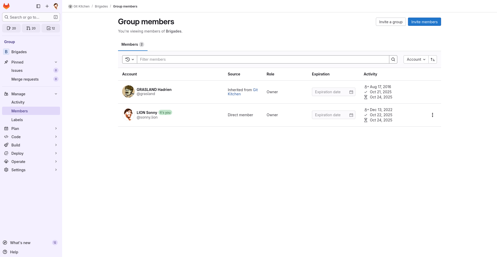

# Un projet GitLab commun

Après avoir préparé votre propre carnet de recettes, il est temps de passer en
cuisine à plusieurs ! Dans cette partie, vous allez former des **équipes de 2 à
4 personnes** pour créer un **livre de recettes collaboratif**.


## Création de la brigade

Dans chaque groupe, désignez un chef de projet, que nous appellerons dans la
suite le **chef cuisinier**. C’est cette personne qui sera responsable de créer
le dépôt commun au sein d’un groupe privé dans le sous-groupe
[Brigades](https://gitlab.in2p3.fr/git-kitchen/brigades) sur GitLab. Prenez
ensuite un moment pour choisir ensemble un nom de brigade original et
représentatif.

Le chef cuisinier devra ensuite se signaler (pour permettre aux formateurs de
vérifier l’équilibre des groupes), puis créer le sous-groupe de sa brigade dans
le sous-groupe [Brigades](https://gitlab.in2p3.fr/git-kitchen/brigades). Nous
conseillons à tous les membres de l'équipe de suivre ce que fait le chef
cuisinier sur son poste afin que chacun se familiarise avec la création de
groupe sur GitLab.

Pour créer le sous-groupe :

1. Rendez-vous sur la page du sous-groupe
   [Brigades](https://gitlab.in2p3.fr/git-kitchen/brigades).
2. Cliquez sur **New subgroup**.
3. Remplissez les champs suivants :
   * **Subgroup name** : le nom de votre brigade (ex. `La Bonne Humeur`)
   * **Subgroup URL** : générée automatiquement à partir du nom choisi
   * **Visibility Level** : `Private` (héritée du groupe parent)
4. Cliquez sur **Create subgroup**.


## Inviter les rédacteurs et gérer les permissions

Le chef cuisinier peut désormais inviter ses camarades à rejoindre sa brigade.
Depuis la page du sous-groupe nouvellement créé, sélectionnez dans la barre
latérale **Manage > Members**, puis cliquez sur le bouton bleu **Invite
members** :



Ajoutez les identifiants GitLab de vos coéquipiers et attribuez-leurs un
[rôle](https://docs.gitlab.com/user/permissions/) adapté, qui définit ce qu'ils
ont la permission de faire au sein de la brigade :

| **Rôle GitLab**      | **Permissions principales**                                                                         | **Utilisation recommandée**                      |
| -------------------- | --------------------------------------------------------------------------------------------------- | ------------------------------------------------ |
| **Guest**            | Peut voir et commenter des _issues_. Pas d’accès aux dépôts privés.                                 | Invités, relecteurs ponctuels, testeurs          |
| **Planner**          | Peut planifier, c'est à dire créer et gérer des _issues_, _milestones_ etc. Pas d’accès aux dépôts. | Coordinateurs, chefs de projets si DevOps dédiés |
| **Reporter**         | Peut lire le code, les _pipelines_/rapports et créer des _issues_. Pas de _push_.                   | Relecteurs techniques (QA, PO)                   |
| **Developer**        | Peut créer des branches, pousser sur branches non protégées et ouvrir des _merge requests_.         | Développeurs                                     |
| **Maintainer**       | Peut fusionner les _merge requests_, gérer les branches protégées, la CI/CD et les membres.         | Chefs de projet ou DevOps dédiés                 |
| **Owner**            | Contrôle total du groupe/projet (visibilité, transfert, suppression).                               | Propriétaire du groupe (rarement délégué)        |

Pour des raisons de sécurité, il est préférable de donner aux utilisateurs les
permissions les plus limitées qui conviennent pour leur tâche. Ici, vous devriez
tous pouvoir interagir avec le dépôt pour pratiquer git, donc ce serait des
permissions de type **Developer**.

<div class="warning">

Au-delà de la formation, vous ne devriez donner ces permissions qu'à des
personnes de confiance, car elles offrent déjà la possibilité de faire pas de
dégats. Par exemple, une personne avec des permissions d'accès Developer à un
dépôt peut déjà [publier des versions malveillantes d'un
logiciel](https://en.wikipedia.org/wiki/XZ_Utils_backdoor) ou modifier/supprimer
les branches de développement de tout le monde.

Pour accepter des contributions d'inconnus, comme c'est l'usage en _open
source_, le mode de fonctionnement basé sur les _forks_ et les _pull requests_
qui est décrit dans le parcours [« GitHub
ouvert »](../../github/3-contribution.md) est donc plus adapté. Il est hélas
difficile de l'utiliser sur l'instance GitLab de l'IN2P3 en raison de sa
politique administrative,[^gitlab-in2p3-forks] mais on peut l'utiliser sur
d'autres instances GitLab comme [celle du CERN](https://gitlab.cern.ch) et
l'instance commerciale [GitLab.com](https://about.gitlab.com/pricing/).

Sur ces instances, la _merge request_ de GitLab fonctionne quasi-exactement
comme la _pull request_ de GitHub, et peut donc être utilisée de la même façon.

</div>

[^gitlab-in2p3-forks]: Le centre de calcul de l'IN2P3, qui gère l'instance
                       GitLab que nous utilisons ici, a fait le choix
                       d'interdire à tous les utilisateurs créés depuis quelques
                       années de créer des dépôts en leur nom propre. En effet,
                       ceux-ci créent une charge de travail importante pour les
                       administrateurs de l'instance GitLab au moment du départ
                       des personnels non permanents, où il faut retrouver et
                       contacter leurs collègues pour décider du devenir de
                       leurs projets GitLab. Transfert à un autre membre de
                       l'équipe ? Suppression ? Depuis cette époque, les
                       utilisateurs ne peuvent créer des projets GitLab qu'au
                       sein de groupes dont ils sont membres, ce qui empêche 
                       l'utilisation habituelle des _forks_ pour l'accueil des
                       contributions extérieures.


## Créer le livre de recettes collaboratif

Une fois le sous-groupe créé, il faut maintenant créer le dépôt GitLab qui
contiendra le **livre de recettes collaboratif**. Le chef cuisinier suit pour
cela les mêmes étapes que dans le [TP
précédent](../4-depot-personnel/2-creation-depot.md) :

1. Accédez au [groupe GitLab de votre brigade](https://gitlab.in2p3.fr/git-kitchen/brigades).
2. Cliquez sur **New project → Create blank project**.
3. Donnez un nom au projet, par exemple :

   ```bash
   Le Livre de la Bonne Humeur
   ```

   ou

   ```bash
   Tout sur la Patate Douce
   ```

   (Faites preuve d’imagination et mettez-vous d’accord entre vous !)
4. Ajoutez une description, par exemple :
   « Un livre collaboratif regroupant nos meilleures recettes maison. »

5. Choisissez la visibilité **Private** (afin de rester entre cuisiniers
   avertis, héritée du sous-groupe).
6. Cliquez sur **Create project**.

Le chef cuisinier accède alors à une page de projet GitLab vide, prête à
accueillir vos créations. Les membres de la brigade héritent automatiquement des
permissions définies au niveau du sous-groupe et peuvent dès à présent
contribuer au projet. Mais pour plus de sécurité, il est préférable de mettre
aussi en place une protection de la branche `main` avant de continuer.


## Protéger la branche principale

Dans la méthode de travail classique utilisée par cette formation, la branche
`main` du dépôt a un statut spécial d'historique officiel du projet. Par
exemple...

- Quand on visualise le dếpôt dans l'interface web, on voit d'abord cette
  branche.
- Le site web officiel du projet est typiquement généré à partir de cette
  branche.
- Pour les projets logiciels, les versions que l'on publie sous forme de paquets
  (ex: v2.0.0) dérivent souvent de commits _taggés_ sur cette branche.
- Les contributions extérieures dérivent de cette branche et sont fusionnées en
  son sein.

Tout ceci fait qu'on souhaite souvent s'imposer et imposer aux autres une
certaine prudence dans la manipulation de cette branche. Et la façon la plus
simple de le faire est d'interdire l'ajout direct de commits à cette branche par
_push_ direct. A la place, on impose l'utilisation de _merge requests_ qui
permettent de s'assurer que les nouvelles contributions ont été revues par
quelqu'un d'autre, passent les tests techniques, et plus généralement respectent
la politique qualité du projet.

On peut interdire le _push_ direct sur `main` en configurant le mécanisme des
branches protégées de GitLab de la façon suivante :

1. Dans l’interface web de GitLab, allez dans « Settings → Repository ».
2. Dans la section « Protected branches », la branche `main` devrait déjà
   apparaître dans la liste des branches protégées.
3. Editez la valeur « Allowed to push and merge » pour restreindre les droits
   d'accès et empêcher quiconque de pousser directement sur `main`.

Essayez maintenant de modifier le fichier de recette
`recettes/crepes-classiques.md` en local, de faire un commit, puis de pousser
directement sur `main`. Si la protection est bien en place, GitLab devrait
refuser le _push_ avec un message d'erreur indiquant que la branche est protégée
:

```text
...
remote: GitLab: You are not allowed to push code to protected branches on this project.
...
```

Il ne vous reste alors qu'à créer une branche pour pouvoir intégrer vos
modifications via une _merge request_. N'hésitez pas à relire la [section
précédente](../3-contribution.md) si besoin.

Une fois la branche et la _merge request_ créées, vous pourrez fusionner vos
modifications dans `main` via l'interface web de GitLab. Pour cela rendez-vous
dans l'onglet « Code > Merge Requests », sélectionnez votre _merge request_,
puis cliquez sur le bouton bleu « Merge » pour finaliser l'intégration.

Vous pourrez alors retourner voir le contenu et le graphique des commits de
votre dépôt pour vérifier que vos modifications ont bien été intégrées dans
`main`.


## Organiser le travail avec les tickets (_issues_)

Avant de plonger vous plonger dans la rédaction des recettes, il faut planifier
et organiser les tâches à accomplir.

Gitlab propose pour cela un outil simple et efficace : les **tickets**
(_issues_). Les **tickets** vous permetteront par exemple de proposer de :

* proposer une **nouvelle recette** (« Créer la recette du fondant au chocolat »),
* proposer une **correction** (« Erreur sur les proportions du gâteau au yaourt »),
* ou encore suggérer une **amélioration** (« Ajouter une photo à la recette des
  crêpes »).

Un **ticket** peut aussi être découpé en plusieurs sous-tâches pour mieux
répartir le travail.


### Créer un ticket

Chaque membre du groupe doit créer au moins un ticket.
Prenez un moment pour définir les tâches et les répartir clairement.

1. Ouvrez l’onglet **Plan > Issues** et cliquez sur le bouton bleu **New item**.
2. Saisissez le type de ticket
3. Saisissez un titre, par exemple : « Ajouter la recette de la tarte aux pommes
   classique ».
4. Dans la description, vous pouvez préciser par exemple :
   * le type de recette ou de correction ;
   * les contraintes éventuelles (ex. « prévoir une version sans gluten ») ;
5. Assignez le ticket à un membre de la brigade.
6. Ajoutez des _labels_ pour faciliter le tri des tickets (ex.
   `nouvelle-recette`, `correction`)[^labels].
7. Cliquez sur **Create issue**.

Votre ticket s’affiche maintenant dans la liste des _issues_, visible par toute
la brigade.

[^labels]: Vous pouvez utiliser les _labels_ GitLab pour organiser vos _issues_
           par type, priorité ou encore statut (ex. `à faire`, `urgent`, `en
           cours`, `terminé`, `CI/CD`, `recette`). Vous retrouverez quelques
           exemples d'utilisation des _labels_ sur [le projet GitLab associé à
           cette
           formation](https://gitlab.in2p3.fr/grasland/formation-git/-/issues).


## Cloner le dépôt du livre en local

Chaque rédacteur (y compris le chef) doit maintenant cloner le projet sur sa
machine afin d’y ajouter des recettes.

Vous commencez à connaître la procédure :

1. Depuis la page du projet, cliquez sur **Code > Clone with SSH**.
2. Copiez l’URL affichée.
3. Exécutez `git clone` dans votre terminal en utilisant l’URL à votre projet
4. Accédez au dossier du projet cloné
5. Créez une branche !


## Du ticket à la _merge request_ : un flux de travail collaboratif

Vous allez travailler à plusieurs sur le même dépôt Git. Pour limiter les
conflits, il est impératif de toujours créer une nouvelle branche pour chaque
recette ou correction. Essayez aussi tant que possible de limiter la durée de
vie de vos branches pour faciliter les fusions.

Pour simplifier la collaboration et fluidifier le processus de contribution,
nous vous proposons de suivre la démarche suivante :

1. Choisir un ticket à traiter
2. Créer une branche dédiée avec un nom explicite et le numéro du ticket (ex.
   `123-recette-tiramisu` pour le ticket #123)[^branch-from-issue]
3. Modifier ou ajouter la recette/correction [^close-with-commit]
4. Pousser la branche sur GitLab
5. Créer une demande de fusion (_merge request_) pour intégrer les modifications
   dans la branche principale `main`
6. Assigner un relecteur (un autre membre de la brigade)[^reviewer] pour valider
   les modifications avant fusion
7. Corriger en fonction des retours éventuels
8. Fusionner la _merge request_ une fois validée[^cleanup-branch]

[^branch-from-issue]: Il est possible de créer une branche directement depuis un
ticket en cliquant sur le bouton chevron à droite du bouton **Create merge
request**. GitLab créera automatiquement une branche nommée d’après le ticket.

[^close-with-commit]: Pour fermer automatiquement le ticket une fois la _merge
request_ fusionnée, ajoutez `fixes #<numéro-du-ticket>` dans le message du
commit ou de la _merge request_ (ex. `fixes #123` pour le ticket #123).

[^reviewer]: Pour garantir la qualité des contributions, il est recommandé de
confier la relecture à une personne autre que l’auteur. En effet, il est souvent
plus facile de repérer les erreurs dans le travail des autres que dans le sien.

[^cleanup-branch]: Après la fusion de la _merge request_, pensez à supprimer la
branche de travail locale et distante pour garder un dépôt propre. Vous pouvez
le faire via l’interface GitLab en cochant l’option **Delete source branch**
lors de la fusion de la _merge request_, et en local avec la commande `git
branch -d <nom-de-la-branche>`.

<div class="warning">

Pour éviter les conflits, n’oubliez pas de toujours synchroniser votre branche
locale avec la branche <code>main</code> avant de créer une nouvelle branche de
travail. Pensez aussi à régulièrement mettre à jour votre branche de travail
avec les dernières modifications de <code>main</code> via la commande
<code>rebase</code> pour garder un historique propre.

</div>

À vous de jouer ! Créez vos tickets, ajoutez vos meilleures recettes, rédigez
vos _merge requests_ et regardez votre livre de cuisine collaboratif prendre
forme, page après page.

## Conclusion

Dans ce TP, vous avez découvert comment travailler en équipe sur GitLab et gérer
un dépôt commun. En particulier, vous avez appris à :

- Créer un groupe GitLab commun pour héberger un projet collectif ;
- Inviter et gérer les membres avec des rôles et des permissions adaptés à leur
  fonction ;
- Protéger la branche `main` pour imposer l'utilisation de _merge requests_.
- Organiser le travail grâce aux tickets (_issues_) pour répartir clairement les
  tâches ;
- Créer des branches pour chaque contribution et assurer un flux de travail
  propre et sans (trop de) conflit ;
- Soumettre et relire les modifications via les merge requests, afin de garantir
  la qualité et la cohérence du projet.

Grâce à ces notions, votre brigade dispose désormais de bases solides pour
collaborer efficacement sur tout type de projet GitLab, qu’il s’agisse d’un
simple livre de recettes ou d’un véritable projet de développement logiciel.

Dans la [prochaine section](3-deploiement-continu.md), nous reprendrons les
notions d’intégration continue abordées précédemment et les transposerons à ce
nouveau contexte collaboratif. Nous verrons comment utiliser cet outil pour vous
accompagner dans vos demandes de fusion et automatiser certaines vérifications.
Et enfin nous aborderons la mise en ligne de votre livre de recettes sous la
forme d’un site web statique généré automatiquement à chaque mise à jour du
projet.
