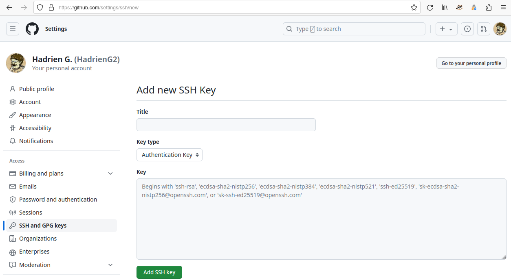
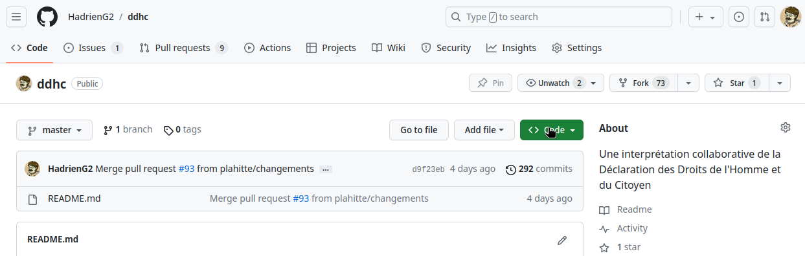
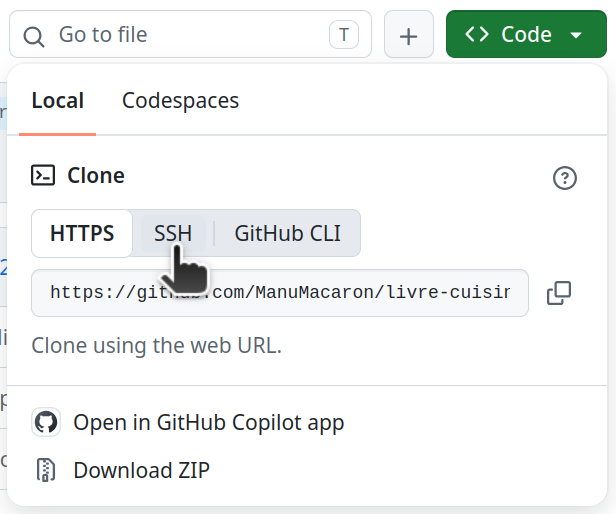

# Réseau et forges

## Introduction

Pour ce dernier TP sur le réseau et les forges sociales, je vous propose de
refaire le monde en vous livrant à un petit exercice d’édition collaborative
autour de la Déclaration des Droits de l’Homme et du Citoyen de 1789.

Pourquoi ce texte, me direz-vous ? Parce que c’est un texte court, très connu,
dans le domaine public, et dont la nature politique se prête naturellement à des
polémiques bon enfant. En un mot, un candidat idéal pour explorer les subtilités
de la gestion de version collaborative.


## Préparations au travail en réseau

### Authentification SSH

Il ne suffit pas de pouvoir vous connecter à l’interface web d’une forge pour
pouvoir échanger librement des _commits_ avec. Vous devez également fournir à
votre utilitaire git local un moyen de confirmer votre identité auprès du
serveur, lors de certaines opérations sensibles comme écrire des _commits_ dans
un dépôt ou lire les _commits_ d’un dépôt privé. On parle d’authentification.

Il existe plusieurs moyens de faire cela. Dans ce TP nous utiliserons
l’authentification SSH, qui est la plus utilisée. Mais vous pouvez consulter la
section « Informations complémentaires » pour plus d’informations sur
l’authentification HTTPS, qui est parfois utilisée comme alternative.

SSH est basé sur le chiffrement à clé publique, qui utilise deux clés de
chiffrement :

- La **clé privée** est une information secrète qui sert à vous authentifier.
  Elle ne doit être transmise à personne, car toute personne qui la possède peut
  se faire passer pour vous.
- La **clé publique** doit être transmise aux services auprès desquels vous
  souhaitez vous authentifier au moyen de votre clé privée. Elle permet de
  vérifier que vous possédez la clé privée, mais pas d’usurper votre identité
  auprès d’autres services connaissant la clé publique.

Votre compte utilisateur sur les machines de TP ne possède pas encore de clés
SSH, mais vous pouvez facilement générer une paire clé privée + clé publique
avec la commande suivante :

```bash
{{#include reseau-forges.sh:ssh-keygen}}
```

`ssh-keygen` va vous poser une série de questions :

- L’endroit où vous souhaitez stocker vos clés. Je vous recommande d’utiliser
  l’emplacement par défaut en appuyant sur Entrée sans rien saisir, cela vous
  évitera de devoir préciser l'emplacement de la clé à tous les utilitaires
  basés sur SSH plus tard.
- La phrase de passe que vous souhaitez utiliser pour protéger votre clé. Pour
  simplifier la formation, je vous recommande de ne pas utiliser de phrase de
  passe, en appuyant deux fois de suite sur Entrée.

<div class="warning">

  Ce second choix mérite plus ample discussion. Sans phrase de passe, votre clé
  privée est stockée dans votre dossier personnel sans chiffrement supplémentaire,
  ce qui est problématique si vous vous retrouvez dans un des cas suivants :
  
  - Votre ordinateur est volé alors que votre disque dur n’était pas chiffré (rare
    au CNRS, où le chiffrement des postes professionnels est obligatoire).
  - Vous partagez votre ordinateur avec d’autres utilisateurs qui ont accès à
    votre dossier personnel, peuvent y changer les permissions de fichiers pour
    rendre votre clé privée SSH lisible (donc ont probablement des privilèges
    administrateur) et ne sont malgré tout pas dignes de confiance.
  - Vous exécutez accidentellement des logiciels malveillants qui s’empressent
    d’envoyer une copie de votre clé privée à un tiers malveillant.
  
  Toutefois, les méthodes permettant de protéger votre clé SSH de ce type
  d’attaque sans se retrouver à saisir une phrase de passe à chaque utilisation de
  git sont un peu complexes et dépendent du système d’exploitation utilisé.
  
  Pour simplifier cette formation, qui est effectuée dans un cadre contraint et
  pour une durée limitée, à l’issue de laquelle votre compte utilisateur et sa clé
  SSH seront détruits, je vous propose d'accepter le risque de travailler sans
  phrase de passe.

</div>

Une fois votre paire de clés SSH générée avec `ssh-keygen`, il ne vous reste
plus qu’à afficher votre clé publique, par exemple avec `cat`…

```bash
{{#include reseau-forges.sh:show-pubkey}}
```

…puis à la copier (avec un clic droit ou Ctrl+Maj+C) et la coller dans
l’interface web de gestion de clé SSH de votre compte GitHub, afin que GitHub
reconnaisse cette clé SSH comme vous identifiant.

Vous pouvez accéder à l'interface pour ajouter une clé SSH en vous rendant sur
l'URL <https://github.com/settings/ssh/new> après vous être connecté à votre
compte GitHub avec le bouton « Sign In » en haut à droite. Ou si vous souhaitez
le faire sans lien direct, vous pouvez en cliquant sur votre avatar en haut à
droite de l'interface web de GitHub, puis sur « Settings » dans le menu qui
s'affiche, « SSH and GPG keys » dans la barre latérale à gauche de la nouvelle
page qui s'ouvre, et enfin le bouton « New SSH key » vert en haut à droite.

Dans tous les cas, vous vous retrouverez face au formulaire « Add new SSH Key » :



Dans ce formulaire, vous êtes invité à saisir les informations suivantes :

- **Title :** Un nom de votre choix qui vous permettra de distinguer cette clé
  SSH de vos autres clés SSH. Je vous conseille d'utiliser un nom qui clarifie
  qu'elle est temporaire et liée à cette formation, par exemple « Formation Git ».
- **Key type :** La façon dont vous allez utiliser la clé SSH que vous êtes en
  train d'ajouter à votre compte GitHub. Pour vous connecter à GitHub en SSH
  avec git, prenez le choix par défaut « Authentication Key ».
- **Key :** Collez ici le contenu de la clé publique que vous avez générée
  précédemment, i.e. la sortie de `cat ~/.ssh/id_ed25519.pub`.

Et voilà, vous êtes prêt à échanger des _commits_ avec la forge GitHub !

### _Fork_ et clonage

Une copie de la Déclaration des Droits de l’Homme et du Citoyen est disponible
sur le dépôt git <https://github.com/HadrienG2/ddhc>.

Pour commencer, créez-en un _fork_ sous votre contrôle. Vous utiliserez pour ça
le bouton « Fork » situé en haut à droite de l’interface de GitHub, entre le
bouton « Watch » et le bouton « Star ». Acceptez les paramètres proposés par
défaut avec le bouton « Create fork ».

L’opération va prendre un petit moment (typiquement quelques secondes).
Lorsqu’elle est terminée, vous devriez être redirigé automatiquement sur votre
_fork_ nouvellement créé.

Pour travailler dessus localement, vous allez ensuite devoir copier son contenu
sur votre machine. Pour cela, vous aurez besoin de son URL SSH, que vous pouvez
obtenir comme suit.

D'abord, cliquez sur le bouton vert « Code », en haut à droite de la page
d'accueil du dépôt, en-dessous des boutons « Watch », « Fork »
et « Star » :



Ensuite, allez sur l’onglet « Local » puis sur le sous-onglet « SSH » :



L'URL qui s'affiche alors est celle que vous devrez transmettre à git pour
cloner le dépôt en ayant une authentification SSH pour vos opérations
ultérieures :

```bash
{{#include reseau-forges.sh:clone-from-github}}
```

Votre client git vous avertira alors qu’il ne connaît pas l’identité du serveur
auquel vous vous connectez, ce qui est normal ici puisque c’est la première fois
que votre compte utilisateur sur les machines d’enseignement se connecte à
GitHub via SSH. Vous pouvez donc autoriser l’opération.

### Connexion au dépôt officiel

Comme notre clone local dans le TP précédent, le clone du _fork_ possède une
_remote_ pointant vers le _fork_ qui permet d’échanger facilement des commits
avec ce dernier :

```bash
{{#include reseau-forges.sh:goto-repo-and-show-remote}}
```

Mais pour appliquer la méthode de travail basée sur les _forks_ et les _pull
requests_ (appelée _GitHub flow_), il faut aussi être capable d’échanger des
commits avec le dépôt officiel, celui à partir duquel vous avez créé votre _fork_.
En effet, des nouveautés vont arriver sur ce dernier au fur et à mesure du TP,
et vous devrez vous synchroniser avec ces dernières.

Par convention, la _remote_ associée au dépôt officiel est souvent appelée
_upstream_ :

```bash
{{#include reseau-forges.sh:add-upstream-remote}}
```

Notez qu’on peut ici utiliser une URL HTTPS, sans avoir besoin de saisir un mot
de passe, puisqu’on ne fait que lire des _commits_ depuis un dépôt public, ce
qui ne nécessite pas de s’identifier.

Si vous ouvrez maintenant `gitg`, vous pourrez constater que vous pouvez
maintenant visualiser vos commits et branches locales, celles de votre _fork_, et
celles du dépôt officiel. Tout est prêt !


## Travail distribué avec le _GitHub flow_

### Introduction

Le _GitHub flow_ est une méthode de travail qui, malgré son nom, n’a rien de
spécifique à la forge GitHub. Toutes les forges sociales modernes peuvent être
utilisées de cette manière. Dans cette méthode, le travail s’organise autour de
quatre grandes étapes :

1. Rester à jour par rapport au dépôt officiel
2. Préparer des changements dans une branche dédiée de son dépôt local
3. Publier ses changements sur son _fork_ lorsqu’ils sont prêts
4. Les soumettre au dépôt officiel pour qu’ils y soient intégrés

Examinons ces quatre étapes en détail

### Se synchroniser avec le dépôt officiel

Comme nous l’avons vu dans le TP précédent, il est possible de récupérer les
changements du dépôt officiel avec `git fetch upstream`.

Cependant, dans le cadre de cette méthode de travail, nous n’avons généralement
pas besoin de nous intéresser à l’ensemble des branches de ce dépôt. Il suffit
de tenir notre branche `master` à jour, ce que l’on peut faire facilement avec
`git pull` après avoir configuré `upstream/master` comme branche amont comme
suit :

```bash
{{#include reseau-forges.sh:set-upstream-master}}
```

Une fois cette préparation effectuée, vous n'aurez pas besoin de la répéter et 
pourrez juste mettre à jour votre branche `master` locale via :

```bash
{{#include reseau-forges.sh:pull-master}}
```

Je conseille ici l’utilisation de `--ff-only` pour vous aider à repérer une
erreur classique. Si l’on applique correctement le _GitHub flow_, la branche
`master` du dépôt officiel devrait avancer de façon monotone, et votre branche
`master` locale devrait suivre son avancée. Par conséquent, si vous ne pouvez
pas mettre en avance rapide, cela relève d’une situation pathologique :

- Soit les mainteneurs du dépôt officiel ont fait diverger `master` en éditant
  son historique. Il n'est que très rarement nécessaire d'en arriver là, et un
  mainteneur responsable devrait informer les autres membres du projet chaque
  fois qu’il doit en venir à de tels extrêmes.
- Soit, et c'est de loin le cas le plus courant, vous avez vous-même créé une
  divergence, typiquement en ajoutant des commits sur votre branche `master`
  locale plutôt que sur une branche de développement dédiée.

Dans ce dernier cas, pour vous tirer d’affaire, vous pouvez…

- Si vous le souhaitez, vous pouvez d'abord sauvegarder vos changements dans une
  nouvelle branche avec `git branch <nom>`.
- Ensuite, forcez votre branche `master` à en revenir au même point que le
  `master` officiel avec la commande `git reset --hard upstream/master`.

Vous pouvez configurer l’utilisation implicite de `--ff-only` pour tous les
`git pull` futurs au sein de ce dépôt avec la commande de configuration…

```bash
{{#include reseau-forges.sh:config-pull-ff-only}}
```

### Construire des changements dans une branche dédiée

Une fois que l’on a un `master` à jour, il est possible de construire des
changements par-dessus ce dernier. Il suffit pour cela de créer une branche qui
part de `master`…

```bash
{{#include reseau-forges.sh:create-dev-branch}}
```

…puis de créer des _commits_ dessus. En voici un exemple, à adapter selon votre
goût : si vous éditez tous la fin du fichier, il y aura des conflits entre
toutes les contributions !

```bash
{{#include reseau-forges.sh:commit-on-dev-branch}}
```

Pendant que vous effectuez vos modifications, le dépôt officiel continue
d’évoluer, et il est possible que des nouveautés arrivent sur la branche
`master`. Les sorties des commandes `git fetch` et `git pull` vous en
informeront.

Si c’est le cas, vous pourrez intégrer ces nouveautés à votre branche de
développement avec les outils que nous avons vus précédemment. Un cycle complet
de mise à jour de `master` et d’intégrations de ses nouveautés à votre branche
pourrait ainsi ressembler à ceci :

```bash
{{#include reseau-forges.sh:update-master-and-merge}}
```

En cas de conflit de fusion, il vous appartiendra de vous adapter aux nouveautés
de la branche `master` officielle qui sont incompatibles avec vos changements.

<div class="warning">

  Plus une de vos branches a une durée de vie longue, plus il y a de chances que
  des conflits se produisent avec le _master_ qui évolue en parallèle. De plus,
  si vous utilisez `git rebase` plutôt que `git merge`, comme la politique de
  certains projets l’exige, il peut aussi arriver que vous rencontriez de
  conflits de fusion en cascade, où vous devrez faire face à des conflits non
  pas une seule fois, mais une fois par commit de votre branche !
  
  Pour éviter cela et simplifier le passage en revue de vos changements par les
  mainteneurs, il est recommandé de privilégier des branches de durée de vie
  courte, aux objectifs précis et modestes, que l’on soumettra au dépôt officiel
  dès que possible. Nous allons maintenant étudier ce processus de soumission.

</div>

### Mettre en ligne des changements sur son _fork_

Lorsque vous êtes satisfait de votre branche locale, vous pouvez la mettre en
ligne sur votre _fork_ avec la commande `git push`.

L’option `--set-upstream`, que nous avons évoquée précédemment, vous permettra
de mémoriser l’association entre votre branche locale et la branche distante sur
votre _fork_ lors de la mise en ligne.

```bash
{{#include reseau-forges.sh:push-set-upstream}}
```

Une fois cette association mémorisée, vous pourrez par la suite vous contenter
d’une simple commande `git push` sans arguments supplémentaires.

Nous l’avons évoqué précédemment, dès lors que vous avez mis des changements en
ligne sur un serveur, il faut être prudent avec les modifications d’historique
et les `git push --force` associés pour ne pas « couper l’herbe sous le pied » aux gens
qui travaillent par-dessus vos branches.

Mais l’un des avantages qu’il y a à utiliser un _fork_, c’est que ce dépôt
n’appartient qu’à vous. Personne d’autre n’est donc censé baser son travail
dessus, et c’est pourquoi la plupart des projets tolèrent l’utilisation libérale
du _force-push_ sur les _forks_, un confort très appréciable pour les amateurs
d’édition d’historique.

<div class="warning">

  Cette politique est à double tranchant. Si vous devez un jour baser votre
  travail sur le _fork_ de quelqu’un d’autre, il vous appartiendra de vivre avec
  les suppressions de branches et autres modifications d’historique effectuées
  par cette personne sur son _fork_. Évitez donc si possible de baser du travail
  sur le _fork_ d’autrui, en privilégiant toujours le travail à partir du dépôt
  officiel du projet.

</div>

### Soumission au dépôt officiel

Une fois que vous avez mis des changements en ligne sous la forme d’une branche
sur votre _fork_, vous pouvez demander l’intégration de ces changements au dépôt
officiel avec une fonctionnalité des forges git modernes, la _pull request_.
Cette fonctionnalité est également appelée _merge request_ par GitLab, mais
comme nous utilisons GitHub dans ce TP, nous nous en tiendrons à sa terminologie
afin d’éviter toute confusion.

Comme son nom l’indique, une _pull request_ invite les mainteneurs du dépôt
officiel à intégrer des changements au projet en fusionnant les nouveautés de
votre branche dans un historique officiel (généralement la branche `master`).

Cette possibilité vous sera généralement directement offerte par l’affichage
d’une URL dans la console lorsque vous poussez la branche sur votre _fork_,
ainsi que par un bandeau dans l’interface web de votre _fork_ sur GitHub pendant
quelque temps après le _push_. Mais si vous avez ignoré tous ces raccourcis,
vous pouvez toujours créer « manuellement » une _pull request_ de la façon suivante.

Allez sur l’interface web de votre _fork_ et affichez la liste des branches avec
le lien « N branches » en haut à gauche, un peu en-dessous du nom du dépôt :


Ensuite, cliquez sur le bouton « New Pull Request » associé à la branche que
vous voulez soumettre au dépôt officiel pour initier le processus de soumission
:


Après avoir fait tout ça, vous vous retrouverez sur la même interface de
création de _pull request_ que vous auriez eu si vous aviez utilisé un des
raccourcis initialement :


De haut en bas, cette interface contient…

- En haut, une section à laquelle vous n'aurez presque jamais besoin de toucher
  qui vous permet de spécifier quelle branche de votre _fork_ (ou d'un autre
  dépôt) vous voulez fusionner dans quelle branche du dépôt officiel.
- Ensuite, un formulaire pour donner un nom à votre _pull request_ ainsi qu'une
  description plus détaillée si besoin. Cette description peut être formatée
  avec [le dialecte local de
  Markdown](https://docs.github.com/fr/get-started/writing-on-github/getting-started-with-writing-and-formatting-on-github/basic-writing-and-formatting-syntax).
- En bas de ce formulaire, une case à cocher « Allow edits by maintainers » qui
  permet aux mainteneurs du dépôt d'ajouter des changements à votre branche (ça
  permet de fluidifier un peu le processus de passage en revue d'une
  contribution en faisant directement les modifications mineures plutôt que de
  vous demander de les faire vous-même).
- Près de cette case à cocher, un bouton « Create pull request » qui termine la
  saisie et crée la _pull request_, avec sur le côté droit une option un peu
  trop bien cachée (flèche descendante) pour créer la _pull request_ en mode
  brouillon. Cela signifie que vous informez les mainteneurs que vous aurez
  bientôt des changements à intégrer et leur permettez d'y jeter un œil, mais
  ne souhaitez pas qu'ils soient intégrés tout de suite car vous n'avez pas fini
  le travail.
- En dessous de tout ça, pour information, une visualisation des changements
  apportés par votre branche : liste des commits et différences par rapport à la
  branche de destination.

Pour les mainteneurs, une _pull request_ se présente ensuite sous la forme du
titre et de la description que vous avez donnée, d’une visualisation des
changements proposés, et d’une interface permettant de discuter desdits
changements (pour proposer des modifications avant intégration par exemple).

Il est aussi possible pour le mainteneur de définir une batterie de tests
automatisés que toute _pull request_ doit passer avant d’être acceptée par le
projet. On parle alors d’intégration continue.

Si des changements sont demandés par le mainteneur, vous pouvez ajouter ceux-ci
à votre branche locale via de nouveaux commits et de les pousser sur votre
_fork_ avec un simple `git push`. La _pull request_ associée sera alors mise à
jour automatiquement.

Une fois la _pull request_ fusionnée, vous pourrez supprimer la branche de
développement associée de vos dépôts locaux et distants…

```bash
{{#include reseau-forges.sh:delete-dev-branch}}
```

…puis recommencer un autre développement depuis la branche `master` quand vous
voudrez en reprenant le cheminement indiqué ci-dessus à partir du début.


## À vous de jouer !

À ce stade, vous en savez assez pour commencer à vous amuser avec cette pauvre
Déclaration des Droits de l’Homme.

Peut-être avez-vous toujours rêvé de paraphraser Olympe de Gouges en réécrivant
entièrement le texte au féminin (« Déclaration des Droits de la Femme et de
la Citoyenne ») ? Peut-être souhaitez-vous y ajouter l’article
manquant qui résoudra enfin le débat séculaire entre pain au chocolat et
chocolatine ? Ou bien peut-être est-il temps d’amender l’article 15 qui
autorise chaque citoyen à demander des comptes aux agents publics ?

Modifiez le texte comme vous le souhaitez, en n’hésitant pas à créer des commits
en cours de route pour vous permettre de revenir facilement en arrière. Puis,
quand vous aurez fini, poussez votre branche finale sur votre _fork_, et
soumettez une _pull request_ au dépôt officiel pour terminer ce TP.


## Conclusion

Dans ce dernier TP, nous avons vu comment utiliser git en réseau, avec une
méthode de travail basée sur les _forks_ et les _pull requests_.

Si ce n’est pas la seule manière d’utiliser git, cette méthode est une des plus
populaires aujourd’hui, car elle sécurise le dépôt officiel, facilite les
contributions extérieures, et évite certains problèmes liés à l’utilisation
naïve d’un dépôt git partagé (par exemple un _force-push_ malencontreux sur
une branche du dépôt principal qui sème le chaos dans le projet).

Nous terminerons cette formation par une exploration « à la carte » de sujets
plus avancés, ou de tout point déjà abordé que vous souhaiteriez approfondir.


----

## Exercices

1. Partez de votre clone du dépôt `ddhc`.
2. Vérifiez que les URLs de vos deux _remotes_ sont correctes : `origin` doit
   pointer sur votre _fork_ et utiliser une connexion SSH, `upstream` doit
   pointer sur le dépôt officiel, et utiliser une connexion HTTPS.
3. Créez une nouvelle branche partant du `master`, et ajoutez-y un commit.
4. Poussez cette branche sur votre _fork_.
5. Ajoutez deux nouveaux commits à la branche, puis poussez-les sur votre _fork_
   aussi.
6. Mettez à jour votre dépôt vis-à-vis des éventuelles nouveautés du dépôt
   officiel du projet.
7. Détruisez la version locale de votre nouvelle branche avec `git branch -D`,
   puis régénérez-la à partir de la version sauvegardée sur votre dépôt.


## Antisèche

Ce TP n’est qu’une mise en pratique des enseignements du TP4, et n’introduit
aucune nouvelle commande git. Par conséquent, nous vous invitons à vous référer
aux TPs précédents pour retrouver les commandes utilisées.


---

## Informations complémentaires

### Authentification HTTPS

Vous pourriez être amené au cours de votre carrière à travailler dans un réseau
informatique bloquant le trafic SSH sortant. Si cette politique réseau n’est pas
négociable, cela empêche l’utilisation du protocole SSH auquel nous avons fait
appel pendant ce TP.

À la place, vous devrez utiliser le protocole HTTPS, basé sur un couple nom
d’utilisateur + mot de passe. Ceci nécessite quelques étapes préparatoires :

- Cloner votre dépôt git depuis l’URL HTTPS fournie par la forge, ou dans le cas
  d’un dépôt déjà cloné changer l’URL des _remotes_ associées à la forge avec
  la commande `git remote set-url <remote> <URL>`.
- Pour les forges utilisant un mécanisme d’authentification « SSO » comme
  gitlab.in2p3.fr…
  * D'abord, trouvez votre nom d’utilisateur sur la forge. Dans le cas de
    GitLab, il apparaît comme `@<nom>` quand on clique sur le menu en haut à
    droite.
  * Ensuite, configurez un mot de passe dédié aux échanges git HTTPS. Sur
    l’instance GitLab de l’IN2P3, cela se passe à l’adresse suivante :
    <https://gitlab.in2p3.fr/-/profile/password/edit>. Essayez de laisser le
    champ « Current password » vide, et si ça ne fonctionne pas utilisez le lien
    « I forgot my password » pour obtenir par mail un mot de passe utilisable.

Une fois ceci fait, vous devrez saisir votre nom d’utilisateur et votre mot de
passe à chaque fois que vous écrivez des données sur la forge (via `git push`),
et également à chaque fois que vous lisez des données (via `git clone`,
`git fetch` ou `git pull`) dans le cas d’un dépôt privé. Ce qui devient
rapidement rébarbatif.

Pour une meilleure ergonomie, il est possible de conserver une copie du mot de
passe en RAM pour la durée de votre session (sûr) ou de stocker votre mot de
passe sur le disque dur (dangereux). Pour savoir comment, référez-vous à la page
« gitcredentials » de l’aide de git via `git help gitcredentials`
ou <https://git-scm.com/docs/gitcredentials>.

### Petit tour d’horizon des forges logicielles

Dans ce TP, nous avons utilisé GitHub, mais il existe beaucoup d'autres forges
basées sur git.

Les trois moteurs de forge les plus utilisés à l’heure actuelle sont GitHub,
GitLab et BitBucket. Les éditeurs de ces applications web proposent des
instances hébergées sur leurs propres serveurs, selon un modèle commercial
« freemium » (niveau de service gratuit limité, pour avoir plus il
faut souscrire à un abonnement). Il est également possible d’en héberger une
instance sur un serveur que l’on contrôle, par exemple lorsque le secret
professionnel l’exige.

Dans ce cadre d’auto-hébergement, GitLab est le moteur le plus populaire dans le
secteur académique. On trouve par exemple des instances ayant des milliers
d’utilisateurs au CERN, au centre de calcul de l’IN2P3 (CCIN2P3), ou au sein du
réseau Mathrice (plate-forme PLM), ainsi que des déploiements plus modestes au
sein de laboratoires individuels. La popularité de GitLab tient sans doute au
fait que c’est l’éditeur de forge le plus ouvert à l’auto-hébergement.

Parmi les hébergeurs publics, GitHub domine. C’est donc souvent la meilleure
solution lorsque l’on souhaite collaborer avec des développeurs hors de son
cercle de sociabilité académique, ou lorsque l’on n’a pas accès à un hébergeur
« en propre ». Notez toutefois que la légalité de l’utilisation de GitHub,
hébergeur américain, pour stocker des données de recherche européennes, est un
sujet de polémique récurrent vis-à-vis duquel un consensus clair se fait
toujours attendre.

Les moteurs de forge ci-dessus ont de nombreuses fonctionnalités en commun :

- Visualisation de l’historique et des différentes branches
- Parcours de l’arborescence des fichiers à la tête d’une branche donnée
- Visualisation de certains formats de fichier (ex : Markdown, code source)
- Possibilités limitées d’édition de fichiers en ligne
- Gestion de tickets (pour signaler des problèmes, recevoir des demandes…)
- Soumission et revue de changements (_pull requests_/_merge requests_)
- Documentation collaborative au format wiki
- Statistiques diverses et variées sur les contributions
- Outils de gestion de projet agile
- Systèmes de notification élaborées pour « suivre » l’évolution d’un projet

Cependant, chaque moteur a aussi ses spécificités :

- GitLab a toujours fourni en standard des fonctionnalités comme l’intégration
  continue ou l’hébergement d’images Docker, là où chez GitHub ce type de
  service a longtemps été délégué à des tierces parties comme Travis CI. Depuis
  fin 2019, il existe une solution GitHub « en propre », mais comme on
  pourrait s’y attendre elle est un peu moins mature que la concurrence au
  moment où sont écrites ces lignes (mi-2020).
- BitBucket propose une intégration poussée avec d’autres applications web du
  même éditeur (JIRA, Bamboo, Confluence, HipChat…)
- Le vocabulaire utilisé et le détail des statistiques proposées varie d’une
  forge à l’autre, et il n’est pas toujours facile de migrer l’ensemble d’un
  projet (y compris les tickets, _merge requests_…) d’une forge à une autre.

### Autres méthodes de travail

Dans ce TP, nous nous sommes intéressés au _GitHub Flow_, une des méthodes de
travail les plus utilisées avec git. Mais c’est loin d’être la seule. On peut
mentionner comme autres méthodes classiques…

- Le _GitLab flow_, une variante simplifiée où au lieu d’utiliser des _forks_,
  on utilise des branches de développement au sein d’un dépôt commun, la
  protection des branches sensibles comme `master` étant assurée via des
  permissions utilisateur à grain fin.
- Le _Git flow_, une variante plus complexe où l’on maintient plusieurs branches
  spéciales au sein du dépôt commun :
    * On distingue `master`/`master`, qui représente les développements publiés,
      de `develop`, qui contient des développements expérimentaux. Les
      nouveaux développements sont fusionnés dans `develop`.
    * Avant de sortir une nouvelle version, on crée une branche dédiée (_release
      branch_) partant de `develop`, qui ne reçoit plus de nouvelles
      fonctionnalités mais peut encore recevoir des correctifs. Lorsqu’on est
      satisfait de l’état de cette branche, on la fusionne dans `master` et crée
      une étiquette pour la nouvelle version officielle.
    * En cas de problème urgent dans `master`, on peut créer une branche
      `hotfix` issue de `master`, dédiée à la résolution de ce problème et vouée
      à être immédiatement fusionnée dans `master` à la fin.

Voici un article très complet sur ce sujet qui part des principes fondamentaux
pour expliquer comment différentes méthodes de travail en découlent :
<https://martinfowler.com/articles/branching-patterns.html>.
