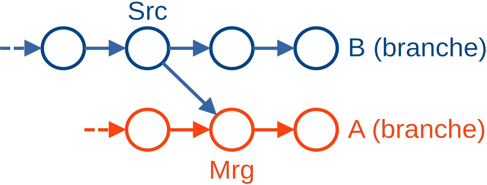
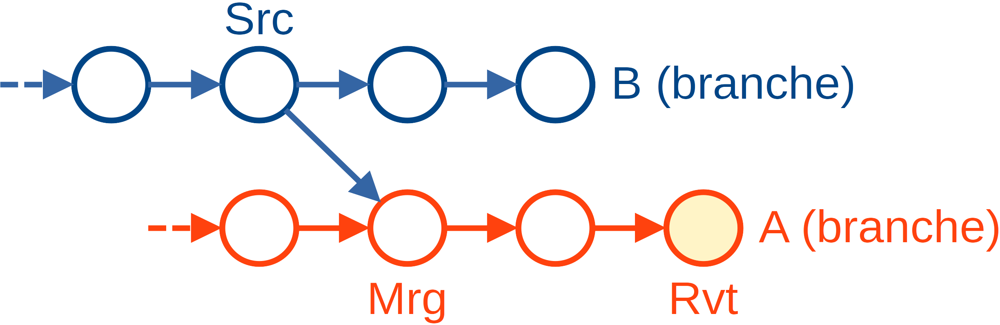
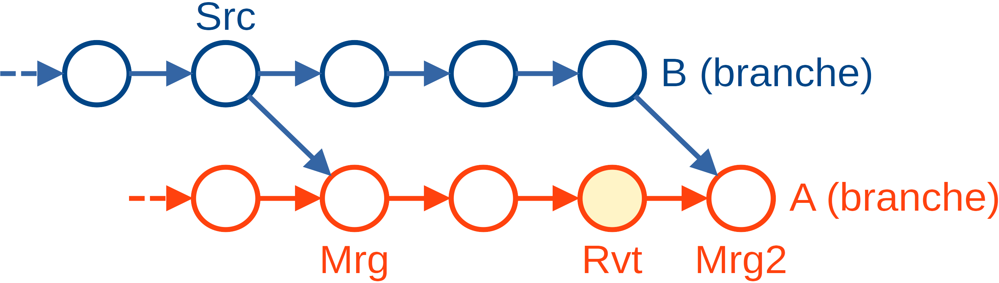

# TP3 : Manipulation de branches

## Des évolutions parallèles

### Changement de dépôt

Pour aborder la notion de branches dans un cadre plus simple, commençons par
créer un deuxième dépôt, vierge de toutes les manipulations précédentes :

    $ cd ~/Desktop
    $ mkdir MesBranches && cd MesBranches
    $ git init

Nous allons créer dans ce dépôt deux fichiers, qui nous permettront d’apprécier
le mécanisme de fusion automatique et ses limites.

    $ echo 'Bonjour !' > HelloWorld.txt
    $ printf 'Première partie\n\n\n\nDeuxième partie\n' > Contenu.txt
    $ git add --all
    $ git commit -m 'Commit initial'

Gardons une étiquette sur ce premier commit, on s’en servira plus tard :

    $ git tag initial

### Créer et détruire une branche

On peut créer une branche avec la commande `git branch <nom de branche>` :

    $ git branch univers-parallele

La commande `git branch --list` (qui s’abrévie en `git branch`) permet
d’afficher la liste des branches présentes au sein du dépôt, la branche active
étant mise en surbrillance :

    $ git branch --list

Nous pouvons constater que git ne bascule pas automatiquement sur la branche
nouvellement créée. On utilise pour cela `git checkout <nom de branche>` :

    $ git checkout univers-parallele

Une autre manière de vérifier le nom de la branche active est de regarder le
début de la sortie de `git status` :

    $ git status

Il est courant de vouloir créer une nouvelle branche et basculer dessus
immédiatement. git fournit donc pour cela un raccourci, `git checkout -b <nom>`.

Il est aussi possible de renommer une branche avec
`git branch --move <ancien nom> <nouveau nom>`, ou de la supprimer avec
`git branch --delete <nom>` (qui s’abrévie en `git branch -d <nom>`).

Pour éviter des pertes de données, git ne vous laissera pas supprimer avec
`--delete` une branche contenant de nouveaux changements qui n’ont pas été
fusionnés au sein d’une autre branche. Si vous souhaitez bien perdre ces
changements, utilisez `--delete --force`, qui s’abrévie en `-D`.

### Deux jeux de changements

Nous pouvons maintenant « commettre » quelques éditions de fichier sur
la branche que nous venons de créer :

    $ echo 'Hi there!' > HelloWorld.txt
    $ echo 'Troisième partie' >> Contenu.txt
    $ git add --all
    $ git commit -m 'Premier jeu de modifications'

Revenons ensuite sur la branche `main` :

    $ git checkout main

Vous pouvez constater que les changements que nous avons effectués au sein de la
branche `univers-parallele` ne se sont pas répercutés sur `main` :

    $ cat HelloWorld.txt

Maintenant, modifiez le fichier « Contenu.txt » pour changer la
première ligne « Première partie » en ce que vous voulez. **Laissez le
reste du fichier tel quel pour les besoins de cette démonstration**.

    ? nano Contenu.txt

Pendant que nous y sommes, nous allons aussi créer un nouveau fichier.

    $ echo 'Nouveau fichier' > AutreContenu.txt

Et pour terminer, sauvegardons nos changements dans un _commit_ :

    $ git add --all
    $ git commit -m 'Deuxième jeu de modifications'

### Visualiser les changements

Nos branches ont maintenant _divergé_. Cela signifie que depuis le commit
initial, certains changements sont survenus dans la branche `main`, et
d’autres changements sont survenus dans la branche `univers-parallele`.

Il est possible d’afficher ces différents changements avec `git diff` :

    $ git diff initial main
    $ git diff initial univers-parallele
    $ git diff main univers-parallele

Un autre moyen de visualiser la situation est d’utiliser `gitg` en sélectionnant
le mode « Tous les commits » dans le menu sur la gauche.

## Fusion de branches

### Fusionner des changements

Nous souhaitons maintenant intégrer les changements survenus au sein de la
branche `univers-parallele` à la branche `main`. Pour cela, nous pouvons
utiliser la commande `git merge`, qui crée un commit contenant ces changements.

Avant d’effectuer une fusion, il est _très fortement_ recommandé de n’avoir
aucun changement en instance dans le répertoire de travail et l’index, ce que
l’on peut vérifier avec `git status`.

    $ git status

Cette vérification étant faite, il n’y a plus qu’à lancer la fusion :

    ? git merge univers-parallele

Si vous avez suivi le TP comme prévu, la fusion va s’effectuer de façon
complètement automatisée, et après avoir saisi un message de commit (ou accepté
le message par défaut) vous allez obtenir un commit ajoutant les changements
de `univers-parallèle` à ceux déjà présents dans `main` :

- « HelloWorld.txt » a été modifié comme au sein de `univers-parallele`
- « Contenu.txt » comprend la modification de la première ligne effectuée dans
  `main` et l’ajout effectué dans `univers-parallele`.
- « AutreContenu.txt », qui a été ajouté dans `main`, est toujours présent.

Vous pouvez étudier les différences de ce nouveau commit avec l’ancienne version
de `main`, le commit initial, et `univers-parallele` :

    $ git diff main~
    $ git diff initial
    $ git diff univers-parallele

Au sein de `gitg`, vous constaterez également qu’un nouveau commit est apparu
sur la branche `main`, et que ce commit possède deux commit parents : l’ancienne
« tête » de la branche `main`, et la branche `univers-parallele`. On parle de
commit de fusion (_merge commit_).

Notez que `main~` désigne le premier parent de `main`, c’est-à-dire la
lignée « historique » de la branche.

### Fusion en avance rapide

Maintenant, que se passe-t-il si nous essayons d’intégrer les changements
survenus au sein de la branche `main` à `univers-parallele` ?

Pour le savoir, exécutez cette fusion en surveillant les changements dans la
fenêtre de `gitg` (n’oubliez pas de rafraîchir la vue avec `Ctrl + R`) :

    $ git checkout univers-parallele
    $ git merge main

À ce stade, `univers-parallele` n’a plus de nouveaux commits par rapport à
`main`. Toutes ses nouveautés ont été intégrées à `main` dans la fusion que nous
avons effectuée précédemment.

Par conséquent, `git merge` n’a pas besoin de créer un nouveau commit pour
intégrer les nouveautés de `main` à `univers-parallele`. Il lui suffit de
déplacer `univers-parallele` sur le dernier commit de la branche `main`. C’est
ce que git appelle une fusion en avance rapide (_fast-forward merge_).

Parfois, ce comportement est désirable, par exemple quand on veut mettre à jour
une branche locale par rapport à des changements survenus sur un dépôt distant.
Parfois, il est indésirable, par exemple quand on souhaite garder les deux
branches clairement séparées dans l’historique.

Il est possible de forcer `git merge` à utiliser une stratégie particulière avec
les options `--ff-only` et `--no-ff` :

- Avec `--ff-only`, git tente une fusion en avance rapide. Si elle échoue, il
  s’arrête en affichant une erreur au lieu de créer un commit de fusion.
- Avec `--no-ff`, git crée un commit de fusion même s’il aurait pu effectuer
  une fusion en avance rapide.

Essayons cette seconde stratégie en revenant en arrière. Pour cela, nous allons
utiliser une fonctionnalité de git qui garde une copie de sauvegarde de tous les
états passés des branches, les _reflogs_, afin d’annuler la fusion précédente.

Pour en savoir plus sur cette fonctionnalité relativement avancée et le mode de
fonctionnement de la commande suivante, vous pourrez consulter la section
« Informations complémentaires » de ce TP ultérieurement.

    $ git reset --hard @{1}

Quoi qu’il en soit, la fusion en avance rapide ayant été annulée, nous pouvons
maintenant retenter la fusion en forçant cette fois la création d’un commit :

    ? git merge --no-ff main

## Conflit de fusion

### Nature du problème

Nous l’avons vu, git est capable de fusionner un grand nombre de changements
de façon automatique :

- Création d’un nouveau fichier
- Modification d’un fichier dans une seule des deux branches
- Modifications de différentes parties d’un fichier dans les deux branches

Il existe cependant un type de fusion qui ne peut pas être automatisé, c’est le
cas où un fichier a été modifié au même endroit dans les deux branches qui sont
en train d’être fusionnés. On dit dans ce cas qu’il y a conflit.

La bonne manière de fusionner de tels changements dépend de la nature exacte des
changements et du type de fichier auquel on a affaire (code source, texte
littéraire…). git n’a pas accès à ce type d’information, par conséquent il ne
peut pas résoudre le conflit de façon automatique. C’est donc à l’utilisateur
qu’il reviendra de décider de la bonne marche à suivre.

### Mise en pratique

Ajoutons une ligne à un fichier dans nos deux branches :

    $ git checkout main
    $ echo 'Annexe' >> Contenu.txt
    $ git commit -am 'Ajoutons une annexe'
    $ git checkout univers-parallele
    $ echo 'Bibliographie' >> Contenu.txt
    $ git commit -am 'Ajoutons une bibliographie'

Si nous essayons d’intégrer les changements de `main` à `univers-parallele`,
`git merge` indiquera qu’il est incapable d’effectuer la fusion automatiquement
à cause d’un conflit dans « Contenu.txt » :

    @ git merge main

Lorsqu’un conflit survient, les fichiers en conflit sont indiqués dans la sortie
de `git status` :

    $ git status

Et si on affiche leur contenu, on observe que git a ajouté des annotations à
l’emplacement du conflit, indiquant les deux versions du fichier entre
lesquelles il faut arbitrer.

    $ cat Contenu.txt

Cette information est également présente, sous une forme un peu différente, dans
la sortie de `git diff` :

    $ git diff

### Résoudre un conflit

On peut répondre à un conflit de fusion de différentes manières.

Une première approche consiste à annuler la fusion en cours. C’est la bonne
chose à faire si on s’est trompé de branche lors de l’appel à `git merge` :

    $ git merge --abort
    $ git status

Une autre approche est d’examiner soigneusement les changements en conflit, et
de décider au cas par cas si l’une des deux branches a « raison », ou s’il faut
avoir recours à une troisième approche. On parle de résoudre le conflit.

Cela peut être fait manuellement, via la procédure suivante…

- Ouvrir chaque fichier au sein duquel git a ajouté des annotations de conflit.
- Rechercher ces dernières avec la fonction adéquate de son éditeur de texte.
- Les remplacer par le contenu final désiré.
- Confirmer qu’on a résolu le conflit en faisant un `git add` du fichier.

…mais il faut être très prudent en écrivant le contenu final, il est très facile
de faire des erreurs, typiquement en oubliant accidentellement un changement
issu d’une des deux branches en conflit.

Pour cette raison, il est fortement recommandé d’utiliser un outil graphique de
résolution de conflit, qui permet de mieux visualiser l’ensemble du processus et
contrôler en permanence ce qu’on est en train de faire. Dans cette formation,
nous utiliserons pour cela l’application Meld.

    @ git merge main
    ? meld .

Appliqué à un dossier, Meld recherche l’ensemble des changements survenus dans
ce dossier qui concernent le commit de fusion, et indique en rouge les fichiers
sur lesquels il y a conflit. En double-cliquant sur l’un d’eux, on accède à une
vue composée de trois volets :

- À gauche, on trouve la version « distante » du fichier, c’est-à-dire celle de la
  branche que l’on a passé en argument à `git merge`.
- À droite, on trouve la version « locale » du fichier, c’est-à-dire celle de la
  branche _vers laquelle_ on est en train d’intégrer des changements.
- Au milieu, on trouve la version proposée du fichier, qui sera intégrée au
  commit de fusion. Notez que cette version est **modifiable**.

De part et d’autre de la version centrale, on a une visualisation des
différences existant entre cette version et les deux versions parentes. Des
petits boutons en forme de flèches sont présents, permettant d’intégrer les
changements de la version locale ou distante à la version proposée.

Une fonctionnalité trop bien cachée de Meld permet également d’intégrer les deux
jeux de changement, l’un au-dessus de l’autre, en maintenant enfoncée la touche
Ctrl avant d’appuyer sur les boutons en forme de flèche suscités (qui prennent
alors la forme d’un signe `+`).

Les différences en rouge provenant de gauche et de droite sont des conflits :
des changements incompatibles sont présents dans la version locale et distante.
Il faut alors proposer une solution au conflit en éditant la vue centrale.

Quand on a fini, on peut fermer le fichier en cliquant sur la « croix » de
l’onglet de Meld correspondant. Meld proposera alors de sauvegarder la version
proposée si ce n’est pas déjà fait, puis demandera si le conflit survenu au sein
de ce fichier est maintenant résolu. Si oui, il le marquera comme tel dans Git.

Attention à bien fermer l’onglet associé au fichier, et non pas l’application.
Un bug de Meld fait que les modifications ne seront pas enregistrées dans ce
second cas…

Quand on a fini de résoudre tous ses conflits de fichier, on peut vérifier que
tout est prêt dans `git status`…

    $ git status

…puis terminer l’opération de fusion avec :

    $ git merge --continue

Notez qu’on peut aussi utiliser `git commit` pour cela, et dans d’anciennes
versions de git c’était la seule commande disponible. L’utilisation de
`git merge --continue` est juste proposée ici parce qu’elle clarifie l’intention.

En règle générale, plus une paire de branches a divergé, plus il est difficile
de les fusionner. En effet, on doit alors « mettre d’accord » deux états du
dépôt très différents, ce qui requiert une gymnastique intellectuelle difficile.
Pour cette raison, il est recommandé en gestion de version distribuée de
 _fusionner les branches qui divergent aussi fréquemment que possible_.

### Conflits silencieux

Remarquons pour terminer cette section qu’il existe des conflits de fusion que
git n’est pas capable de détecter par lui-même. Dans ce cas, la fusion réussira
du point de vue de git, mais le dépôt se retrouvera dans un état incorrect.

Par exemple, si une branche de développement d’un logiciel ajoute une nouvelle
utilisation d’une interface (_API_), tandis qu’une autre branche de
développement du même logiciel supprime cette interface, les deux branches sont
incompatibles du point de vue du langage de programmation utilisé, mais git
acceptera de les fusionner parce qu’elles sont compatibles selon sa définition à lui
(pas d’éditions au même endroit du même fichier).

Ce comportement vient du fait que git ne comprend pas la sémantique des langages
de programmation utilisés. Il raisonne purement en termes de documents textuels.
Pour lui, des modifications éloignées d’un même document, ou des modifications
de deux documents distincts, sont toujours compatibles, alors que du point de
vue des langages de programmation, ce n’est pas forcément le cas.

De tels conflits sont particulièrement sournois, et il faut un outillage
relativement sophistiqué pour les détecter automatiquement. En l’absence d’un
tel outillage, la vigilance humaine est primordiale lorsqu’on effectue plusieurs
fusions à la suite sans période de test intermédiaire.

## Conclusion

Dans ce TP, nous avons vu comment git nous permet de gérer plusieurs branches
en parallèle, et de les synchroniser les unes par rapport aux autres par le
biais de fusions de branches.

La notion de branche est extrêmement puissante. Elle permet non seulement
d’organiser des développements séparés sur sa propre machine, mais aussi et
surtout de gérer les divergences d’historique qui surviennent inévitablement
quand plusieurs personnes modifient indépendamment un contenu sur leurs
machines. Et ce sans pour autant nécessiter une connexion constante à Internet
et une synchronisation régulière avec un serveur maître.

C’est ce que nous allons mettre en pratique dans la séquence suivante.

----

## Exercices

1. Créez une copie du dépôt `MonDepot` utilisé au cours du TP2.
2. Visitez le parent de son commit actif, et créez une branche qui en part.
3. Basculez sur cette branche, et créez un commit ajoutant un nouveau fichier.
4. Visualisez la branche `main` et celle que vous venez de créer avec `gitg`.
5. Fusionnez les changements de `main` au sein de la branche actuelle.
6. Remplacez le contenu d’un fichier par deux textes différents au sein de
   `main` et de la nouvelle branche, en commitant ces changements.
7. Fusionnez les changements de la nouvelle branche au sein de `main`, et
   résolvez le conflit de fusion qui s’ensuit.

## Antisèche

Créer une branche :

    ? git branch <nom>

…et basculer dessus dans la foulée :

    ? git checkout -b <nom>

Énumérer les branches présentes au sein du dépôt :

    $ git branch --list

Basculer sur une autre branche :

    ? git checkout <branche>

Supprimer une branche :

    ? git branch --delete <branche>

Fusionner les nouveautés d’une branche au sein de la branche active :

    ? git merge <branche>

…uniquement si la fusion peut être effectuée en avance rapide :

    ? git merge --ff-only <branche>

…ou bien en interdisant à git d’utiliser l’avance rapide :

    ? git merge --no-ff <branche>

Annuler une fusion de branche qui vient d’être effectuée :

    $ git reset --hard @{1}

Annuler une fusion de branche qui est bloquée par un conflit :

    $ git merge --abort

Ouvrir `meld` dans le dossier actif pour y régler un conflit :

    ? meld .

Continuer une fusion de branche après avoir résolu un conflit :

    $ git merge --continue

---

## Informations complémentaires

### Rebase : Une alternative à la fusion

Un inconvénient de la commande `git merge` est que son utilisation intensive
crée un grand nombre de commits de fusion, ce qui à la longue rend l’historique
du projet moins lisible. Cela conduit certains projets très soucieux de la
clarté de ce dernier à rechercher des solutions alternatives.

Pour ces projets, git fournit `git rebase <nom>`. Cette commande vise le même
objectif que `git merge <nom>`, à savoir intégrer les changements de `<nom>` au
sein de la branche active, mais procède de manière très différente :

- `git merge <nom>` crée un commit au sein de la branche active qui y intègre
  les nouveautés de la branche `<nom>`.
- `git rebase <nom>` détermine quels commits sont présents dans la branche
  active mais pas dans la branche `<nom>`, puis modifie l’historique en
  appliquant les différences de ces commits un par un au-dessus de `<nom>`,
  avant de faire pointer la branche active sur le résultat. `<nom>` devient
  ainsi un ancêtre de la branche active.

Ce mode de fonctionnement par modification d’historique a plusieurs
conséquences importantes :

- Durant la procédure de fusion, les rôles de branches locale et distante sont
  inversés dans Meld et les _diffs_, puisqu’on opère par-dessus la branche `<nom>`
  et non par-dessus la branche que l’on veut « rebaser ».
- Tous les commits de la branche locale sont remplacés. Leur contenu (_diff_)
  change, et leur _hash_ aussi. Si on a mal réglé un conflit de fusion, ces
  changements atterrissent dans le commit modifié. Il peut donc être plus
  difficile de revenir en arrière qu’avec `git merge`, où tous les changements
  sont concentrées au sein du commit de fusion.
- Les branches qui se basaient sur les anciennes versions des commits existent
  toujours, et continuent de pointer dessus. On peut donc accidentellement créer
  des divergences d’historique là où il n’en existait pas auparavant.
- On doit régler les conflits de fusion commit par commit, et sur des branches
  longues il arrive fréquemment qu’en réglant un conflit au début de la chaîne,
  on en crée de nombreux autres dans la suite du `rebase`.

En résumé, si `git rebase` a ses amateurs, cette commande reste relativement
complexe et ne devrait être employée que lorsque vous êtes sûr de ce que vous
faites. Vous devriez aussi garder un œil sur `gitg` au cours de son utilisation
pour vérifier que vous n’avez pas commis d’impair.

Il est conseillé aux débutants de `git rebase` de créer une étiquette « de
sauvegarde » en haut de leur branche avant de lancer le `rebase`, pour pouvoir
facilement vérifier (par exemple avec `git diff`) que tout se passe bien à
chaque résolution de conflit ainsi qu’à la fin de l’exécution de `git rebase`.

### Cherry-pick : Une fusion sélective

À la croisée des chemins entre `git merge` et `git rebase`, on trouve
`git cherry-pick`. Cette commande permet d’importer sélectivement des
changements issus d’une autre branche, sans nécessairement opérer une fusion
totale, en rejouant les commits en question par-dessus la branche actuelle.

La syntaxe de `git cherry-pick` est similaire à celle de `git revert` : il est
possible de sélectionner les commits à rejouer un par un comme ceci…

    ? git cherry-pick <commit1> [<commit2> ...]

…et il est aussi possible de sélectionner tous les commits entre deux points :

    ? git cherry-pick <commit1>..<commitN>

Comme avec `git rebase`, les commits qui sont « importés » de cette façon sont
des copies de ceux de la branche d’origine, avec quelques ajustements en cas de
conflits de fusion. Si la branche d’origine est modifiée par la suite, les
_cherry-picks_ associés ne seront pas mis à jour.

Comme avec `git merge`, la commande est sans risque pour la branche active,
puisque les commits précédents ne sont pas modifiés par l’opération. On ne fait
qu’ajouter des commits à la fin de la branche.

Contrairement à ces deux commandes, `git cherry-pick` n’effectue pas une fusion
totale mais importe des changements sélectivement, commit par commit. Cela évite
de synchroniser complètement deux branches.

Par exemple, dans un contexte de développement logiciel, on peut rejouer un
correctif de sécurité de `main` sur la branche associée à une version publiée
du logiciel, sans pour autant devoir y intégrer toutes les autres nouveautés de
la branche `main`.

### Reset et le _reflog_

Nous avons précédemment utilisé une syntaxe pour le moins curieuse pour annuler
une fusion de branches : `git reset --hard @{1}`. Nous allons maintenant
détailler comment cette commande fonctionne.

Comme nous l’avons déjà vu, l’interface de git est conçue pour éviter les
opérations destructives autant que faire se peut. Quoi qu’il arrive, l’outil
essaie de permettre l’annulation de toute manipulation.

À première vue, les opérations qui modifient des branches, ou d’autres
références comme `HEAD`, sont des exceptions à cette règle. Mais en réalité, git
permet bel et bien de revenir dessus, car il conserve un historique des états
passés de ces références, appelé « Reference logs » ou en abrégé _reflogs_.

On peut afficher cet historique avec la commande `git reflog` :

    $ git reflog main
    $ git reflog --all

On peut désigner le commit où se trouvait une référence il y a N modifications
(commits, _resets_, etc.) avec la syntaxe `[<ref>]@{<N>}`. Si l’on ne spécifie
pas de `<ref>`, c’est la branche active qui est considérée par défaut. Ainsi…

- `main@{1}` désigne le commit sur lequel pointait la branche `main` avant
  la dernière opération effectuée sur cette branche.
- `HEAD@{1}` désigne le commit actif précédent.
- `@{1}` désigne le commit sur lequel pointait la branche active auparavant.

Passons maintenant à `git reset <commit>`. Cette variante de `git reset` permet
de modifier le commit sur lequel pointe la branche active, ainsi que le contenu
de l’index et du répertoire de travail, selon la logique suivante :

- `git reset --soft <commit>` modifie uniquement le commit sur lequel pointe la
  branche active, l’index et le répertoire de travail restant inchangés. C’est
  donc, comme on l’a vu dans le TP2, l’inverse de `git commit`.
- `git reset <commit>` déplace la branche active et synchronise l’index avec
  le nouveau commit actif, mais ne modifie pas le répertoire de travail.
- `git reset --hard <commit>` déplace la branche active et synchronise le
  contenu de l’index _et du répertoire de travail_ avec cette dernière.

En somme, `git reset --hard <commit>` a un effet similaire à celui de
`git checkout <commit>`, à ceci près qu’elle déplace la branche active au lieu
de basculer sur une autre branche ou en mode `HEAD détachée`.

Par conséquent, quand on exécute la commande `git reset --hard @{1}` juste après
un `git merge` réussi, git effectue les opérations suivantes :

- Déplacer la branche active au point où elle se trouvait précédemment, c’est à
  dire juste avant l’appel à `git merge`.
- Synchroniser l’index et le répertoire de travail avec le nouveau `HEAD`.

Combinées, ces deux opérations permettent d’annuler l’effet de `git merge`.

Si le sujet des _reflogs_ vous intéresse, vous trouverez plus d’information
dans les pages d’aide `git help reflog` et `git help revisions`.

### `git revert` et les fusions

Lorsqu’une fusion incorrecte vient d’être effectuée, il est préférable
d’utiliser la combinaison de `git reset` et des _reflogs_ expliquée ci-dessus.
Mais parfois, on ne découvre un problème avec une fusion que quelque temps
après, alors qu’on a déjà effectué d’autres commits sur la branche.

Dans ce cas, on peut être tenté d’utiliser `git revert`, mais par défaut git
refusera, et ce pour d’excellentes raisons qui vont être expliquées maintenant.

Le nœud du problème est que les commandes git qui combinent les changements de
deux branches, comme `git merge` et `git rebase`, fonctionnent en analysant la
forme de l’historique.

Si, alors qu’on est sur une branche A, on demande à faire un `git merge B`,
alors git va remonter l’historique de la branche A jusqu’à trouver soit un
commit commun avec la branche B (ancêtre commun), soit un point où la branche B
a été fusionnée dans A. À ce point-là de l’historique, l’algorithme considère
que les deux branches étaient synchrones, et seules les modifications effectuées
ultérieurement au sein des branches A et B sont considérées pour la fusion.

Donc dans la situation schématisée ci-dessous…

…seuls les commits `Mrg..A` de la branche A et `Src..B` de la branche B sont
considérés lorsqu’on tente de fusionner B dans A. Où l’on appelle `Mrg` le
dernier commit de fusion effectué au sein de la branche A et `Src` le commit de
la branche B depuis lequel on a fusionné.

Le fait que les commits de B avant `Mrg` ne soient pas considérés peut
surprendre, mais c’est en fait préférable, car s’ils étaient considérés, on
serait amené à résoudre les mêmes conflits de fusion encore et encore.

Supposons maintenant que l’on force git à annuler une fusion avec `git revert`,
ce qu’on peut faire avec l’option `--merge`/`-m`, ici on utiliserait
`git revert -m 1 Mrg`. On va alors se retrouver dans la situation suivante…

…où le nouveau commit `Rvt` de la branche A annule l’effet du commit du commit
de fusion `Mrg` précédent. Et jusqu’ici tout va bien. Là où il va y avoir un
problème, en revanche, c’est quand on va essayer par la suite de fusionner la
nouvelle version de la branche B, après que les problèmes aient été résolus :

À ce moment-là, pour créer le commit `Mrg2`, git va considérer les commits
`Src..B` de la branche `B` et les commits `Mrg..Rvt` de la branche A, incluant
donc le commit `Rvt` créé par `git revert`. Ce qui aura pour conséquences…

1. Une probabilité assez importante de conflit de fusion, liée au fait que le
   commit `Rvt` touche à un certain nombre de fichiers qui sont activement
   modifiés par la branche B.
2. Une fusion insatisfaisante, en apparence incomplète, puisque les changements
   de la branche B avant `Src` qui avaient précédemment été intégrés par `Mrg`
   mais supprimés ensuite par `Rvt` ne feront pas partie de `Mrg2`.

Pour éviter ce problème, il faudrait commencer par annuler l’effet du commit
`Rvt` avant d’effectuer la fusion `Mrg2`. Mais il est trop facile d’oublier de
le faire ou de ne pas comprendre ce qui se passe, et de perdre accidentellement
des changements de la branche B.

Il est donc préférable de ne pas utiliser `git revert` sur des commits de fusion
quand on peut s’en passer, et de prévenir les autres collègues qui pourraient
être amenés à réessayer la fusion ultérieurement si on est amené à le faire.
